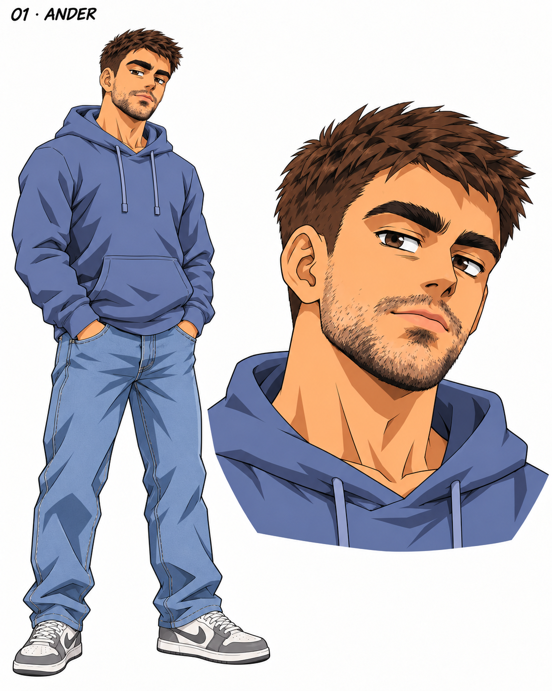
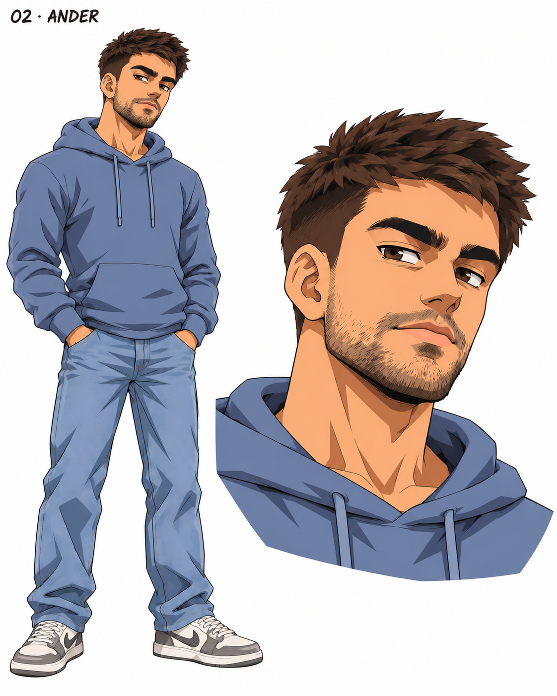
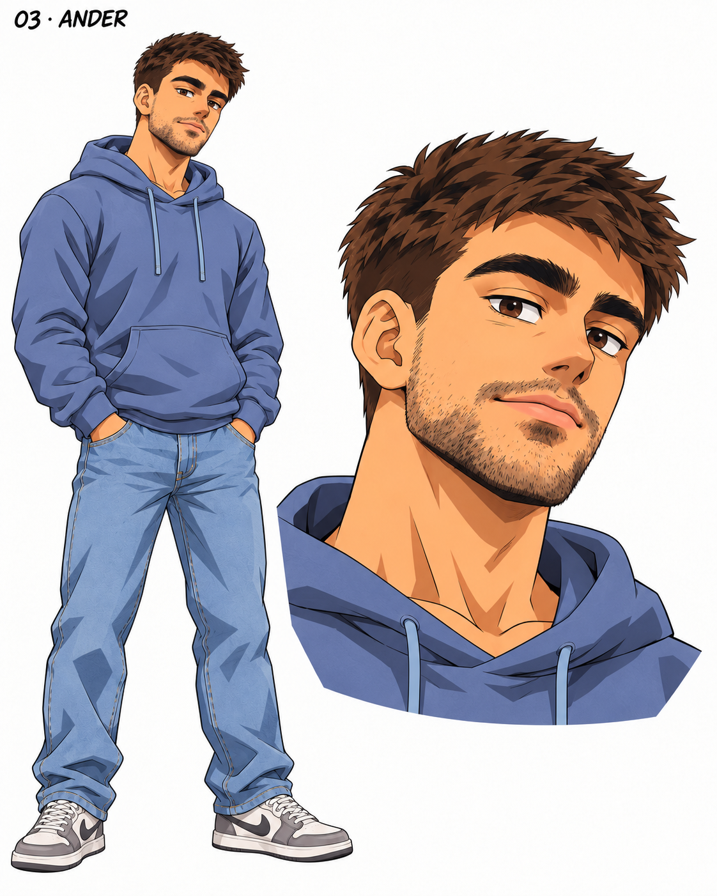
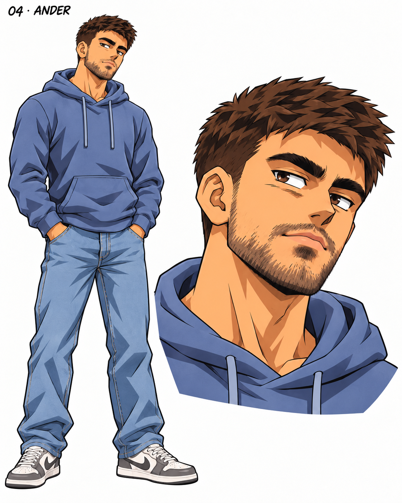
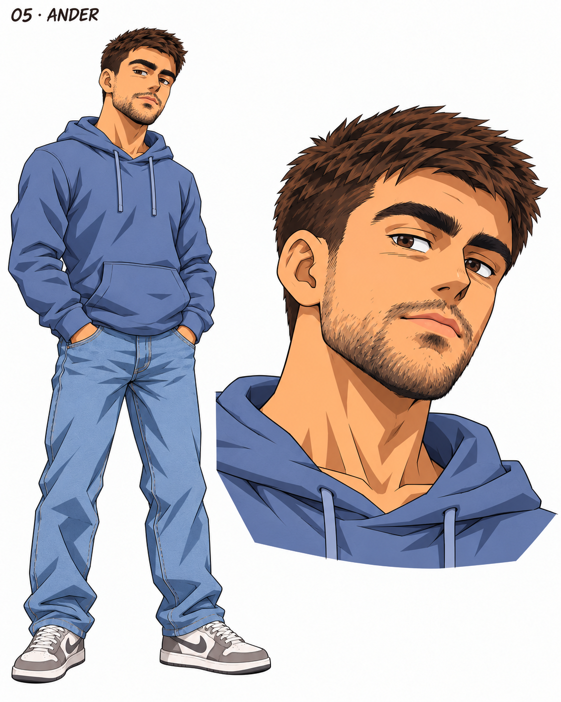

# Ander · Avatares 2D

Cinco variantes dentro del estilo **Guillermo Aladro 03 · Dragon Ball clásico**. Pendiente de elegir la versión de Ander.

[Comparativa numerada en PDF](Comparativa-Ander-2D.pdf) · [Prompts, referencias y revisión](propuestas.json) · [Volver a la colección](../README.md)

Cada PNG incluye cuerpo completo y retrato. Pulsa una imagen para verla a tamaño completo.

| 01 · Equilibrio clásico | 02 · Rostro angular |
|---|---|
|  |  |

| 03 · Expresivo suave | 04 · Tinta marcada |
|---|---|
|  |  |

| 05 · Parecido reforzado |  |
|---|---|
|  |  |

Basado en los SVG de [Ander](../../avatares%20SVG%20-%20Astra/Ander.svg). Referencias, prompts y comprobaciones guardados en `propuestas.json`.

