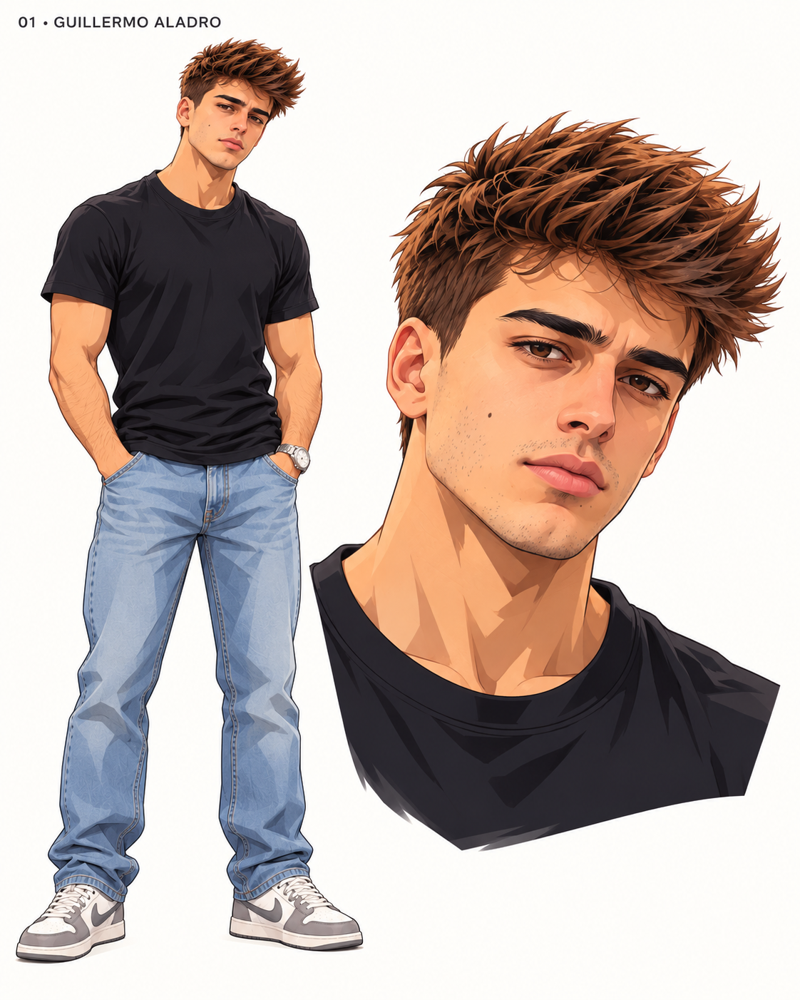
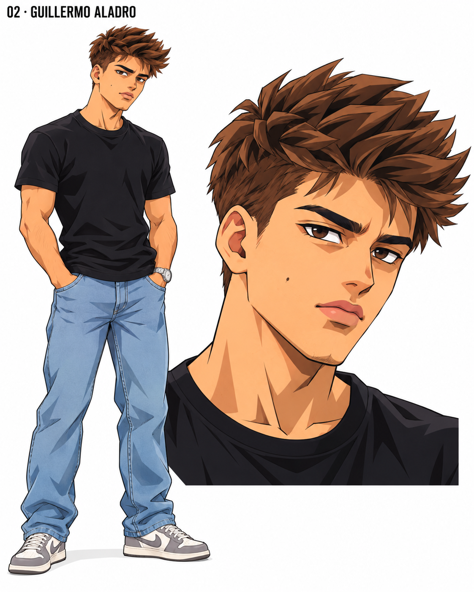
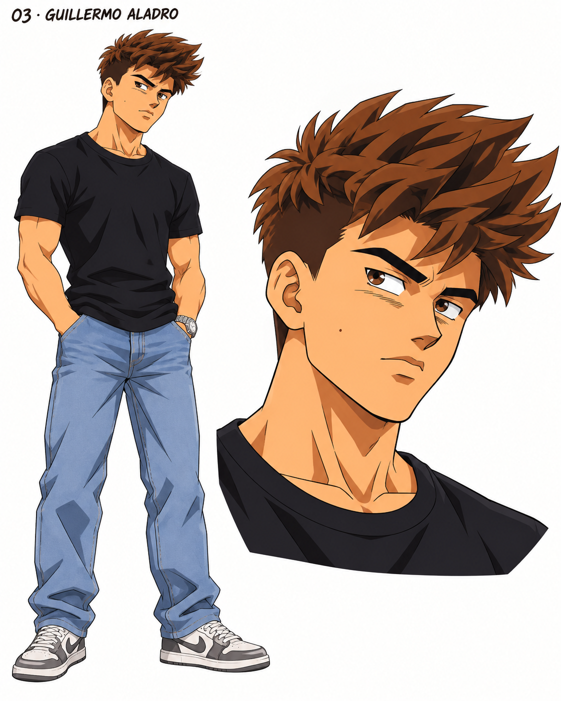
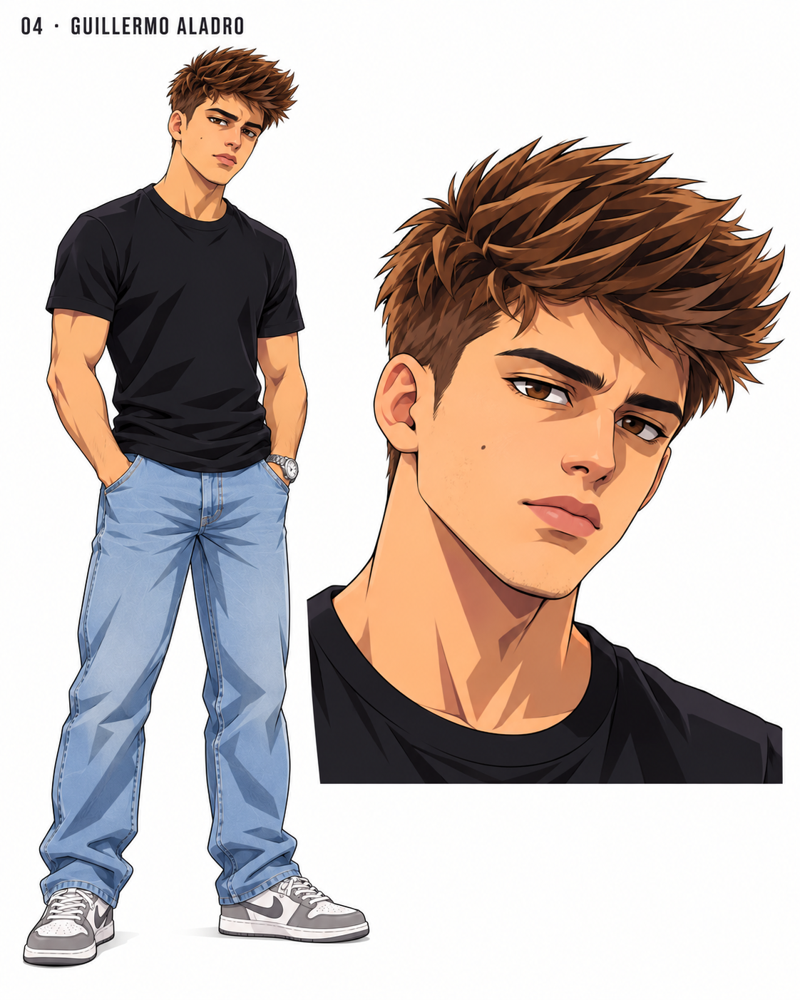
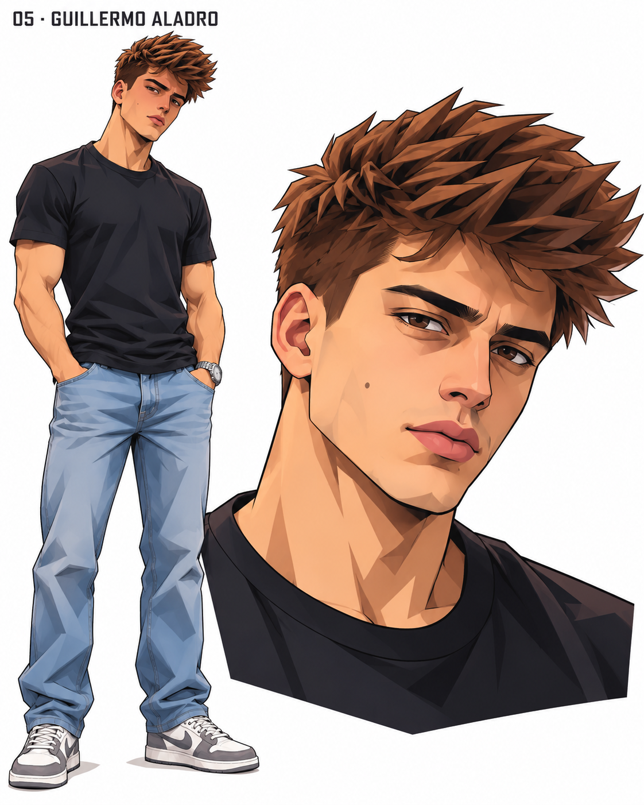
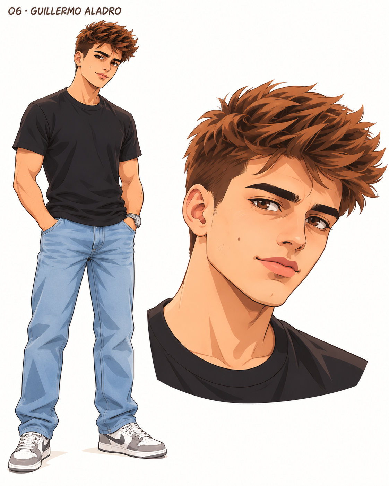
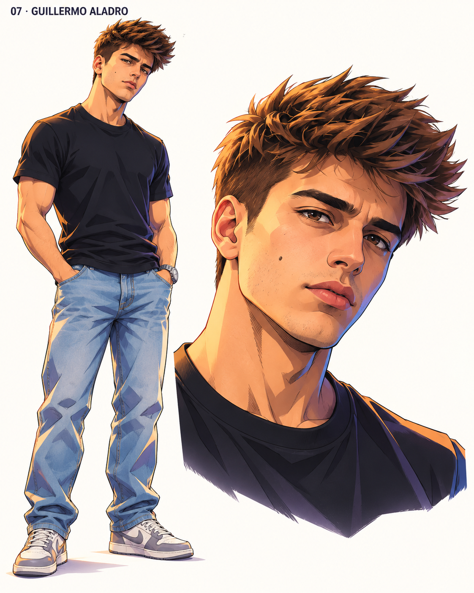
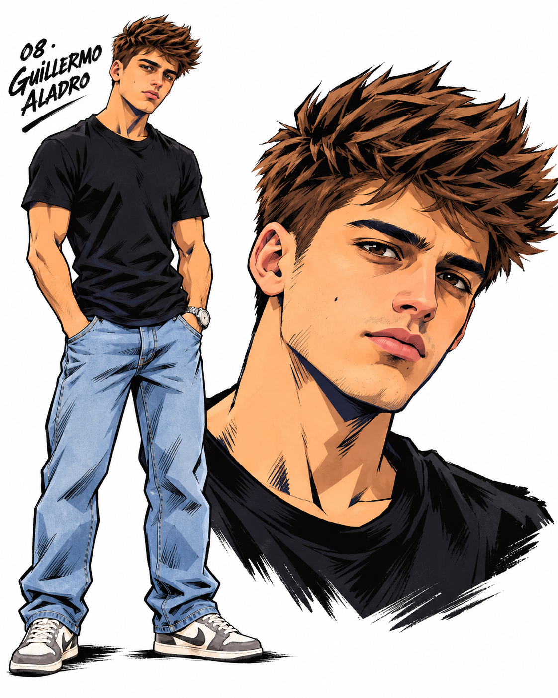
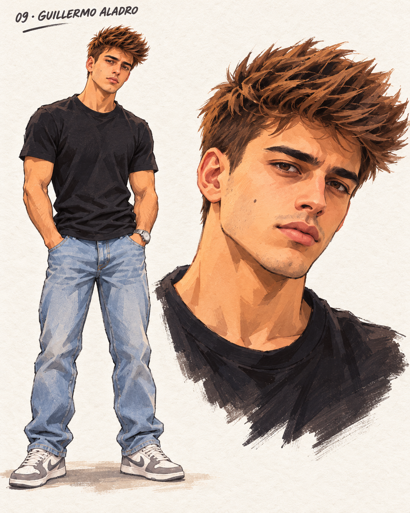
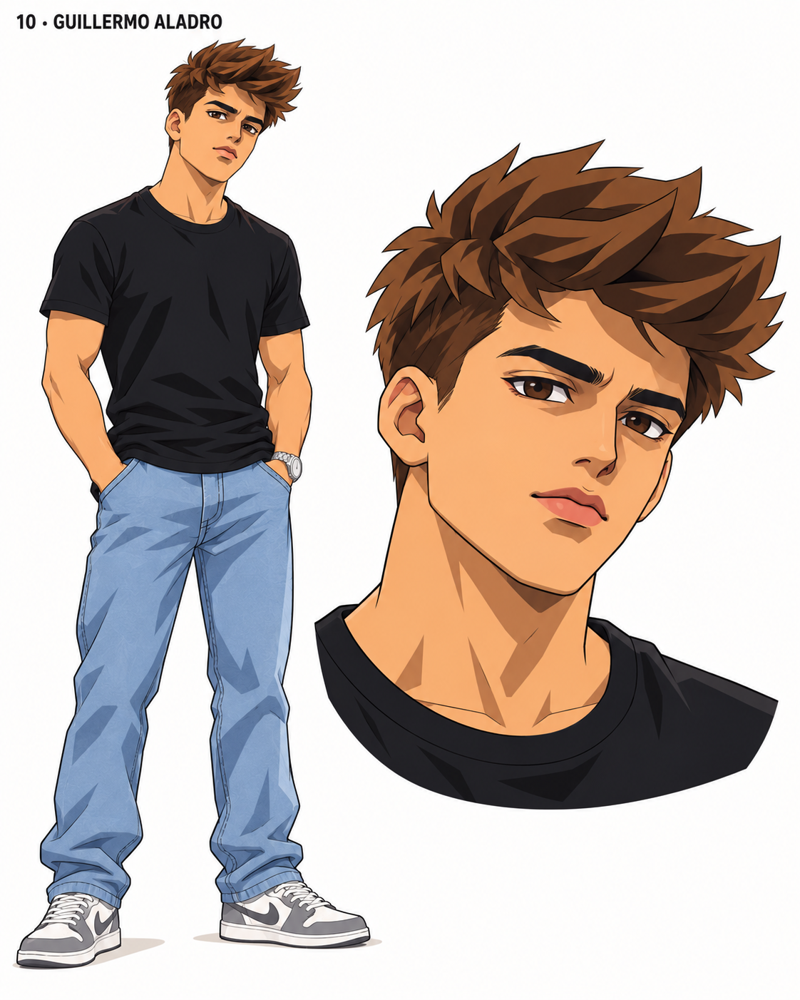

# Guillermo Aladro · Avatares 2D

**Elegido: 03 · Dragon Ball clásico.** Es la referencia visual para los siguientes avatares.

[Comparativa numerada en PDF](Comparativa-Guillermo-Aladro-2D.pdf) · [Prompts, referencias y revisión](propuestas.json) · [Volver a la colección](../README.md)

Cada PNG incluye cuerpo completo y retrato. Pulsa una imagen para verla a tamaño completo.

| 01 · Parecido natural | 02 · Equilibrio anime |
|---|---|
|  |  |

| 03 · Dragon Ball clásico | 04 · Anime moderno limpio |
|---|---|
|  |  |

| 05 · Rasgos angulares | 06 · Trazo suave |
|---|---|
|  |  |

| 07 · Anime cinematográfico | 08 · Tinta gráfica |
|---|---|
|  |  |

| 09 · Pintado 2D | 10 · Modelo animable |
|---|---|
|  |  |

Basado en los SVG de [Guillermo Aladro](../../avatares%20SVG%20-%20Astra/Guillermo-Aladro.svg). Referencias, prompts y comprobaciones guardados en `propuestas.json`.

