# Avatares 2D

**Un único diseño por persona.** Estilo basado en las elecciones del usuario: **Guillermo Aladro 03** y **Ander 04**. Las alternativas y sus comparativas se han retirado de esta carpeta.

Cada PNG contiene el cuerpo completo y un retrato ampliado del mismo diseño. Se conservan los rasgos, peinado, ropa y accesorios de cada persona a partir de sus SVG.

Colección completa: **14 personas, 14 PNG**.

| Persona | Archivo único | Estado |
|---|---|---|
| [Guillermo Aladro](Guillermo-Aladro/) | [PNG](Guillermo-Aladro/Guillermo-Aladro-2D.png) | Elegido por el usuario |
| [Ander](Ander/) | [PNG](Ander/Ander-2D.png) | Elegido por el usuario |
| [Carla](Carla/) | [PNG](Carla/Carla-2D.png) | Versión única |
| [Dari](Dari/) | [PNG](Dari/Dari-2D.png) | Versión única |
| [Deivi](Deivi/) | [PNG](Deivi/Deivi-2D.png) | Versión única |
| [Gabacho](Gabacho/) | [PNG](Gabacho/Gabacho-2D.png) | Versión única |
| [Kiriku](Kiriku/) | [PNG](Kiriku/Kiriku-2D.png) | Versión única |
| [Laura](Laura/) | [PNG](Laura/Laura-2D.png) | Versión única |
| [Marcos Bombero](Marcos-Bombero/) | [PNG](Marcos-Bombero/Marcos-Bombero-2D.png) | Versión única |
| [Marta](Marta/) | [PNG](Marta/Marta-2D.png) | Versión única |
| [Paradigma](Paradigma/) | [PNG](Paradigma/Paradigma-2D.png) | Versión única |
| [Rodri](Rodri/) | [PNG](Rodri/Rodri-2D.png) | Versión única |
| [Sara Sáez](Sara-Saez/) | [PNG](Sara-Saez/Sara-Saez-2D.png) | Versión única |
| [Yorgi](Yorgi/) | [PNG](Yorgi/Yorgi-2D.png) | Versión única |

## Galería

| Guillermo Aladro | Ander |
|---|---|
|  |  |

| Carla | Dari |
|---|---|
| [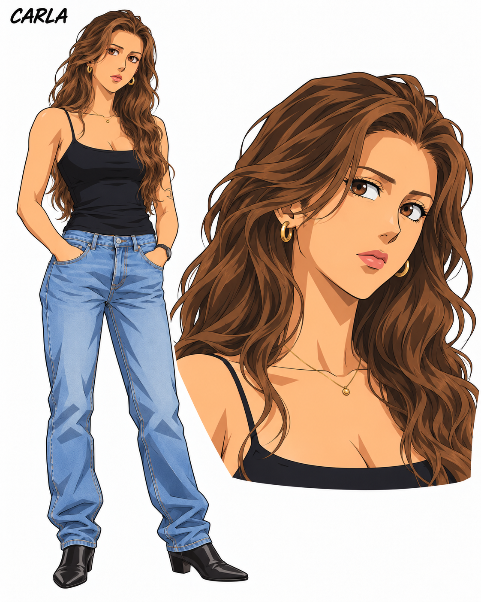](Carla/Carla-2D.png) | [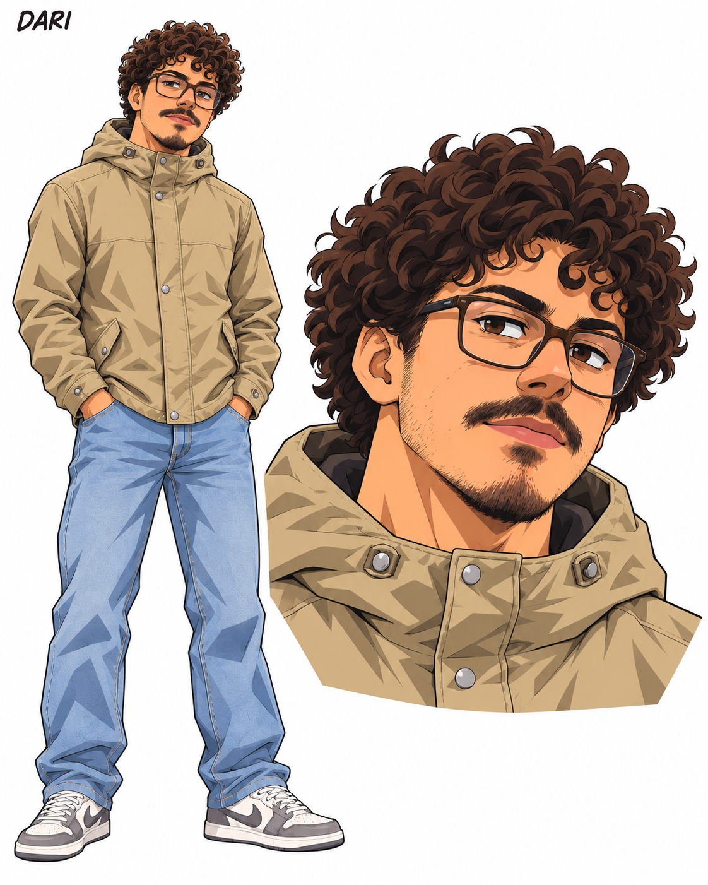](Dari/Dari-2D.png) |

| Deivi | Gabacho |
|---|---|
| [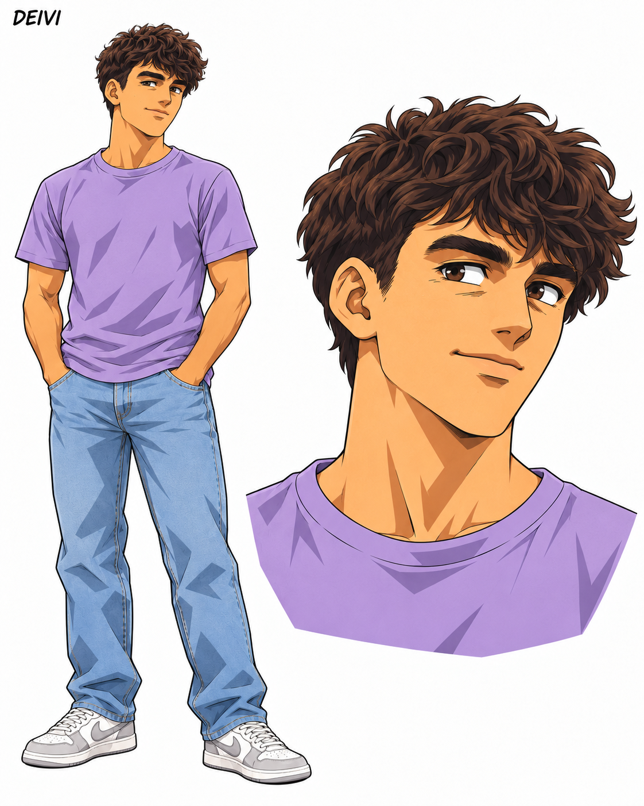](Deivi/Deivi-2D.png) | [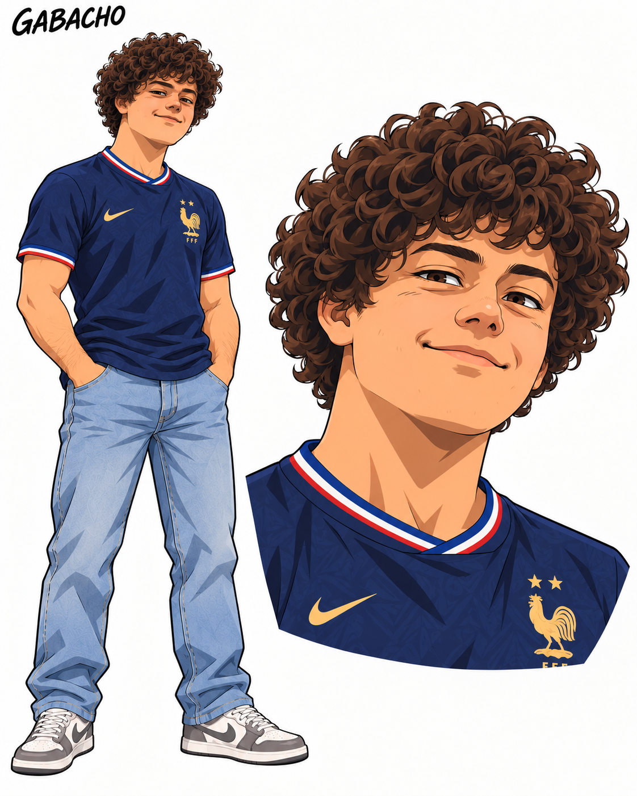](Gabacho/Gabacho-2D.png) |

| Kiriku | Laura |
|---|---|
| [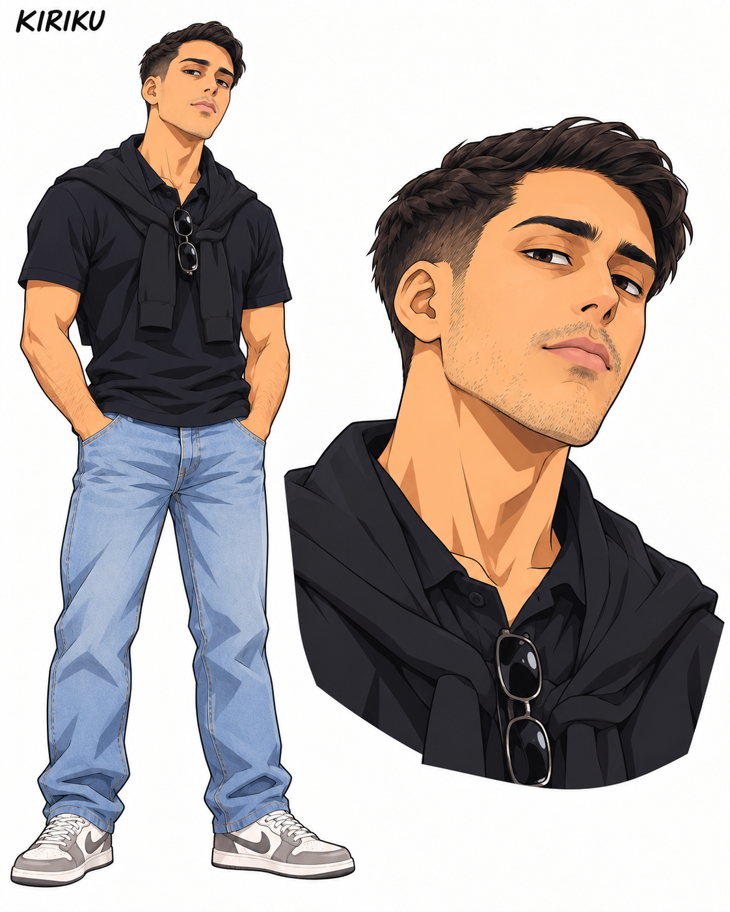](Kiriku/Kiriku-2D.png) | [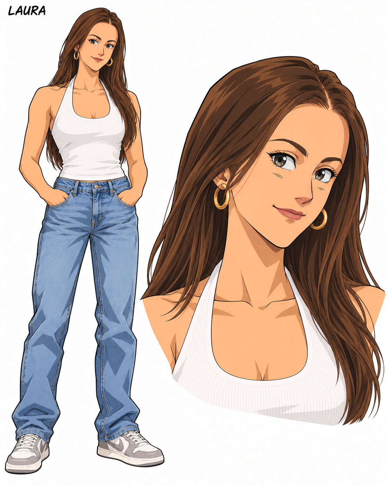](Laura/Laura-2D.png) |

| Marcos Bombero | Marta |
|---|---|
| [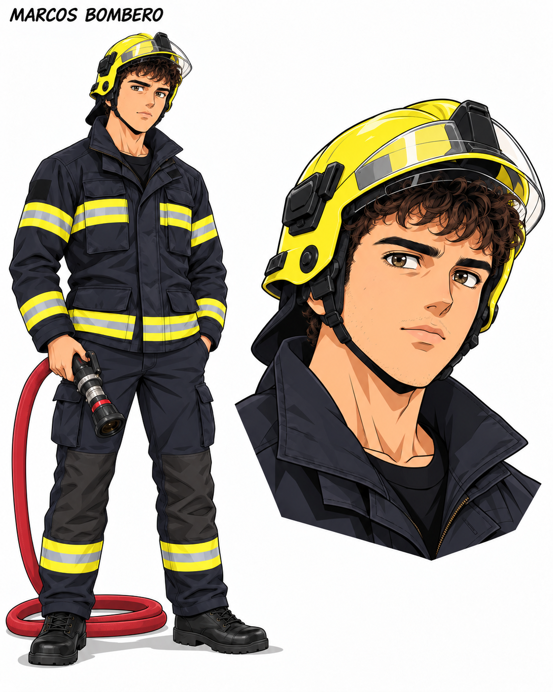](Marcos-Bombero/Marcos-Bombero-2D.png) | [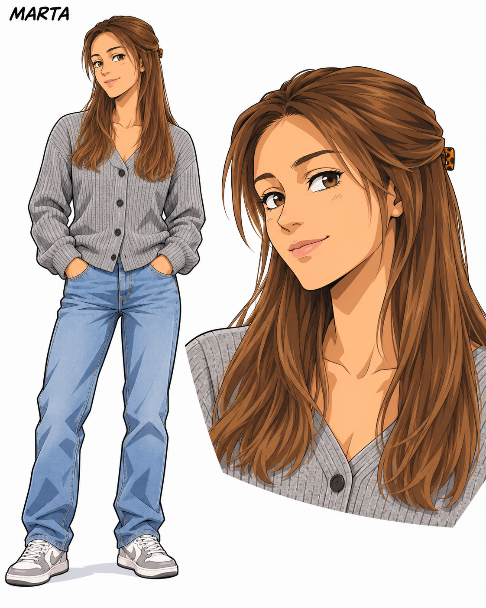](Marta/Marta-2D.png) |

| Paradigma | Rodri |
|---|---|
| [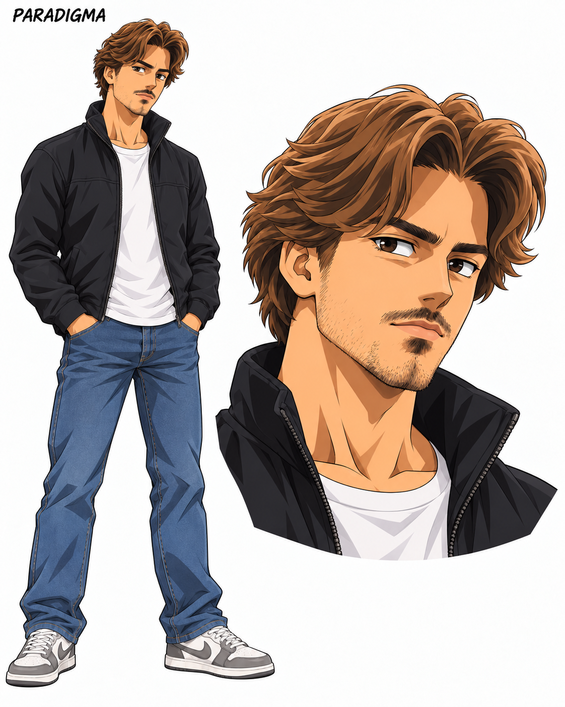](Paradigma/Paradigma-2D.png) | [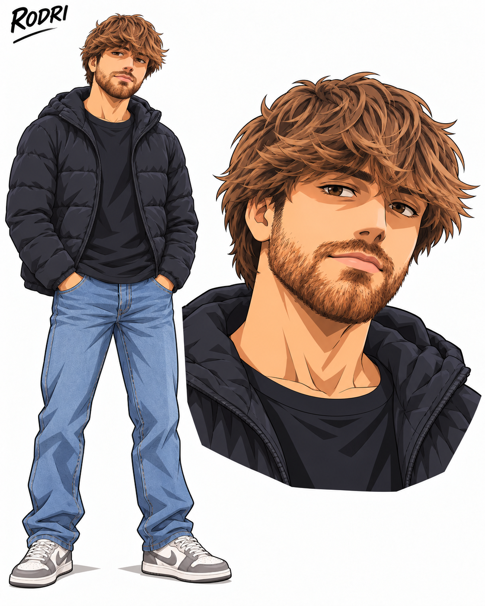](Rodri/Rodri-2D.png) |

| Sara Sáez | Yorgi |
|---|---|
| [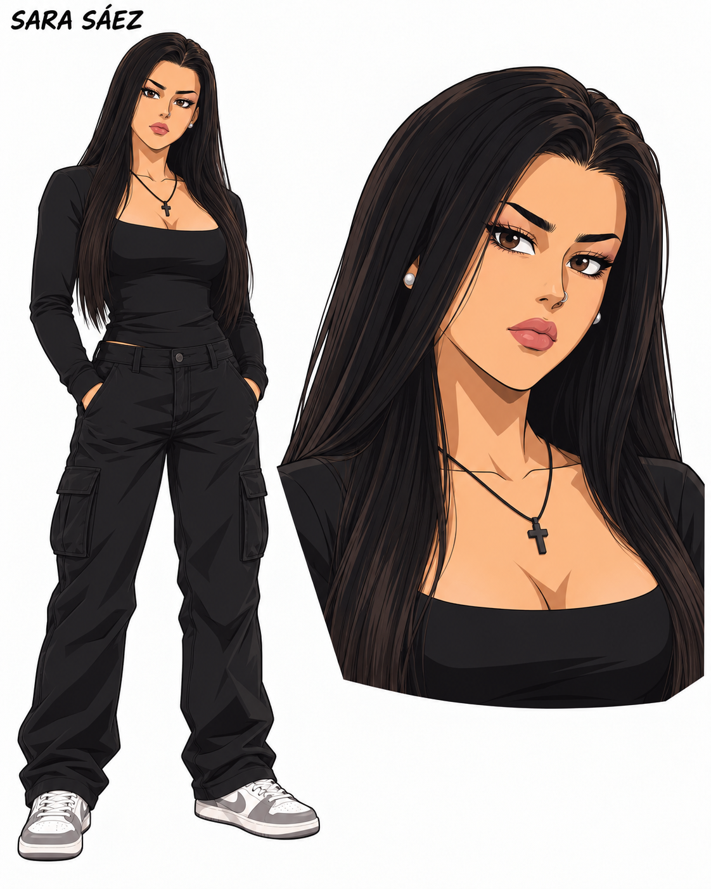](Sara-Saez/Sara-Saez-2D.png) | [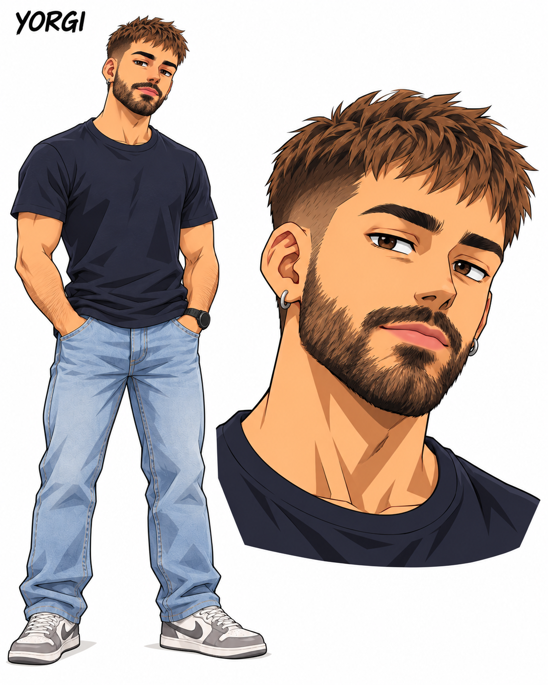](Yorgi/Yorgi-2D.png) |

Los diseños son ilustraciones **PNG**, no SVG vectoriales ni animaciones terminadas. Cada carpeta conserva un `diseno.json` con el prompt de generación, las referencias y la revisión visual. Las imágenes se generaron con la herramienta integrada `image_gen`; los SVG originales permanecen en su carpeta.
