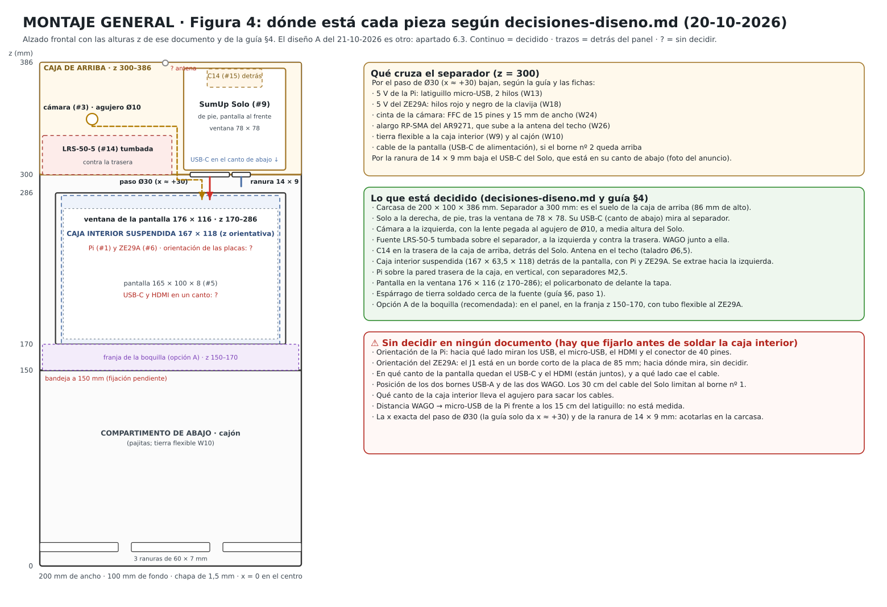

# MONTAJE GENERAL

Cómo se conecta cada componente de la máquina con los demás: de qué puerto, borne o pin sale cada cable y adónde llega. Es el cableado de la guía de montaje eléctrico (v2, 20-10-2026) corregido con lo que han dejado las 31 fichas de [`componentes/`](componentes/README.md) y los documentos que descargaste.

**Estado a 21-10-2026: es un esquema de papel. Nada se ha montado ni medido todavía.** Hoy he leído los anuncios de Amazon.es de nueve piezas ([resumen](montaje-general/anuncios-amazon-21-10-2026.md)). Cierran los tornillos del borne USB-A, los puertos de la pantalla y la posición del USB-C del Solo, y desmienten un supuesto de la guía: el esquema interno del C14 no se puede sacar del anuncio. Lo que sigue sin confirmar lleva ⚠ y está reunido en el apartado 5. Dos de esas dudas pueden cambiar el cableado: el esquema interno del módulo C14 y el tipo de conector del ZE29A.

**Última corrección (21-10-2026, al escribir el paso a paso):** el cálculo de la tensión en la Pi olvidaba la caída del troncal. Con ella, colgando de la regleta, la Pi se quedaba en 4,88 V en uso normal y 4,62 V en el pico. Ahora **la Pi va directa a los bornes de la fuente con su fusible** (W13) y el troncal lleva un F 5 A (W11).

**Revisión del 21-10-2026 (noche), contra las dos auditorías.** He contrastado este documento con `analisis-auditoria.md` y `analisis-auditoria-2.md` (Project) y con las hojas de datos locales de la fuente, del ZE29A y de la Pi. Lo que cambia respecto a la versión de esta tarde: la fuente se ajusta a **5,10 V** y no a 5,20 V (H13); **un fusible por rama de 5 V** con un portafusibles en línea, que es la pieza nueva #32 (H04); **el Solo se conecta a una Wi-Fi que crea la propia Pi**, no al router del bar (H16); la pantalla cuenta como **1 A**, no 0,5 A; el tubo de soplido lleva **dos tomas y una barrera** (W28), porque el manual del ZE29A lo exige; el −V se une a tierra en un solo punto (W12b, propuesta); y se añaden las pruebas de arranque del Solo y de señal Wi-Fi. El apartado 7 dice qué hallazgo de cada auditoría queda cerrado aquí y cuál no.

**Después han llegado al repositorio cuatro auditorías más** (carpeta [`auditorias/`](auditorias/) y tres zips en la raíz): Auditor 6.1-S, Auditor 6-A, Auditor P y Auditor 5.6, todas del 21-10-2026 sobre el commit `84be976`. Las cuatro dictaminan **no energizar** con los documentos de entonces. Coinciden en lo que este documento ya cambiaba y añaden lo que ahora incorporo: fusible también en el troncal; el C14 genérico se sustituye por una entrada bipolar documentada, sin «aceptar el riesgo»; tapa para los bornes de 230 V de la fuente; la nota 7 de la hoja de la fuente (rizado fuera de especificación por debajo del 50 % de carga); el Solo se valida primero con su propio cargador; resistencias para el apagado parcial de la UART; tornillos de la fuente (3 mm en la base, 5 mm en el lateral); fijación M2 de la cámara, que no está en la lista; y la frase «la Pi no alimenta nada», que era falsa. Lo que las auditorías dejan como ensayo de banco sigue siendo ensayo de banco: **este documento es un esquema de papel y ninguna auditoría ha aprobado energizar.** Tabla completa en el apartado 7.2.

**Este documento sigue el diseño anterior.** El cableado y la colocación de abajo siguen la guía de cableado y `decisiones-diseno.md` (19 y 20 de octubre). Desde el 22-10-2026 manda el diseño A (`diseno-cajon-A.md`, CAD en [`carcasa/diseno-A/`](carcasa/diseno-A/README.md)), que cambia las medidas y añade un portafusibles por rama. Las diferencias están en el apartado 6.3 y llevan la marca «diseño A»; falta rehacer este documento sobre él.

> **Sin botón.** La máquina no lleva pulsador: el SumUp Solo está siempre esperando tarjeta y la prueba empieza al pagar ([DECISIONES](DECISIONES.md)). Por eso no hay pieza #11 ni conexiones W21 y W22.

**El orden de montaje y las pruebas de cada fase están en [MONTAJE PASO A PASO](MONTAJE-PASO-A-PASO.md).**

**La parte de 230 V y la tierra:** si no tienes experiencia con red eléctrica, que un electricista la revise antes de enchufar.

Números entre paréntesis, como (#14), son los de la lista de componentes. Los bornes de la fuente y los pines del ZE29A están comprobados con la copia local de sus hojas de datos (LRS-50 y manual V1.1). Los pines del GPIO llevan el número físico del conector de 40 pines.

## Los cuatro esquemas

**Figura 1. Alimentación (230 V → 5 V) y tierra.** Cada borne de la fuente, cada polo de las WAGO y cada destino.

**Figura 2. Puertos de la Raspberry Pi y señales.** Qué sale de cada puerto de la Pi y adónde va, y cómo se hablan la Pi y el SumUp Solo (sin cable).

**Figura 3. Conector GPIO de 40 pines.** Los dos pines que se usan (8 y 10, la UART) y los errores que estropean la Pi o el sensor.

**Figura 4. Dónde está cada pieza.** Alzado de la máquina con las alturas decididas, qué cruza el separador y lo que ningún documento ha decidido todavía.

Cada figura está en SVG (el que se ve arriba) y en PNG (pincha en la imagen) dentro de [`montaje-general/`](montaje-general/).

## 1. Resumen

- **230 V:** toma de pared → cordón Schuko-C13 (#17) → módulo C14 (#15) con fusible T2,5A (#16) e interruptor → fuente Mean Well LRS-50-5 (#14), bornes 1 (AC/L) y 2 (AC/N).
- **Tierra:** el pin de tierra del C14 va a un espárrago M4 soldado al cuerpo (#25). Del espárrago salen los cables de tierra a la fuente (borne 3, FG), al panel frontal, a la caja interior y al cajón.
- **5 V:** la fuente, ajustada a **5,10 V** sin carga, da +V (borne 5) y −V (borne 4) a dos regletas WAGO 221-415 (#20), una de +5 V y otra de GND. Cada regleta tiene cinco polos: el 1 es el troncal, los polos 3 a 5 son el Solo, la pantalla y el ZE29A, y el 2 queda libre. **La Pi no cuelga de las regletas: va directa a los bornes 4 y 5 de la fuente, con su fusible de 3 A** (W13), para no cargar con la caída del troncal. Entre el borne 5 y la WAGO «+5 V» va un fusible de troncal de 5 A, y en el +5 V del Solo, la pantalla y el ZE29A un portafusibles en línea (#32) con un fusible rápido de vidrio de 5 × 20: 2 A, 2 A y 1 A. El −V se une a tierra en un solo punto (W12b).
- **Las cuatro cargas de 5 V:** Raspberry Pi (puerto micro-USB, desde la fuente), SumUp Solo (borne USB-A nº 1 y cable a su USB-C), pantalla (borne USB-A nº 2 y cable a su USB-C) y sensor ZE29A (pines 1 y 2).
- **Señales de la Pi:** UART con el ZE29A por los pines 8 y 10, HDMI a la pantalla, CSI a la cámara y un USB al adaptador Wi-Fi AR9271.
- **La Pi alimenta dos cosas:** la cámara (3,3 V por el conector CSI) y el adaptador AR9271 (USB). Las dos cuentan en la rama de la Pi (típico 0,9 A, pico 2 A con todo). Nada más cuelga de la Pi.
- **Pi y Solo no tienen cable entre sí.** La Pi manda cobrar por Internet (Cloud API de SumUp). **El Solo se conecta a una Wi-Fi de 2,4 GHz que crea la propia Pi con su Wi-Fi interno (punto de acceso), y la Pi sale al router del bar por el AR9271 con la antena fuera** (W29). Así el Solo no depende de que la Wi-Fi del bar llegue dentro de la chapa.
- **El aire del soplido no es un cable, pero también está cableado:** boquilla → toma de presión → barrera → toma de alcohol → salida (W28). El manual exige ese orden y la barrera; sin ellos no hay señal de presión (deducción mía).

## 2. Lista de conexiones, cable a cable

### A. Entrada de red y tierra (figura 1)

| N.º | De | A | Cable y terminales | Nota |
|---|---|---|---|---|
| W1 | Toma de pared (Schuko) | Módulo C14 (#15), entrada | Cordón Schuko → C13 de 2 m (#17) | El C13 se enchufa en el C14. El módulo tiene que ir bien fijado a la chapa: el tirón del cable lo aguanta la fijación (ficha #15, §6.4) |
| W2 | C14, pestaña de la fase (la que sale del portafusibles con el T2,5A) | Interruptor, contacto A | Marrón 1,5 mm², faston hembra aislado (#27) | ⚠ Qué pestaña es la de la fase y qué faston es el A: se mide con el módulo suelto (apartado 4, punto 1) |
| W3 | C14, pestaña del neutro | Interruptor, contacto C (solo en el caso 1) | Azul 1,5 mm², faston hembra aislado | ⚠ En el caso 2 no existe: el neutro va directo a W5 |
| W4 | Interruptor, contacto B (el que cierra con A) | LRS-50-5, borne 1 (AC/L) | Marrón 1,5 mm². Faston en el módulo, puntera (#28) en la fuente | |
| W5 | Interruptor, contacto D (caso 1) o pestaña del neutro del C14 (caso 2) | LRS-50-5, borne 2 (AC/N) | Azul 1,5 mm². Faston en el módulo, puntera en la fuente | |
| W6 | C14, contacto de tierra (PE) | Espárrago M4 × 20 (#25), 1ª tuerca | Verde-amarillo. Faston en el C14, ojal M4 (#23) con arandela dentada (#24) en el espárrago | ⚠ Sección: 1,5 mm² (guía) o 2,5 mm² (ITC-BT-19 §2.3). Más largo que L y N. Sin fusible ni interruptor en la tierra |
| W7 | Espárrago, 2ª tuerca | LRS-50-5, borne 3 (FG) | Verde-amarillo, ojal M4 / puntera | |
| W8 | Espárrago, 2ª tuerca | Panel frontal, si va atornillado | Verde-amarillo, ojal M4 en los dos extremos | |
| W9 | Espárrago, 2ª tuerca | Caja interior (la suspendida) | Verde-amarillo flexible, con holgura, ojal M4 | Los muelles no valen como tierra |
| W10 | Espárrago, 2ª tuerca | Cajón | Verde-amarillo flexible, con holgura, ojal M4 | |

**Los dos casos del interruptor del C14.** El anuncio dice que es un basculante con luz roja de 4 pines, pero no dice si corta uno o dos polos, y sus dos dibujos de cableado no coinciden entre sí ([anuncios](montaje-general/anuncios-amazon-21-10-2026.md)). Dos reseñas con compra verificada dicen que el dibujo del vendedor está mal: el interruptor corta, pero la luz no se apaga.

- **Caso 1, dos polos:** dos pares de contactos independientes (A–B y C–D). La lámpara puede ir en terminales propios o **dentro del interruptor, entre las dos salidas** (un DPST iluminado de cuatro terminales, como los del catálogo de Bulgin que cita la auditoría 6.1-S): entonces no hay terminales de lámpara y un neón se mide como circuito abierto. Es lo que dio por hecho la guía. Se cablea como W2 a W5.
- **Caso 2, un polo con luz:** un solo par de contactos (A–B) y dos terminales de lámpara. Es lo que sugieren las reseñas, que hablan de un puente para la luz; no está confirmado. **En este caso el módulo no se usa** (siguiente punto). No se cablea la lámpara «a ver si se apaga»: una lámpara de 12 V a 230 V se quema y un neón no se distingue con el polímetro (auditorías 6.1-S F02 y 6-A A6A-02).
- **Con un solo polo hay un problema de seguridad y las cuatro auditorías lo dejan como bloqueante:** el enchufe Schuko entra de las dos maneras, así que el fusible y el interruptor pueden quedar en el neutro y no en la fase. **Si el módulo resulta de un polo, o si su esquema medido no coincide con ningún esquema de fabricante, se sustituye por una entrada C14 bipolar con esquema documentado** (la familia Schurter KD/KM es el ejemplo que dan las auditorías; la variante y sus accesorios se eligen antes de comprar). «Aceptar el riesgo» no cierra el punto (ficha #15, §4 y §5; auditorías 6.1-S F02–F03, 6-A A6A-02, P H1, 5.6 C-02). Aun con corte bipolar, los bornes anteriores al interruptor siguen con tensión: para intervenir se desenchufa el cordón.

Techo, separador y bandeja ya tienen tierra por estar soldados al cuerpo. En el espárrago el orden es: chapa, arandela dentada, ojal del PE del C14, tuerca y contratuerca; encima, otra arandela dentada, los ojales de los cables internos y otra tuerca.

### B. Raíl de 5 V (figura 1)

| N.º | De | A | Cable y terminales | Nota |
|---|---|---|---|---|
| W11 | LRS-50-5, borne 5 (DC +V) → portafusibles en línea (#32) con **fusible F 5 A de troncal**, pegado a la fuente | WAGO «+5 V», polo 1 | Rojo 0,75 mm² (#21); en el borne 5, **puntera doble** (#28) con el rojo de la rama de la Pi (W13). El rojo se empalma con el hilo de entrada del portafusibles en una WAGO 221-412, y el hilo de salida (16 AWG) entra directo en el polo 1; el 16 AWG no cabe con otro hilo en una puntera doble de 2 × 0,75 mm². Troncal de 25 cm como máximo. Por el troncal pasan solo el Solo, la pantalla y el ZE29A: 1,4 a 2 A típicos, 3 a 3,5 A de pico | **Ajuste de la fuente: 5,10 V sin carga, como valor de partida** (auditorías 1.0 H13, 6-A A6A-04, P H6 y 5.6 C-05 coinciden en 5,10–5,12 V). Envolvente de la hoja de datos: línea ±0,5 %, carga ±1 % y 0,03 %/°C dan 5,10 × 1,0225 ≈ 5,22 V en continua; con 80 mVp-p de rizado, unos 5,26 V de pico: al límite USB de 5,25 V y por debajo de los 5,3 V del ZE29A. Con 5,20 V se superan los dos. **El valor definitivo sale de la medida** (apartado 4, punto 3): nunca se sube el trimmer para compensar una caída, y **nunca más de 5,12 V** (con 5,12 V la envolvente da 5,24 V en continua y unos 5,28 V de pico: por debajo de los 5,3 V del ZE29A; con 5,15 V ya no). ⚠ **Los 80 mVp-p no están garantizados aquí:** la nota 2 de la hoja los mide con un filtro de 0,1 µF y 47 µF que esta máquina no lleva, y la nota 7 (p. 2) dice que en los modelos de 3,3 y 5 V, con carga del 0 al 50 %, la fuente entra en modo ráfaga y el rizado «se sale de la especificación»; la carga típica estimada es de 2,3 a 2,9 A (23 a 29 %). Hay que medir el rizado con osciloscopio en cada carga. La protección propia de la fuente es por hipo a 110–150 % (11 a 15 A): no protege el troncal de 0,75 mm² ni un latiguillo de 22 AWG, por eso lleva fusible el troncal y cada rama (W13 a W18). El F 5 A aguanta el pico del troncal con margen y protege mejor el cable de 0,75 mm² que el F 8 A de la versión anterior |
| W12 | LRS-50-5, borne 4 (DC −V) | WAGO 221-413 «−V» (del surtido #20), polo 1; su polo 2 → WAGO «GND» 221-415, polo 1 | Negro 0,75 mm²; en el borne 4, puntera doble con el negro de la rama de la Pi (W13) | El −V sale aislado de tierra (1,25 kVAC entre salida y FG, hoja de datos). La 221-413 está solo para dar un tercer polo a W12b; cada polo de una WAGO admite un solo conductor, por eso el troncal no va directo a la 221-415 |
| W12b | WAGO 221-413 «−V», polo 3 | Espárrago de tierra, 2ª tuerca | Verde-amarillo 1,5 mm² (hilo de la manguera #22) con ojal M4 (#23) | **Propuesta de este documento, no de la guía:** unir el −V a tierra **en un solo punto** para que el 0 V de toda la máquina sea el de la chapa. Con el −V a tierra, un +5 V que toque la chapa funde el fusible de su rama. **Condición: que sea el único punto.** El jack RP-SMA de panel une la malla del coaxial (GND de la Pi) al techo (ficha #13): sería un segundo punto y parte del retorno de la Pi (hasta 2 A) volvería por el conector USB del AR9271 y la malla fina del alargo en vez de por el latiguillo. Por eso **el jack se monta aislado del techo con arandelas aislantes** (W26), se acepte o no W12b. Si prefieres el −V flotante, quita W12b y deja el jack aislado igualmente |
| W13 | LRS-50-5, **borne 5** (puntera doble con W11) → rojo 0,75 mm² → WAGO 221-412 → portafusibles (#32) con **fusible F 3 A** → WAGO 221-412 → rojo del latiguillo; **borne 4** (puntera doble con W12) → negro 0,75 mm² → WAGO 221-412 → negro del latiguillo | Raspberry Pi, puerto micro-USB | Latiguillo micro-USB 22 AWG, ≤ 15 cm (#19): rojo → VBUS (pin 1), negro → GND (pin 5). Las 221-412 son del surtido #20 | **La Pi va directa a la fuente y no a las regletas (corrección del 21-10-2026, noche).** Cálculo mío: troncal (0,75 mm², 2 × 25 cm, a 26 mΩ/m, más el fusible y los contactos) ≈ 0,03 Ω; rama de la Pi (latiguillo 0,016 Ω, dos contactos micro-USB ≤ 30 mΩ cada uno, polifusible F1 de la Pi de 15 a 100 mΩ, fusible F 3 A de 30 a 40 mΩ y los empalmes) ≈ 0,16 Ω. Si la Pi colgara del polo 2 de la WAGO compartiría el troncal: con la fuente a 5,10 V le llegarían **4,88 V en uso típico (2,5 A en total, 0,9 A la Pi) y 4,62 V en el pico (5 A y 2 A)**, por debajo del criterio de 4,90 V y en el aviso de subtensión (4,63 V ±5 %). La versión anterior de esta fila daba 4,95 / 4,77 V porque olvidaba el troncal. **Directa a la fuente: 4,96 V típicos y 4,78 V en el pico.** El polifusible F1 de la Pi (MF-MSMF250, esquema RP-008339) va entre el micro-USB y los pines de 5 V. ⚠ El anuncio del latiguillo no dice cuál es VBUS: se mide con la Pi apagada (rojo → pin 2 del GPIO, negro → pin 6). **Medir en la Pi (pin 4 frente al pin 6) con todo encendido: ≥ 4,90 V.** Si no llega: latiguillo más corto o de hilo más grueso (18 a 20 AWG, auditoría 5.6 §8.4) antes que subir la fuente. No alimentar por los pines de 5 V del GPIO para saltarse el polifusible (auditorías 6.1-S y P) |
| W14 | WAGO «+5 V» polo 3 → portafusibles (#32) con **fusible F 2 A** → tornillo «+»; WAGO «GND» polo 3 → tornillo «−» | Borne USB-A nº 1 (#18) | Rojo y negro 0,75 mm², puntera (el borne admite AWG 28 a 16). D+ y D− unidos con un hilo corto (BC 1.2 pide menos de 200 Ω entre ellos); S (malla) al tornillo «−» | Los cinco tornillos van rotulados S, +, D−, D+ y − (anuncio, texto y foto). La malla se une a GND porque el propio cable A → C ya une blindaje y GND dentro de sus clavijas (USB Type-C 2.5, tabla 3-13; auditoría 6-A): dejar S al aire no aísla nada. ⚠ El puente D+/D− no está probado con el Solo. Con un cable A → C el Solo ve una fuente «legacy» de 500 mA; si no reconoce el puente como cargador, se queda en 0,5 A. **Debería bastar:** la batería es de 6,16 Wh y dura «hasta 12 h» (anuncio), es decir, unos 0,5 W de media; pero es un cálculo, no un dato de SumUp. **Las cuatro auditorías piden validar primero la carga del Solo con su propio cargador y cable** (batería baja, media y llena, temperatura, cobros) y solo después pasar a esta rama. La corriente que aguanta el borne no consta |
| W15 | Borne USB-A nº 1 (conector hembra) | SumUp Solo (#9), USB-C del canto de abajo | Cable USB-A → USB-C acodado 90°, 30 cm (#10) | USB-C en el canto de abajo: se ve en una foto del anuncio (no es una medida). El cable que trae el Solo es C–C y no entra en el borne; la base de carga no se usa. ⚠ El anuncio del cable da 5 V y 3,1 A y 480 Mbit/s, pero no dice qué punta es la acodada, ni la resistencia de 56 kΩ ±5 % en el pin CC, **ni que el extremo grande sea USB-A** (también hay cables C–C de USB 2.0; la deducción por velocidad no vale, auditoría 6-A). Se mira al recibirlo. El conector tiene que caber en la ranura de 14 × 9 mm del separador |
| W16 | WAGO «+5 V» polo 4 → portafusibles (#32) con **fusible F 2 A** → tornillo «+»; WAGO «GND» polo 4 → tornillo «−» | Borne USB-A nº 2 (#18) | Igual que W14 | ⚠ Igual que W14. **La pantalla consume 5 W, es decir, 1 A** (anuncio; la guía decía 0,5 A: auditoría 2.0). El fabricante recomienda un alimentador de 5 V y 2 A: medir el arranque y el brillo máximo. Pico total de la fuente con las cifras de este documento: 2 + 1,5 + 1 + 0,5 = 5 A (5,5 A si el Solo llegara a 2 A), la mitad de lo que da; por el troncal pasan 3 a 3,5 A, porque la Pi no va por él |
| W17 | Borne USB-A nº 2 (conector hembra) | Pantalla (#5), USB-C «Power IN» | Cable «USB a USB-C» del paquete de la pantalla | La pantalla tiene un solo USB-C, junto al HDMI y al selector de la retroiluminación, en el mismo canto. ⚠ El anuncio no escribe «A»: lo normal es A → C y hay que comprobarlo al recibirlo, porque un C → C no entra en el borne. ⚠ Una reseña dice que el contacto de alimentación falla con un roce: sujetar el cable. No conectar el cable USB Pi–pantalla de la wiki de 52Pi |
| W18 | WAGO «+5 V» polo 5 → portafusibles (#32) con **fusible F 1 A** → pin 1; WAGO «GND» polo 5 → pin 2 | ZE29A (#6), pin 1 (5 V) y pin 2 (GND) | Dos hilos de la clavija de 4 pines, 150 mm, 22 AWG (#7); el hilo de 16 AWG del portafusibles se empalma con el del pin 1 en una WAGO 221-412 (#20) | El manual pide 5 V ±0,3 V y menos de 500 mA. El J1 del módulo es un conector blanco de 4 vías con la serigrafía «Rx Tx GND 5V» (fotos del anuncio): el pin 1 del manual es el extremo «5V». Los hilos vienen amarillo, blanco, rojo y negro, y el anuncio no dice qué color va en cada posición: se mira en la clavija y se cablea por posición, no por color. ⚠ Tipo y paso del conector sin confirmar (la carcasa mide unos 11 a 12 mm en la foto, lo que apunta a JST-XH de 12,4 mm pero no lo prueba) |

**Por qué un fusible por rama y de qué calibre.** La fuente solo se protege a sí misma (hipo a partir de 11 A). Un cortocircuito en un latiguillo de 22 AWG o en un borne haría circular esos 11 a 15 A por un hilo dado para unos 3 A hasta que algo se quemara (auditoría 1.0, H04). El fusible va solo en el +5 V, lo más cerca posible de su origen (la fuente para la Pi y el troncal, la WAGO para las demás), y es rápido (F) de vidrio de 5 × 20 del kit #32. Calibres: 5 A el troncal (pico 3 a 3,5 A), 3 A para la Pi (típico 0,9 A, pico 2 A), 2 A para el Solo (0,5 a 1,5 A), 2 A para la pantalla (1 A) y 1 A para el ZE29A (< 0,5 A). **Los calibres se confirman midiendo cada rama con una pinza** (apartado 4): si una rama funde su fusible al arrancar, se sube un escalón, no más.

### C. Señales y datos de la Pi (figuras 2 y 3)

| N.º | De | A | Cable y terminales | Nota |
|---|---|---|---|---|
| W19 | Pi, pin 8 (GPIO14, TXD) | ZE29A, pin 4 (RX) | Hilo de la clavija con Dupont hembra (#29) en la Pi | UART 9600 baudios, 8N1, 3,3 V. TX va a RX. **La consola serie tiene que estar desactivada** (`raspi-config` → Serial Port: consola No, hardware Sí; sin `console=serial0,…` en `cmdline.txt`): si no, el kernel y el getty escriben por el pin 8 al sensor. ⚠ **Apagado parcial** (auditorías 6.1-S F12 y 6-A A6A-07): con un fusible por rama puede quedar la Pi encendida y el sensor apagado, o al revés, y entonces un TX a 3,3 V inyecta corriente en una entrada sin alimentación. Regla de servicio: antes de tocar la UART o cambiar un fusible, se apaga todo. Mitigación barata, pendiente de decidir: una resistencia de 1 kΩ en serie en cada hilo de la UART, que limita la inyección a unos 3 mA; no es una protección completa (las auditorías citan un búfer con Ioff, como el SN74LVC2G125, si se quiere tolerancia real) |
| W20 | ZE29A, pin 3 (TX) | Pi, pin 10 (GPIO15, RXD) | Igual | La serigrafía del J1 cuadra con el manual. ⚠ Comprobarlo en la placa recibida antes de dar tensión. Mismo aviso de apagado parcial que W19 |
| W23 | Pi, HDMI | Pantalla, entrada HDMI | Cable HDMI que trae la pantalla | Tamaño completo en los dos extremos |
| W24 | Pi, conector CSI «CAMERA» | Camera Module 3 (#3), conector J1 | Cable FFC de 15 pines, paso 1,0 mm, 50 cm (#4) | El anuncio es un pack de tres cables (50, 100 y 200 cm). ⚠ No dice si los contactos están en la misma cara o en caras opuestas: hace falta «caras opuestas». Lado de la Pi: contactos hacia el conector HDMI. Lado de la cámara: hacia su placa. Con la Pi apagada |
| W25 | Pi, un puerto USB 2.0 (cualquiera de los 4) | Adaptador Wi-Fi AR9271 (#12) | El propio adaptador | |
| W26 | AR9271, conector RP-SMA | Antena en el techo | Alargo RP-SMA de 30 cm (#13) hasta el jack de panel (taladro de Ø6,5 mm); la antena se enrosca fuera | ⚠ Macho y hembra del alargo, a comprobar al recibirlo. **El jack de panel se monta aislado del techo** (arandelas aislantes a los dos lados de la chapa, no están en la lista): si tocara el techo, uniría la malla del coaxial, que es el GND de la Pi, a tierra, y sería un segundo punto de unión −V–tierra además de W12b (ficha #13, §4.5; auditorías 6.1-S F11, 6-A A6A-06). El coaxial nunca hace de conductor de tierra |
| W27 | Pi, ranura microSD | SanDisk High Endurance 32 GB (#2) | — | |
| W28 | Boquilla del panel | ZE29A, **sus dos tomas**: la de presión y la de muestra de alcohol | Tubo de silicona de 6 mm (#8). Es aire, no cable | **El manual del ZE29A (notas 1, 4 y 6) exige:** una barrera en el tubo que cree presión al soplar; **primero la toma de presión y después la de alcohol**, en el sentido del soplido; sentido fijo; entrada del sensor sin bloquear. Montaje: boquilla → T con la toma de presión → barrera (reductor) → T con la toma de muestra → salida al aire. Es lo que `diseno-cajon-A.md` llama «T de presión → reductor de latón → T de alcohol → escape». ⚠ Cómo son físicamente las dos tomas del módulo (racor, tubito o agujero en la placa) no está en el manual ni en las fotos: **se mide al recibirlo** y entonces se eligen los racores. ⚠ Opción A/B de la boquilla pendiente. El manual pide además un soplido continuo de 4 s a 10 L/min o más (tabla 1). Deducción mía, no frase del manual: sin barrera no hay señal de presión y el módulo no pasa de «esperando soplido» (0x33) |

### D. Sin cable

| N.º | De | A | Cómo | Nota |
|---|---|---|---|---|
| W29 | Pi, Wi-Fi interno (wlan0) **como punto de acceso** | SumUp Solo (#9) | Wi-Fi 2,4 GHz, red propia de la máquina (WPA2) | **Cambio respecto a la guía (auditoría 1.0, H16):** el Solo ya no se conecta al router del bar, sino a una red que crea la Pi: `nmcli device wifi hotspot ifname wlan0 band bg channel <1, 6 u 11> ssid <red> password <clave>` (NetworkManager la crea con NAT, `ipv4.method shared`). **Ese comando la crea sin arranque automático:** después, `nmcli connection modify Hotspot connection.autoconnect yes connection.autoconnect-priority 100` (como en el tutorial de Raspberry Pi); si no, tras un corte de luz no hay red para el Solo. **El canal del punto de acceso se elige lejos del canal del bar:** las dos radios de la Pi están en 2,4 GHz a centímetros una de otra y se desensibilizan entre sí. En `config.txt` **se quita `dtoverlay=disable-wifi`**; `dtoverlay=disable-bt` se queda. Es el montaje del tutorial oficial de Raspberry Pi para un hotspot con dos radios. ⚠ La Pi está dentro de la caja interior de chapa y el Solo en la caja de arriba: **medir la señal** del Solo asociado con `iw dev wlan0 station dump` (objetivo: mejor que −70 dBm). Plan B si no llega: un segundo AR9271 (misma referencia, #12) como punto de acceso, con su antena dentro de la caja de arriba por el segundo alargo del pack #13 |
| W30 | Pi, AR9271 (wlan1, antena en el techo) | Router Wi-Fi del bar → Internet → SumUp Cloud API | Wi-Fi del bar: `nmcli device wifi connect <red-bar> password <clave> ifname wlan1` | La Pi crea el cobro con `POST /readers/{id}/checkout` y consulta el resultado con `GET /readers/{id}/checkout/{id}`. La orden llega al Solo por su propia conexión, a través de la Pi. Sin Internet no se puede cobrar; plan B: router 4G. SumUp pide tener el Solo siempre enchufado («keep the Solo terminal plugged in») y el firmware ≥ 3.3.24.3 para el cobro, ≥ 3.3.28.0 para cancelar y ≥ 3.3.39.0 para `/status` (ficha #9). Atar cada conexión de NetworkManager a la MAC de su radio (`802-11-wireless.mac-address`) para que no se intercambien al arrancar; renombrar las interfaces con un `.link` de systemd a `wlan0`/`wlan1` no sirve, porque son nombres del kernel |

## 3. Los 31 componentes: dónde se conecta cada uno

| # | Componente | Dónde se conecta | Comprar (Amazon.es) |
|---|---|---|---|
| 1 | [Raspberry Pi 3B+](componentes/raspberry-pi-3b-plus/README.md) | micro-USB (W13), HDMI (W23), CSI (W24), USB (W25), pines 8 y 10 (W19 y W20) y microSD (W27) | [B0BNJPL4MW](https://www.amazon.es/dp/B0BNJPL4MW) |
| 2 | [SanDisk High Endurance](componentes/sandisk-high-endurance-32gb/README.md) | Ranura microSD de la Pi (W27) | [B07P14QHB7](https://www.amazon.es/dp/B07P14QHB7) |
| 3 | [Camera Module 3](componentes/raspberry-pi-camera-module-3/README.md) | Conector J1 → FFC → CSI de la Pi (W24). El objetivo asoma por el agujero de Ø10 del panel. Recibe 3,3 V por el CSI: cuenta en la rama de la Pi. ⚠ Sus taladros son de 2,2 mm (plano RP-008153): hace falta tornillería **M2**, que no está en la lista (auditoría 6.1-S F16) | [B0BRY6MVXL](https://www.amazon.es/dp/B0BRY6MVXL) |
| 4 | [Cable FFC 50 cm](componentes/cable-ffc-camara-50cm/README.md) | Entre el J1 de la cámara y el CSI de la Pi (W24) | [B07DKB4M1H](https://www.amazon.es/dp/B07DKB4M1H) |
| 5 | [Pantalla 7"](componentes/pantalla-geeekpi-7-hdmi/README.md) | HDMI desde la Pi (W23) y USB-C «Power IN» desde el borne nº 2 (W17) | [B0CHMBCCJB](https://www.amazon.es/dp/B0CHMBCCJB) |
| 6 | [ZE29A](componentes/winsen-ze29a/README.md) | Pines 1 y 2 a las WAGO (W18), pin 4 a Pi 8 y pin 3 a Pi 10 (W19, W20), toma de aire al tubo (W28) | [B0H8NVXVG5](https://www.amazon.es/dp/B0H8NVXVG5) |
| 7 | [Cables JST-XH](componentes/cables-jst-xh-4-pin/README.md) | La clavija de 4 pines del ZE29A: llevan los hilos W18 a W20. Vienen 25 clavijas con hilo y 25 conectores sin hilo | [B0CBWZNP6Z](https://www.amazon.es/dp/B0CBWZNP6Z) |
| 8 | [Tubo de silicona](componentes/tubo-silicona-6mm/README.md) | Boquilla del panel → toma de aire del ZE29A (W28) | [B0D9FJY1SG](https://www.amazon.es/dp/B0D9FJY1SG) |
| 9 | [SumUp Solo](componentes/sumup-solo/README.md) | Puerto USB-C del canto de abajo (W15) y Wi-Fi (W29) | [B0C9V3LXTF](https://www.amazon.es/dp/B0C9V3LXTF) |
| 10 | [Cable USB-A → USB-C](componentes/cable-usb-a-usb-c-90-30cm/README.md) | Del borne USB-A nº 1 al USB-C del Solo (W15) | [B0C8FS5FV2](https://www.amazon.es/dp/B0C8FS5FV2) |
| 12 | [Adaptador AR9271](componentes/adaptador-wifi-ar9271/README.md) | Un USB de la Pi (W25) y el alargo de antena (W26). Es la radio que sale al router del bar (W30); el Wi-Fi interno de la Pi es el punto de acceso del Solo (W29) | [B0CBW6THN1](https://www.amazon.es/dp/B0CBW6THN1) |
| 13 | [Alargo RP-SMA](componentes/alargo-antena-rp-sma-30cm/README.md) | Del AR9271 al jack de panel del techo (W26) | [B0FJRPC7MN](https://www.amazon.es/dp/B0FJRPC7MN) |
| 14 | [Fuente LRS-50-5](componentes/meanwell-lrs-50-5/README.md) | Bornes 1 y 2 (W4, W5), 3 (W7), 4 (W12 y el negro de la Pi, W13) y 5 (W11 y el rojo de la Pi, W13), con puntera doble en 4 y 5. Ajustada a 5,10 V | [B06XWRCWZ9](https://www.amazon.es/dp/B06XWRCWZ9) |
| 15 | [Módulo C14](componentes/modulo-c14-fusible-interruptor/README.md) | Cordón (W1), pestañas al interruptor (W2, W3), salidas a la fuente (W4, W5) y tierra (W6) | [B08Z6FCR5Z](https://www.amazon.es/dp/B08Z6FCR5Z) |
| 16 | [Fusibles T2,5A](componentes/fusibles-ceramicos-5x20-t2-5a/README.md) | En el portafusibles del C14 | [B0956XYTN6](https://www.amazon.es/dp/B0956XYTN6) |
| 17 | [Cordón Schuko-C13](componentes/cable-schuko-c13-2m/README.md) | Toma de pared → C14 (W1) | [B00AOAJAUC](https://www.amazon.es/dp/B00AOAJAUC) |
| 18 | [Bornes USB-A](componentes/borne-usb-a-hembra-tornillo/README.md) | Dos bornes: WAGO → cable del Solo (W14, W15) y WAGO → cable de la pantalla (W16, W17) | [B07V86XPL4](https://www.amazon.es/dp/B07V86XPL4) |
| 19 | [Latiguillos micro-USB](componentes/latiguillo-micro-usb-22awg/README.md) | Uno, de WAGO a micro-USB de la Pi (W13). Los otros cinco sobran | [B0DP2NT8LY](https://www.amazon.es/dp/B0DP2NT8LY) |
| 20 | [WAGO 221](componentes/wago-221-surtido/README.md) | Dos 221-415: una de +5 V y otra de GND (W11, W14 a W18; el polo 2 queda libre); una 221-413 para el −V y su unión a tierra (W12, W12b); cinco 221-412: una en el troncal (W11), tres en la rama de la Pi (W13) y una en la del sensor (W18). El surtido trae 25 de 2 vías, 25 de 3 y 25 de 5 | [B09XB58ZXJ](https://www.amazon.es/dp/B09XB58ZXJ) |
| 21 | [Cable 2 × 0,75 mm²](componentes/cable-2x0-75-rojo-negro-10m/README.md) | Troncal y ramas de 5 V (W11 a W18) | [B0D12QPF4Y](https://www.amazon.es/dp/B0D12QPF4Y) |
| 22 | [Manguera H05VV-F 3G1,5](componentes/cable-h05vv-f-3g1-5-5m/README.md) | Sus hilos marrón, azul y verde-amarillo son los de 230 V y tierra (W2 a W10) | [B07BDHJGKG](https://www.amazon.es/dp/B07BDHJGKG) |
| 23 | [Ojales M4](componentes/terminales-ojal-m4/README.md) | Extremos de los cables de tierra en el espárrago (W6 a W10) | [B0CVW7Y2P4](https://www.amazon.es/dp/B0CVW7Y2P4) |
| 24 | [Arandelas dentadas M4](componentes/arandelas-dentadas-m4/README.md) | En el espárrago, bajo cada ojal y bajo la tuerca | [B0B77J5FZS](https://www.amazon.es/dp/B0B77J5FZS) |
| 25 | [Espárrago M4 × 20](componentes/esparragos-soldar-m4x20/README.md) | Punto de tierra, soldado al cuerpo (W6 a W10) | [B0GSCLY4D7](https://www.amazon.es/dp/B0GSCLY4D7) |
| 26 | [Tornillería inox](componentes/tornilleria-inox-m3-m6/README.md) | Fijaciones (fuente, C14, pantalla). Sin función eléctrica. **En la LRS-50-5 la penetración máxima del tornillo M3 es de 3 mm por la base (99 × 82) y de 5 mm por el lateral (99 × 30)**: plano de la hoja de datos, p. 4, «2-M3 L=3.0» y «2-M3 L=5», comprobado en la imagen; la guía y la ficha #26 lo tenían al revés (auditorías 6.1-S F17 y 6-A A6A-14). Como la fuente va tumbada y se fija por la base, el tornillo entra 3 mm como máximo, descontando chapa y arandelas | [B0BGRY2JGX](https://www.amazon.es/dp/B0BGRY2JGX) |
| 27 | [Kit faston](componentes/kit-faston-aislados/README.md) | Módulo C14 e interruptor (W2, W3, W4, W5, W6) | [B0B4H54KPS](https://www.amazon.es/dp/B0B4H54KPS) |
| 28 | [Crimpadora y punteras](componentes/crimpadora-y-punteras/README.md) | Punteras en los bornes de la fuente y en las WAGO (W4, W5, W7, W11 a W14, W16, W18). En los bornes 4 y 5, **punteras dobles de 2 × 0,75 mm²** (W11 a W13): comprobar si el kit las trae | [B0FQP6KDL4](https://www.amazon.es/dp/B0FQP6KDL4) |
| 29 | [Cables Dupont](componentes/cables-dupont-elegoo-120/README.md) | Extremo de la Pi de los hilos de los pines 8 y 10 (W19 y W20) | [B01NGTXASZ](https://www.amazon.es/dp/B01NGTXASZ) |
| 30 | [Separadores de nailon M2,5](componentes/separadores-nylon-m2-5/README.md) | Fijan la Pi y el sensor a la caja interior sin unir masas | [B0G4G7WQRM](https://www.amazon.es/dp/B0G4G7WQRM) |
| 31 | [Pasacables de goma](componentes/pasacables-goma/README.md) | En cada agujero de chapa por donde pase un cable | [B0B5DLWVZ2](https://www.amazon.es/dp/B0B5DLWVZ2) |
| 32 | [Portafusibles en línea 5 × 20 + fusibles](componentes/portafusibles-en-linea-5x20/README.md) | **Pieza nueva (auditoría 1.0, H04; las cuatro auditorías del repositorio piden protección por rama y del troncal).** Cinco portafusibles: F 5 A en el troncal (W11), F 3 A Pi (W13, directa a la fuente), F 2 A Solo (W14), F 2 A pantalla (W16), F 1 A ZE29A (W18). El kit trae exactamente 5 portafusibles con hilo de 16 AWG y 150 fusibles rápidos de vidrio (15 de cada valor: 0,5, 1, 2, 3, 4, 5, 8, 10, 15 y 20 A): no sobra ninguno | [B07KQ46H6K](https://www.amazon.es/dp/B07KQ46H6K) |

## 4. Antes de dar tensión

1. **Módulo C14, suelto, sin tensión y sin enchufar, con el fusible T2,5A puesto** (polímetro en continuidad; es el protocolo de la [ficha #15](componentes/modulo-c14-fusible-interruptor/README.md), §4.3 y §8.2):
   1. Fotografía y numera los terminales de atrás. Apunta el tamaño de las lengüetas.
   2. Interruptor: mide entre cada par de terminales con él en «O» y en «I». Los pares que cierran en «I» son los polos. Dos pares: caso 1 (bipolar). Un par: caso 2.
   3. Lámpara: si hay terminales que no cierran nunca, son los de la lámpara; un neón se mide como circuito abierto (OL), así que «abierto» no demuestra que no haya lámpara. Si solo hay cuatro terminales y dos pares que cierran, la lámpara está dentro, entre las salidas. Mira la tensión marcada en el interruptor: tiene que ser de 230 V.
   4. Fusible: mide entre cada pin del C14 y los terminales del portafusibles, con y sin fusible. El pin que solo cierra con el fusible puesto es el del polo con fusible. Si ningún pin va al portafusibles, el cableado de ese lado es externo y lo decides tú.
   5. Entre L y N del C14 no debe haber continuidad en ninguna posición del interruptor, ni entre los terminales de un polo y los del otro o los de la lámpara.
   6. Tierra: mide entre el pin central del C14 y su faston.
   7. Dibuja el esquema real y busca un esquema de fabricante que coincida. **Si no coincide con ninguno, o si corta un solo polo, el módulo no se cablea:** se sustituye por una entrada bipolar documentada (W2 a W5).
2. **Tierra:** continuidad del pin PE del C14 a cada pieza metálica, con 0,1 Ω como máximo. La medida buena se hace con un comprobador que inyecte 10 a 25 A.
3. **Fuente sola, sin cargas:** comprueba la serigrafía de los bornes contra 1 AC/L, 2 AC/N, 3 FG, 4 −V, 5 +V. Mide entre los bornes 4 y 5 y ajusta el trimmer a **5,10 V como punto de partida**. Después, con todo conectado y encendido, mide en continua y con osciloscopio (20 MHz) en cada carga: en la Pi entre el pin 4 (5 V) y el 6 (GND) **4,90 V o más**; en el ZE29A, en el Solo y en la pantalla, pico por debajo de 5,25 V; rizado en carga típica (nota 7 de la hoja: puede salirse de los 80 mVp-p). Con esas medidas se fija el valor definitivo dentro de la ventana común; si la Pi da menos de 4,90 V, acorta o engorda el latiguillo antes de tocar el trimmer, y nunca pases de 5,12 V. Antes de ajustar, enchufa y desenchufa la fuente sola cinco veces con un minuto entre una y otra: el T2,5A tiene que aguantar el arranque en frío (45 A de pico según la hoja; su nota 6 avisa de que encender y apagar muy seguido alarga el arranque). Si el rizado se sale, un condensador en los bornes del ZE29A es un parche a medir, no una solución (auditoría 6.1-S §6.4). La Pi avisa de subtensión por debajo de 4,63 V ±5 % (ficha #1, §4.1).
4. **Bornes USB-A:** con el polímetro y sin tensión, continuidad entre el tornillo «+» y el pin 1 (VBUS) del conector hembra, y entre el tornillo «−» y el pin 4 (GND). Con D+ y D− unidos, su orden no importa.
5. **Cable USB-A → USB-C del Solo:** 56 kΩ entre el pin CC y VBUS (el anuncio no lo dice), qué punta es la acodada y que el conector del Solo pasa por la ranura de 14 × 9 mm del separador.
6. **Cable de la pantalla:** que su extremo grande sea USB-A, y que el contacto USB-C no se mueva con un roce.
7. **Latiguillo micro-USB:** polaridad (rojo = VBUS) y caída de tensión con carga.
8. **Fusibles por rama:** con una pinza amperimétrica de continua, apunta la corriente típica y la de arranque de cada rama (Pi, Solo cargando desde vacío, pantalla, ZE29A tomando una muestra). El fusible de cada rama tiene que estar por encima del pico con margen; si uno funde al arrancar, sube un escalón (3 → 4 A, 2 → 3 A). Los valores de los fusibles del kit se leen mal en el cristal: fíate de la etiqueta de la caja.
9. **ZE29A:** mide con calibre el paso del J1 (2,5 mm si es XH), mira que el pin 1 es el extremo «5V» de la serigrafía y que su TX en reposo da unos 3,3 V. Mira en la clavija qué color cae en cada posición y apúntalo.
10. **Cobro continuo del Solo:** con el Solo emparejado a la Cloud API y `main.py` en marcha, el lector tiene que estar **siempre** esperando tarjeta con el precio en pantalla: míralo durante 10 minutos y comprueba que, cuando un cobro caduca, aparece otro solo en unos segundos. Después haz un pago real y su reembolso (ficha [#9](componentes/sumup-solo/README.md), apartado 4).
11. **GPIO:** con el alojamiento Dupont puesto, ningún hilo en un pin de 5 V (pines 2 y 4). Mide con la Pi apagada. El alojamiento de los pines 8 y 10 se puede poner corrido o girado (auditoría P, H11): marca los hilos, haz una foto con el alojamiento puesto y compárala con la figura 3 antes de cada encendido; mejor aún, un conector con polarización mecánica.
12. **Cable FFC:** con el cable plano sobre la mesa, el metal de una punta tiene que verse por arriba y el de la otra por abajo («caras opuestas»). Lado de la Pi: contactos hacia el conector HDMI. Lado de la cámara: contactos hacia su placa. Siempre con la Pi apagada.
13. **Tubo de soplido:** con el ZE29A en «esperando soplido» (0x33), sopla por la boquilla: tiene que pasar a «soplando» (0x34). Si no, la barrera no crea presión suficiente o la toma de presión está detrás de la barrera. El umbral se lee con 0x92 (por defecto 8) y se puede bajar con 0x93; antes de bajarlo, mejora la barrera.
14. **Wi-Fi del Solo:** con la máquina cerrada, el Solo asociado a la red de la Pi y `iw dev wlan0 station dump` en la Pi: señal mejor que −70 dBm y sin reintentos. Si no, plan B de W29.
15. **Arranque sin nadie delante:** corta la corriente con todo funcionando y vuelve a darla. La Pi arranca, el programa se lanza solo (servicio), el ZE29A responde a 0x85 y **el Solo tiene que encenderse solo y quedar `ONLINE` en `GET /readers/{id}/status`**. Si el Solo se queda apagado, la máquina no cobra tras un corte de luz y hay que resolverlo con SumUp antes de instalar nada.
16. **Bornes de 230 V de la fuente:** los bornes 1, 2 y 3 quedan al aire y la fuente no trae tapa (auditorías P H4 y 5.6 C-07). Antes de cerrar la caja: tapa de bornes aislante con material y temperatura conocidos, el troncal de 5 V sale por el lado contrario a L y N y no toca la regleta, y el cable de 230 V va con su vaina hasta el borne.
17. **Mapa de masas (sustituye al «circuito abierto» de antes):** con W12b montada, entre el pin 6 de la Pi y la chapa tiene que haber continuidad (la de la unión −V–tierra). Desconecta W12b: entonces tiene que dar **abierto**; si sigue dando continuidad, o el jack RP-SMA toca el techo (W26) o la Pi toca la caja interior a través de un tornillo. Anota la continuidad medida entre malla del coaxial, GND del AR9271, −V y tierra (auditorías 6-A A6A-06, P H8).
18. **Todo montado:** `vcgencmd get_throttled` tiene que dar `0x0` durante 30 minutos con foto, Wi-Fi y cobro a la vez (auditoría P, H10).

## 5. Qué está confirmado y qué no

### 5.1 Confirmado

| Dato | Resultado | De dónde sale |
|---|---|---|
| Bornes de la LRS-50-5 | 1 AC/L, 2 AC/N, 3 FG, 4 −V, 5 +V. Rizado 80 mVp-p (medido con filtro, nota 2, y no garantizado por debajo del 50 % de carga, nota 7), regulación de línea ±0,5 % y de carga ±1 %, sobrecarga 110–150 % por hipo, arranque 45 A en frío, salida aislada de FG 1,25 kVAC, tornillos M3 de 3 mm en la base y 5 mm en el lateral | Datasheet local, pp. 2 y 4 |
| Pines del ZE29A | 1 Vin, 2 GND, 3 TXD (salida 3,3 V TTL), 4 RXD (entrada 3,3 V TTL). 5 V ±0,3 V, < 500 mA. Se conecta directo al GPIO de la Pi, sin conversor | Manual V1.1 local |
| Tubo de soplido | Barrera obligatoria; toma de presión delante y toma de alcohol detrás; sentido fijo | Manual V1.1 local, notas 1, 4 y 6 |
| Checksum y tramas del programa | `(−suma de los bytes 1 a 7) & 0xFF`; las tramas de ejemplo del manual cuadran con `programa/ze29a.py` | Manual V1.1 local |
| J1 del ZE29A | Conector blanco de 4 vías; serigrafía «Rx Tx GND 5V», que cuadra con el manual | Fotos del anuncio |
| Tornillos del borne USB-A | S, +, D−, D+ y −; cable de AWG 28 a 16 | Texto y foto del anuncio |
| Pantalla | Un USB-C «Power IN», un HDMI de tamaño completo y un selector de retroiluminación, en el mismo canto. No es táctil | Texto y foto del anuncio |
| USB-C del Solo | En el canto de abajo; el cable que trae es C–C | Foto del anuncio y reseña |
| Clavija XH | 25 clavijas hembra con hilo de 150 mm y 22 AWG (amarillo, blanco, rojo y negro) y 25 conectores sin hilo | Texto del anuncio |
| Cable FFC | 15 pines, paso 1,0 mm; pack de 50, 100 y 200 cm | Texto del anuncio |
| Latiguillo micro-USB | 6 cables de 30 cm, 22 AWG, rojo y negro, sin datos | Texto del anuncio |

### 5.2 Sigue sin confirmar

- **Esquema interno del C14:** cuántos polos corta el interruptor, cuál es el contacto y cuál la lámpara, y qué polo lleva el fusible. Los dos dibujos del vendedor no coinciden y dos reseñas dicen que están mal. Con un enchufe Schuko, que se puede insertar de las dos maneras, un fusible en un solo polo puede quedar en la fase o en el neutro ([ficha #15](componentes/modulo-c14-fusible-interruptor/README.md), §4 y §5). **Cierra con la medida del apartado 4.1, o con un módulo bipolar de esquema documentado.**
- **Fusible del C14:** el anuncio da dos valores (10 A y 5 A), no dice el tamaño y las reseñas se contradicen sobre si viene. La guía compra el T2,5A de 5 × 20 (#16). **Se mira al recibirlo.** Tampoco consta el ancho y el grosor de las lengüetas ([ficha #27](componentes/kit-faston-aislados/README.md)).
- **Paso y tipo del J1 del ZE29A:** el manual solo da los 4 pines. **Se mide con calibre.**
- **Cara de los contactos del FFC:** el anuncio no la dice ([ficha #4](componentes/cable-ffc-camara-50cm/README.md)). **Se ve al recibirlo.**
- **Polaridad del latiguillo micro-USB:** rojo y negro sin más ([ficha #19](componentes/latiguillo-micro-usb-22awg/README.md)). **Se mide.**
- **Cable de la pantalla:** A → C o C → C ([ficha #5](componentes/pantalla-geeekpi-7-hdmi/README.md)). **Se ve al recibirlo.**
- **Cable acodado del Solo:** qué punta es la acodada y los 56 kΩ ([ficha #10](componentes/cable-usb-a-usb-c-90-30cm/README.md)).
- **Bornes USB-A:** corriente que aguantan (1 a 1,5 A) y si el Solo reconoce el puente D+/D− como cargador. Si no lo reconoce, carga a 0,5 A, que basta (W14) ([fichas #9, #10 y #18](componentes/borne-usb-a-hembra-tornillo/README.md)).
- **Sección del cable de tierra:** 1,5 o 2,5 mm² ([ficha #22](componentes/cable-h05vv-f-3g1-5-5m/README.md) y [ficha #23](componentes/terminales-ojal-m4/README.md)).
- **Un solo espárrago con cinco ojales:** punto único de fallo ([ficha #25](componentes/esparragos-soldar-m4x20/README.md)).
- **Cómo soldar el espárrago:** probablemente sea de descarga de condensador y una soldadora de puntos normal no sirva (razonamiento de la ficha). Faltan el material y el espesor de la chapa.
- **Calibre definitivo de los fusibles por rama:** 3 / 2 / 2 / 1 A son calibres de papel; se confirman con la pinza (apartado 4, punto 8).
- **−V frente a tierra:** W12b lo une en un solo punto. Es una propuesta mía: decide si la aceptas. Si no, hay que aislar el jack RP-SMA del techo ([fichas #13](componentes/alargo-antena-rp-sma-30cm/README.md) y [#30](componentes/separadores-nylon-m2-5/README.md)).
- **Señal Wi-Fi entre la Pi (caja interior de chapa) y el Solo (caja de arriba):** no se puede calcular con fiabilidad; se mide (apartado 4, punto 14). Plan B en W29.
- **El Solo tras un corte de luz:** nadie ha comprobado que se encienda solo al volver la alimentación (apartado 4, punto 15).
- **Cómo son las dos tomas de aire del ZE29A:** racor, tubito o agujero; se ve al recibirlo (W28).
- **Tapa de los bornes de 230 V de la fuente:** no está en la lista; hay que elegirla (apartado 4, punto 16).
- **Arandelas aislantes para el jack RP-SMA** (W26): no están en la lista.
- **Tornillería M2 de la cámara:** no está en la lista (fila 3).
- **Resistencias de 1 kΩ** para la UART (W19, W20): decisión pendiente; tampoco están en la lista.
- **Carga del Solo:** se valida primero con su cargador y cable oficiales; la rama del borne USB-A se prueba después (W14).
- **Calibre del fusible de troncal (5 A) frente al hipo de la fuente:** un fusible no limita al instante y el hipo puede retrasar la fusión (auditoría 6.1-S F04). Se confirma en banco con cargas ficticias, nunca con la Pi o el Solo de carga.
- **Cómo se conectan los pines 8 y 10:** alojamiento Dupont de 1 × 2 o placa de bornes, y la herramienta para crimpar Dupont ([ficha #29](componentes/cables-dupont-elegoo-120/README.md) y [ficha #7](componentes/cables-jst-xh-4-pin/README.md)).
- **Conexión a masa del jack RP-SMA de panel:** une la malla del coaxial a tierra ([ficha #13](componentes/alargo-antena-rp-sma-30cm/README.md)).

La lista completa de decisiones y medidas está en [`componentes/pendientes.md`](componentes/pendientes.md).

## 6. Dónde va cada cosa dentro de la máquina

Figura 4 y esta tabla juntan lo que dicen `decisiones-diseno.md` (20-10-2026) y el apartado 4 de la guía. **Es el diseño más antiguo: el apartado 6.3 explica qué cambia con el diseño A del 21-10-2026.** La máquina mide 200 × 100 × 386 mm y está dividida por el separador, a 300 mm de altura. **Orientación quiere decir qué lado de la pieza mira a qué lado de la máquina.** Donde ningún documento lo decide, lo pone la tabla.

### 6.1 Dónde va cada pieza

| Pieza | Dónde (decidido) | Orientación | Estado |
|---|---|---|---|
| SumUp Solo (#9) | Caja de arriba (86 mm de alto), a la derecha, tras la ventana de 78 × 78 mm | De pie, pantalla al frente. El USB-C (canto de abajo) mira al separador y baja por la ranura de 14 × 9 mm. El botón de encendido queda en el canto derecho, mirando de frente | Decidido. USB-C confirmado por una foto del anuncio |
| Cámara (#3) | Caja de arriba, a la izquierda, con la lente en el agujero de Ø10 mm, a media altura del Solo | Lente al frente. El J1 de la cámara está en la cara contraria a la lente, así que la cinta sale hacia atrás | Decidido |
| Fuente LRS-50-5 (#14) | Caja de arriba, tumbada sobre el separador, a la izquierda y contra la trasera, fijada por la base con M3 que entren 3 mm como máximo (hoja de datos, p. 4) | Qué lado lleva los bornes: sin decidir. Tienen que quedar al alcance de un destornillador, igual que el trimmer, y con tapa sobre los bornes 1, 2 y 3 | ⚠ Lado de los bornes y tapa sin decidir |
| WAGO 221-415 ×2 (#20) | Junto a la fuente | Sin decidir | ⚠ Posición sin decidir |
| Módulo C14 (#15) | Trasera de la caja de arriba, detrás del Solo | El C13 entra por detrás; los faston quedan dentro | ⚠ Hueco sin dibujar |
| Espárrago de tierra (#25) | Soldado por dentro, cerca de la fuente | — | ⚠ Soldadura pendiente |
| Antena y jack RP-SMA (#12, #13) | Techo, taladro de Ø6,5 mm | La antena sale por fuera y el alargo de 30 cm baja por el taladro | ⚠ Posición del taladro sin decidir |
| Caja interior suspendida | Detrás de la pantalla: 167 × 63,5 × 118 mm, sobre muelles, con la Pi y el ZE29A | Se extrae hacia la izquierda | ⚠ Falta el agujero lateral y la altura exacta |
| Raspberry Pi (#1) | Dentro de la caja interior, en vertical sobre la pared trasera, con separadores M2,5 | Sin decidir hacia qué lado miran los USB, el micro-USB, el HDMI y el conector de 40 pines | ⚠ Orientación sin decidir |
| ZE29A (#6) | Dentro de la caja interior, con separadores | La placa mide 85 × 33 × 18 mm y el J1 está en uno de sus bordes cortos (fotos del anuncio). Sin decidir hacia dónde mira | ⚠ Orientación sin decidir |
| Pantalla (#5) | Ventana de 176 × 116 mm, entre z = 170 y 286 mm, tras el policarbonato | Los puertos están todos en un canto: sin decidir cuál | ⚠ Canto de los puertos sin decidir |
| Bornes USB-A ×2 (#18) | Sin decidir | El del Solo tiene que quedar a menos de 30 cm de cable de la ranura | ⚠ Posición sin decidir |
| Boquilla y tubo (#8) | Opción A (recomendada): en el panel, entre la bandeja y la pantalla (z 150–170). Opción B: entre la cámara y el Solo | Tubo flexible hasta las dos tomas del ZE29A, con la barrera entre ellas (W28) | ⚠ Opción A o B sin elegir |
| Adaptador AR9271 (#12) | En un USB de la Pi | — | — |

### 6.2 Qué cruza el separador y las distancias sin medir

**Qué cruza el separador.** Por el paso de Ø30 mm (la guía lo mueve a x ≈ +30 mm porque la fuente tapa el centro) bajan o suben: los 5 V de la Pi (W13), los 5 V del ZE29A (W18), la cinta de la cámara (W24), el alargo de la antena (W26), los dos cables de tierra flexibles (W9 y W10), y los de la pantalla si el borne nº 2 queda arriba. Por la ranura de 14 × 9 mm baja el USB-C del Solo. Los cables que van a la caja interior suspendida (FFC, HDMI, latiguillo, tubo, tierra) llevan un bucle de holgura y una brida en cada extremo, para que el movimiento de los muelles no tire de ningún conector (auditoría 1.0, H25). La auditoría 2.0 (H37 y H43) pide poner el paso de Ø30 en (x = 30, y = 45): a x = 0 queda bajo la fuente y bajo el muelle nº 12. Y H41: el lateral izquierdo está cerrado, así que la caja interior no puede salir por ahí sin una abertura con tapa.

**Dos distancias que nadie ha medido:**

- **WAGO → micro-USB de la Pi:** el latiguillo se corta a 15 cm o menos, y la Pi está debajo del separador. Con la Pi y las WAGO fijadas, hay que comprobar que llega.
- **Borne USB-A nº 1 → USB-C del Solo:** el cable mide 30 cm y tiene que cubrir la bajada por la ranura y el recorrido hasta el borne.

### 6.3 Qué cambia con el diseño A (`diseno-cajon-A.md`, 21-10-2026)

El Project tiene un segundo documento de diseño, firmado por Guillermo el 21-10-2026. Su script `cajon/specs.py` lo llama «el elegido» y dice que B y C se eliminaron ese día. Es posterior a `decisiones-diseno.md` y a la guía de cableado, y no coincide con ellos en esto:

| Tema | Diseño de este documento (20-10) | Diseño A (21-10) | Qué cambia en las conexiones |
|---|---|---|---|
| Medidas | 200 × 100 × 386 mm | 220 × 103 × 434 mm | Nada eléctrico |
| Pi y ZE29A | Caja interior suspendida detrás de la pantalla | Trasera del cajón de componentes: Pi con separadores M2,5 de 6 mm, ZE29A encima con cuatro separadores, AR9271 en el USB de abajo | Cambia el recorrido de W19, W20, W23 y W24 |
| Fuente y C14 | Caja de arriba; C14 en la trasera | «Caja de red» dentro del cajón; C14 en su lateral derecho, enchufable por una ventana de 38 × 56 mm de la carcasa | Cambia W1 y la tierra: espárrago del cajón y puente con faston a otro espárrago de la carcasa, en vez de un solo espárrago con cinco ojales |
| Reparto de 5 V | Dos WAGO y, desde esta revisión, un portafusibles en línea por rama (#32): 3 / 2 / 2 / 1 A | Dos WAGO y cuatro portafusibles de pie: Pi 3 A, Solo 3 A, pantalla 3 A y sensor 2 A | Misma idea. Difieren el tipo de portafusibles y los calibres del Solo, la pantalla y el sensor; los fija la medida de cada rama |
| Cámara | Cable FFC de 50 cm (#4) | «La cinta de 200 mm que trae la cámara» | **Diseño A:** W24 no usa el #4 |
| Wi-Fi | Desde esta revisión, igual que el diseño A: la Pi es el punto de acceso del Solo y sale por el AR9271 (W29, W30) | El Solo se conecta al punto de acceso de la Pi, y la Pi sale a Internet por el AR9271 | Coinciden |
| Antena | Taladro de Ø6,5 en el techo | Fuera, vertical, en el lateral derecho y detrás del cajón, con el alargo RP-SMA de pasamuros | Cambia la salida de W26 |
| Tubo del soplido | Boquilla → toma de aire del ZE29A | Boquilla → T de presión → reductor de latón → T de alcohol → escape por una rejilla del lateral izquierdo | Cambia W28 |
| Ventanas | Solo 78 × 78, cámara Ø10, pantalla 176 × 116 | Solo 85 × 85, cámara Ø12, pantalla 159 × 91, dos policarbonatos de 5 mm | Nada eléctrico |

Lo demás de las conexiones (fuente, tierra del C14 a la fuente, W2 a W5, UART, HDMI, bornes USB-A) es igual en los dos. **Este documento no se ha rehecho sobre el diseño A.** Si es el vigente, hay que repasar W1, W6 a W10, W23, W24, W26 y W28, y rehacer la figura 4.

## 7. Qué dicen las auditorías y qué queda cerrado aquí

### 7.1 Las dos auditorías del Project (20-10-2026)

Las dos auditorías (`analisis-auditoria.md`, 20-10-2026, y `analisis-auditoria-2.md`, 20-10-2026) revisaron el zip del diseño, no este documento. De sus hallazgos, estos tocan el cableado. «Cerrado aquí» quiere decir que el cambio está escrito en las tablas de arriba; la auditoría 2.0 avisa de que una propuesta no cierra un hallazgo hasta que hay código, plano o ensayo.

| Hallazgo | Qué pedía | Estado en este documento |
|---|---|---|
| H04 (P0) | Fusible por rama de 5 V | **Cerrado en papel:** #32 en W13, W14, W16 y W18, con calibres 3 / 2 / 2 / 1 A. Falta medir cada rama |
| H13 | Ajustar a 5,10 V, no 5,20 V | **Cerrado:** W11 y apartado 4, punto 3, con la regla de ≥ 4,90 V en la Pi |
| H16 | El Solo queda dentro de acero: la Pi como punto de acceso | **Cerrado en papel:** W29 y W30, figura 2. Falta medir la señal |
| Pantalla 1 A (auditoría 2.0) | La pantalla consume 5 W | **Cerrado:** W16 y pico total 5 A |
| Fusible I²t (auditoría 2.0) | Quitar los 1,5 / 22 A²s sin fuente | No aparecen en este documento; el T2,5A se comprueba enchufando la fuente sola cinco veces (apartado 4, punto 3). La [ficha #16](componentes/fusibles-ceramicos-5x20-t2-5a/README.md) da el I²t con fuente |
| C14 (auditoría 2.0) | Comprobar que corta los dos polos | **Cerrado:** protocolo del apartado 4, punto 1, y casos 1 y 2 en W2 a W5 |
| Crimpado (auditoría 2.0) | La crimpadora de punteras no vale para faston ni ojales | En 5.2 y en `pendientes.md`: hace falta una matriz para terminales aislados |
| Kit WAGO (auditoría 2.0) | Son 25 de 2, 25 de 3 y 25 de 5 vías | **Cerrado:** fila 20 del apartado 3; la 221-413 de W12b sale de ahí |
| H25 | Cables fijo → caja suspendida sin topes | Bucle de holgura y bridas en 6.2; los topes son del CAD |
| H37, H43 | Paso de Ø30 bajo la fuente y bajo un muelle | Posición (30; 45) anotada en 6.2; cambiarla es del CAD |
| H41 | La caja interior no puede salir por la izquierda | Anotado en 6.2; es del CAD |
| Pi como punto de acceso (auditoría 2.0) | Quitar `disable-wifi` y fijar el papel de cada radio | **Cerrado:** W29, W30 y figura 2 |
| SumUp (auditoría 2.0) | Firmware ≥ 3.3.24.3 y ≥ 3.3.39.0; chip tapado; carga permanente | Firmware en W30 y figura 2. SumUp recomienda tenerlo siempre enchufado (su página de la Cloud API); el límite de 12 h sigue sin confirmar. Lo del chip es una pregunta a SumUp |
| Overlay de la SD (auditoría 2.0) | Guardar sesiones y cobros en un volumen duradero | Es del programa, no del cableado |
| H01, H02, H05, H06–H10, H19–H24, H29–H33 | Programa v2 | **No cerrado.** `ze29a.py` sigue siendo el del 19-10; `main.py` se cambió el 25-10 (sin pulsador: la prueba empieza al pagar en el Solo). Lo que sí he comprobado: el checksum y las tramas de `ze29a.py` cuadran con el manual, y el puerto `/dev/serial0` cuadra con este cableado |
| H03, H26 | Boquilla con caudal y restricción fijos | W28 fija la barrera y el orden de las tomas; el diseño físico de la boquilla sigue pendiente (opción A/B) |
| H15, H17, H18 | SumUp por escrito; foto como dato personal | Decisiones tuyas y correos, no cableado |

### 7.2 Las cuatro auditorías del repositorio (21-10-2026)

Están en [`auditorias/2026-10-21-auditor-6.1-s/`](auditorias/2026-10-21-auditor-6.1-s/AUDITORIA.md), [`auditorias/auditor-6-a/`](auditorias/auditor-6-a/AUDITORIA-AUDITOR-6-A.md) y en los zips `Auditoria- Auditor P.zip` y `Auditoria_Alcoholimetro_Auditor_5_6.zip` de la raíz. Las cuatro revisaron el commit `84be976` (la versión de esta tarde, antes de los fusibles y de la Wi-Fi de la Pi) y las cuatro dicen **no energizar**. El Auditor 6.1-S corrigió además la ficha #14 y la del cable de 0,75 mm², que tenían los bornes de la fuente al revés (1 = −V…); este documento siempre tuvo la numeración buena, y hoy la he vuelto a comprobar en el plano de la hoja de datos.

| Lo que piden las cuatro | Qué hago aquí | Qué sigue abierto |
|---|---|---|
| Bornes de la fuente 1 L, 2 N, 3 FG, 4 −V, 5 +V en todos los documentos (6.1-S F01, 6-A A6A-01, P H3) | Ya era así; el auditor corrigió las fichas. Apartado 4, punto 3: cotejar la serigrafía de la unidad | Cotejo físico |
| C14 genérico: no deducir el esquema contando terminales; sustituir por entrada bipolar documentada; no «aceptar el riesgo» (6.1-S F02–F03, 6-A A6A-02, P H1, 5.6 C-02) | W2 a W5 reescritos: el módulo solo se usa si su medida coincide con un esquema de fabricante y corta los dos polos; si no, entrada bipolar documentada | Referencia exacta del sustituto |
| Protección del troncal y de cada rama, con calibres confirmados por medida (6.1-S F04, 6-A A6A-03, P H2, 5.6 C-03) | F 5 A en el troncal, la Pi directa a la fuente con F 3 A, y 2 / 2 / 1 A en las demás ramas (#32). Las 5.6 y 6.1-S prefieren e-fuses con limitación: queda como mejora | Ensayo de corto con cargas ficticias; selectividad |
| 5,10–5,12 V de partida, medir en cada carga, no compensar caídas con el trimmer; nota 7 del rizado (6.1-S F05, 6-A A6A-04, P H6/H15, 5.6 C-05) | W11 y apartado 4, punto 3 | La medida con osciloscopio |
| Carga del Solo sin demostrar: validar con el cargador oficial; Rp 56 kΩ; borne sin corriente nominal (6.1-S F06, 6-A A6A-05, P H7, 5.6 C-06) | W14 y W15 reescritos; 5.2 | Ensayo con el Solo real y respuesta de SumUp |
| Pantalla: consumo tomado de otra pantalla (6.1-S F07, 6-A U04) | W16: 5 W del anuncio, 2 A del alimentador recomendado; medir | Medida de arranque y brillo máximo |
| Tierra: construcción sin cualificar, un solo espárrago, sección (6.1-S F08–F09, 6-A A6A-12, P H5, 5.6 C-04) | Sin cambios aquí: es decisión de carcasa y norma de producto. Sigue en 5.2 y en `pendientes.md` | Todo |
| Bornes de 230 V al aire y cable de 5 V junto a ellos (P H4, 5.6 C-07) | Apartado 4, punto 16, y 6.1 | Elegir la tapa |
| Masa flotante contradictoria con el jack RP-SMA y con «pin 6 abierto» (6.1-S F11, 6-A A6A-06, P H8, 5.6 C-10) | W12b une el −V a tierra en un punto; el punto 17 del apartado 4 sustituye al criterio de circuito abierto | Aceptar W12b o aislar el jack |
| Apagado parcial por la UART y retornos por HDMI (6.1-S F12, 6-A A6A-07) | W19 y W20: regla de apagar todo; resistencias de 1 kΩ como mitigación pendiente | Decidir; ensayar con corriente limitada |
| Dupont corrido o girado (P H11, 5.6 H-03) | Apartado 4, punto 11 | Conector con polarización |
| Tornillos de la fuente al revés en la guía (6.1-S F17, 6-A A6A-14) | Fila 26 corregida con el plano: base 3 mm, lateral 5 mm | — |
| Cámara: taladros de 2,2 mm, hace falta M2; alimentación por CSI (6.1-S F16, 6-A S6) | Fila 3 y resumen («la Pi alimenta la cámara y el AR9271») | Comprar M2 |
| Neumática: barrera, orden de tomas, caudal (6.1-S F14, 6-A A6A-11, 5.6 H-07) | W28 y apartado 4, punto 13 | Diseño físico y ensayo |
| Wi-Fi: fijar qué radio hace de punto de acceso; no desactivar la interna (6.1-S F15, 6-A A6A-08) | W29 y W30, figura 2 | Medir la señal |
| Parser UART del ejemplo de la ficha #6 pierde tramas; sin firmware integral (6.1-S F13, 6-A A6A-09/10, 5.6 C-08) | No es de este documento. `programa/ze29a.py` del Project lee 9 bytes con timeout y valida checksum; falta resincronizar por byte y la máquina de estados completa | Programa v2 |
| Un solo diseño vigente con BOM y planos (6.1-S F18, 6-A A6A-08, P H14, 5.6 C-01) | Apartado 6.3 | **Decisión tuya** |
| Crimpado: la crimpadora de punteras no vale para faston ni ojales; WAGO 221 admite flexible pelado a 11 mm sin puntera (6-A A6A-13, 5.6 C-11) | 5.2 | Herramientas |

**Dos cosas que las auditorías del Project no vieron y que este documento añade (las del repositorio, 6.1-S y 6-A, sí vieron la neumática):** el ZE29A tiene dos tomas de aire y el manual exige la barrera (W28; el zip tenía «un tubo» a secas), y nadie ha comprobado que el Solo se encienda solo tras un corte de luz (apartado 4, punto 15).

## Fuentes

- Guía de montaje eléctrico v2 (20-10-2026), apartados 1, 4, 5 y 8: lista de compra, dónde va cada cosa, cableado punto a punto y orden de pruebas.
- `decisiones-diseno.md` (20-10-2026): medidas de la carcasa, alturas, ventanas y pendientes de la caja interior.
- `diseno-cajon-A.md` (21-10-2026) y `cajon/specs.py`, del Project: el diseño A del apartado 6.3.
- Anuncios de Amazon.es de las piezas #4, #5, #6, #7, #9, #10, #11, #15, #18 y #19, leídos el 21-10-2026: [resumen y origen de cada dato](montaje-general/anuncios-amazon-21-10-2026.md).
- Las 31 fichas de [`componentes/`](componentes/README.md), con sus discrepancias con la guía.
- Datasheet LRS-50 de Mean Well ([copia local](componentes/meanwell-lrs-50-5/datasheets/LRS-50-SPEC.pdf), versión 2025-04-07): numeración de los bornes (1 AC/L, 2 AC/N, 3 FG, 4 DC −V, 5 DC +V), rizado 80 mVp-p, regulación de carga ±1 %, ajuste 4,5–5,5 V, sobrecarga 110–150 % en modo hipo, arranque en frío 45 A, aislamiento salida–FG 1,25 kVAC.
- Manual V1.1 del ZE29A de Winsen ([copia local](componentes/winsen-ze29a/datasheets/ze29a-c2h5oh.pdf)): pines 1 Vin, 2 GND, 3 TXD y 4 RXD, UART a 3,3 V TTL, 5 V ±0,3 V, < 500 mA; tramas y checksum; notas 1, 4 y 6 sobre el tubo de soplido (barrera, orden de las tomas, entrada sin bloquear).
- Auditorías del repositorio, 21-10-2026, sobre el commit `84be976`: [Auditor 6.1-S](auditorias/2026-10-21-auditor-6.1-s/AUDITORIA.md), [Auditor 6-A](auditorias/auditor-6-a/AUDITORIA-AUDITOR-6-A.md) con sus [anexos](auditorias/auditor-6-a/anexos/), Auditor P (`Auditoria- Auditor P.zip`) y Auditor 5.6 (`Auditoria_Alcoholimetro_Auditor_5_6.zip`).
- Hoja LRS-50, p. 2, nota 7 (modo ráfaga con carga del 0 al 50 % en los modelos de 3,3 y 5 V) y p. 4, plano («2-M3 L=3.0» en la base de 99 × 82, «2-M3 L=5» en el lateral de 99 × 30; bornes 1 AC/L, 2 AC/N, 3 FG, 4 DC −V, 5 DC +V), leídos en la imagen de la copia local el 21-10-2026.
- `analisis-auditoria.md` y `analisis-auditoria-2.md` (Project, 20-10-2026): hallazgos H04, H13, H16, H25, H37, H41, H43 y las correcciones a la guía (pantalla 1 A, kit WAGO, crimpado, C14, Pi como punto de acceso, firmware del Solo).
- `programa/ze29a.py` (Project, 19-10-2026) y `programa/main.py` (Project, 25-10-2026): checksum, puerto serie y cobro continuo con el Solo.
- Ficha #1 (Raspberry Pi 3B+), §4.1: aviso de subtensión a 4,63 V ±5 %; medir entre los pines 4 y 6.
- [Tutorial de Raspberry Pi «Host a hotel Wi-Fi hotspot»](https://www.raspberrypi.com/tutorials/host-a-hotel-wifi-hotspot/): `nmcli device wifi hotspot … ifname wlan0` con el Wi-Fi interno y un adaptador USB como enlace de salida.
- [SumUp, Cloud API](https://developer.sumup.com/terminal-payments/cloud-api): «We strongly recommend keeping the Solo terminal plugged in»; el Solo tiene que estar en línea para aceptar un cobro; Affiliate Key obligatoria.
- Anuncio de Amazon.es del kit de portafusibles B07KQ46H6K, leído el 21-10-2026: 5 portafusibles en línea de 5 × 20 con hilo de 16 AWG y 25 cm, 150 fusibles rápidos de vidrio (0,5 a 20 A, 15 de cada), 9,99 €.
