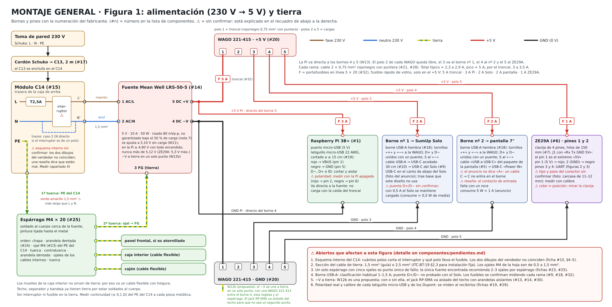
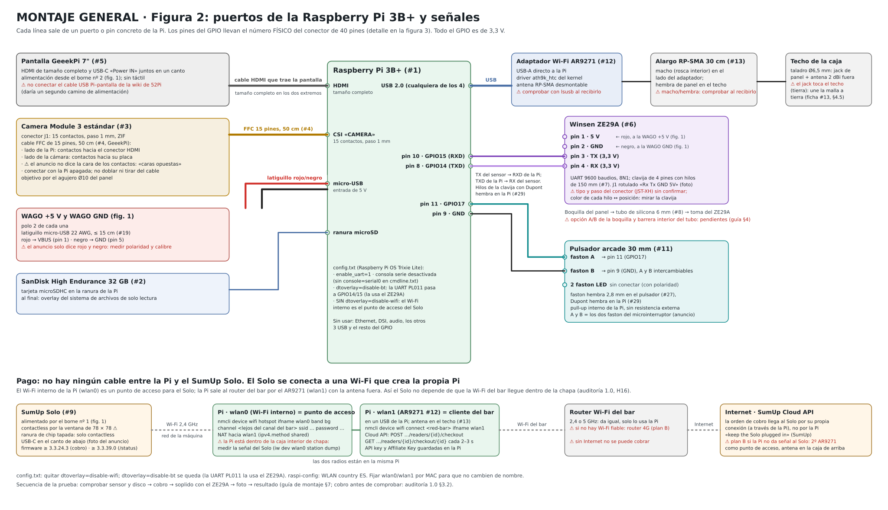
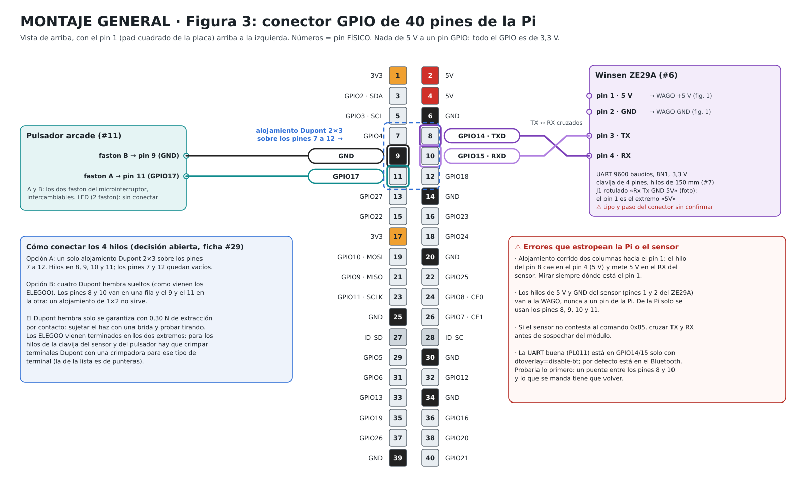

# MONTAJE GENERAL

Cómo se conecta cada componente de la máquina con los demás: de qué puerto, borne o pin sale cada cable y adónde llega. Es el cableado de la guía de montaje eléctrico (v2, 20-10-2026) corregido con lo que han dejado las 31 fichas de [`componentes/`](componentes/README.md) y los documentos que descargaste.

**Estado a 21-10-2026: es un esquema de papel. Nada se ha montado ni medido todavía.** Lo que las fichas no han podido confirmar lleva ⚠ y está reunido en el apartado 5. Dos de esas dudas pueden cambiar el cableado: el esquema interno del módulo C14 y el tipo de conector del ZE29A.

**La parte de 230 V y la tierra:** si no tienes experiencia con red eléctrica, que un electricista la revise antes de enchufar.

Números entre paréntesis, como (#14), son los de la lista de componentes. Los bornes de la fuente y los pines del ZE29A están comprobados con la copia local de sus hojas de datos (LRS-50 y manual V1.1). Los pines del GPIO llevan el número físico del conector de 40 pines.

## Los tres esquemas

**Figura 1. Alimentación (230 V → 5 V) y tierra.** Cada borne de la fuente, cada polo de las WAGO y cada destino.

**Figura 2. Puertos de la Raspberry Pi y señales.** Qué sale de cada puerto de la Pi y adónde va, y cómo se hablan la Pi y el SumUp Solo (sin cable).

**Figura 3. Conector GPIO de 40 pines.** Los cuatro pines que se usan (8, 9, 10 y 11) y los errores que estropean la Pi o el sensor.

Cada figura está en SVG (el que se ve arriba) y en PNG (pincha en la imagen) dentro de [`montaje-general/`](montaje-general/).

## 1. Resumen

- **230 V:** toma de pared → cordón Schuko-C13 (#17) → módulo C14 (#15) con fusible T2,5A (#16) e interruptor → fuente Mean Well LRS-50-5 (#14), bornes 1 (AC/L) y 2 (AC/N).
- **Tierra:** el pin de tierra del C14 va a un espárrago M4 soldado al cuerpo (#25). Del espárrago salen los cables de tierra a la fuente (borne 3, FG), al panel frontal, a la caja interior y al cajón.
- **5 V:** la fuente, ajustada a 5,20 V, da +V (borne 5) y −V (borne 4) a dos regletas WAGO 221-415 (#20), una de +5 V y otra de GND. Cada regleta tiene cinco polos: el 1 es el troncal y los polos 2 a 5 son las cuatro cargas.
- **Las cuatro cargas de 5 V:** Raspberry Pi (puerto micro-USB), SumUp Solo (borne USB-A nº 1 y cable a su USB-C), pantalla (borne USB-A nº 2 y cable a su USB-C) y sensor ZE29A (pines 1 y 2).
- **Señales de la Pi:** UART con el ZE29A por los pines 8 y 10, pulsador por los pines 9 y 11, HDMI a la pantalla, CSI a la cámara y un USB al adaptador Wi-Fi AR9271.
- **La Pi no alimenta nada.** El adaptador AR9271 es lo único que cuelga de un USB de la Pi.
- **Pi y Solo no tienen cable entre sí.** La Pi manda cobrar por Internet (Cloud API de SumUp) y los dos van por Wi-Fi de 2,4 GHz al router del bar.

## 2. Lista de conexiones, cable a cable

### A. Entrada de red y tierra (figura 1)

| N.º | De | A | Cable y terminales | Nota |
|---|---|---|---|---|
| W1 | Toma de pared (Schuko) | Módulo C14 (#15), entrada | Cordón Schuko → C13 de 2 m (#17) | El C13 se enchufa en el C14. El módulo tiene que ir bien fijado a la chapa: el tirón del cable lo aguanta la fijación (ficha #15, §6.4) |
| W2 | C14, contacto de línea L (tras el portafusibles con el T2,5A) | Interruptor, entrada L | Marrón 1,5 mm², faston hembra aislado (#27) | ⚠ Dibujado como interruptor bipolar, que es lo que da por hecho la guía. Hay que medirlo suelto (ficha #15, §4.3) |
| W3 | C14, contacto de neutro N | Interruptor, entrada N | Azul 1,5 mm², faston hembra aislado | ⚠ Igual que W2 |
| W4 | Interruptor, salida L | LRS-50-5, borne 1 (AC/L) | Marrón 1,5 mm². Faston en el módulo, puntera (#28) en la fuente | |
| W5 | Interruptor, salida N | LRS-50-5, borne 2 (AC/N) | Azul 1,5 mm². Faston en el módulo, puntera en la fuente | |
| W6 | C14, contacto de tierra (PE) | Espárrago M4 × 20 (#25), 1ª tuerca | Verde-amarillo. Faston en el C14, ojal M4 (#23) con arandela dentada (#24) en el espárrago | ⚠ Sección: 1,5 mm² (guía) o 2,5 mm² (ITC-BT-19 §2.3). Más largo que L y N. Sin fusible ni interruptor en la tierra |
| W7 | Espárrago, 2ª tuerca | LRS-50-5, borne 3 (FG) | Verde-amarillo, ojal M4 / puntera | |
| W8 | Espárrago, 2ª tuerca | Panel frontal, si va atornillado | Verde-amarillo, ojal M4 en los dos extremos | |
| W9 | Espárrago, 2ª tuerca | Caja interior (la suspendida) | Verde-amarillo flexible, con holgura, ojal M4 | Los muelles no valen como tierra |
| W10 | Espárrago, 2ª tuerca | Cajón | Verde-amarillo flexible, con holgura, ojal M4 | |

Techo, separador y bandeja ya tienen tierra por estar soldados al cuerpo. En el espárrago el orden es: chapa, arandela dentada, ojal del PE del C14, tuerca y contratuerca; encima, otra arandela dentada, los ojales de los cables internos y otra tuerca.

### B. Raíl de 5 V (figura 1)

| N.º | De | A | Cable y terminales | Nota |
|---|---|---|---|---|
| W11 | LRS-50-5, borne 5 (DC +V) | WAGO «+5 V», polo 1 | Rojo 0,75 mm² (#21), puntera (#28) | ⚠ Sin fusible ni PTC por rama: la fuente limita entre 10,6 y 14,4 A y el cable está dado para 6 A |
| W12 | LRS-50-5, borne 4 (DC −V) | WAGO «GND», polo 1 | Negro 0,75 mm², puntera | El −V flota respecto a tierra. ⚠ Decidir si se une a tierra y en qué único punto |
| W13 | Polo 2 de las dos WAGO | Raspberry Pi, puerto micro-USB | Latiguillo micro-USB 22 AWG, ≤ 15 cm (#19): rojo → VBUS (pin 1), negro → GND (pin 5). Datos (D−, D+, ID) cortados y aislados | ⚠ Medir polaridad y calibre de cada latiguillo antes de cortarlo |
| W14 | Polo 3 de las dos WAGO | Borne USB-A nº 1 (#18), tornillos VCC y GND | Rojo y negro 0,75 mm², puntera. D+ y D− del borne unidos con un puente | ⚠ El puente D+/D− no está probado con el Solo. ⚠ Un USB-A suele ir para 1 a 1,5 A y el pico estimado del Solo es de 2 A |
| W15 | Borne USB-A nº 1 (conector hembra) | SumUp Solo (#9), USB-C del canto inferior | Cable USB-A → USB-C acodado 90°, 30 cm (#10) | ⚠ Tiene que llevar datos y 56 kΩ en el pin CC; el conector tiene que caber en la ranura de 14 × 9 mm del separador |
| W16 | Polo 4 de las dos WAGO | Borne USB-A nº 2 (#18), tornillos VCC y GND | Igual que W14 | ⚠ Igual que W14 |
| W17 | Borne USB-A nº 2 (conector hembra) | Pantalla (#5), USB-C «Power IN» | Cable USB del paquete de la pantalla | ⚠ No se sabe si es A → C o C → C; un C → C no entra en el borne. No conectar el cable USB Pi–pantalla de la wiki de 52Pi |
| W18 | Polo 5 de las dos WAGO | ZE29A (#6), pin 1 (5 V) y pin 2 (GND) | Hilos rojo y negro de la clavija de 4 pines, 150 mm (#7) | ⚠ Tipo de conector (JST-XH) sin confirmar |

### C. Señales y datos de la Pi (figuras 2 y 3)

| N.º | De | A | Cable y terminales | Nota |
|---|---|---|---|---|
| W19 | Pi, pin 8 (GPIO14, TXD) | ZE29A, pin 4 (RX) | Hilo de la clavija con Dupont hembra (#29) en la Pi | UART 9600 baudios, 8N1, 3,3 V. TX va a RX |
| W20 | ZE29A, pin 3 (TX) | Pi, pin 10 (GPIO15, RXD) | Igual | ⚠ Orden de pines contra la serigrafía del módulo antes de dar tensión |
| W21 | Pulsador (#11), contacto NO | Pi, pin 11 (GPIO17) | Faston hembra 2,8 mm (#27) en el pulsador, Dupont hembra en la Pi | La Pi pone el pull-up (`gpiozero.Button(17)`) |
| W22 | Pulsador, contacto COM | Pi, pin 9 (GND) | Igual | NC y LED del pulsador sin conectar. ⚠ NO/COM/NC y 2,8 mm sin confirmar |
| W23 | Pi, HDMI | Pantalla, entrada HDMI | Cable HDMI que trae la pantalla | Tamaño completo en los dos extremos |
| W24 | Pi, conector CSI «CAMERA» | Camera Module 3 (#3), conector J1 | Cable FFC de 15 pines, 50 cm (#4) | ⚠ Contactos en caras opuestas. Lado de la Pi: contactos hacia el conector HDMI. Lado de la cámara: hacia su placa. Con la Pi apagada |
| W25 | Pi, un puerto USB 2.0 (cualquiera de los 4) | Adaptador Wi-Fi AR9271 (#12) | El propio adaptador | |
| W26 | AR9271, conector RP-SMA | Antena en el techo | Alargo RP-SMA de 30 cm (#13) hasta el jack de panel (taladro de Ø6,5 mm); la antena se enrosca fuera | ⚠ Macho y hembra del alargo, a comprobar al recibirlo. El jack toca el techo (tierra) y une la malla a tierra (ficha #13, §4.5) |
| W27 | Pi, ranura microSD | SanDisk High Endurance 32 GB (#2) | — | |
| W28 | Boquilla del panel | ZE29A, toma de aire | Tubo de silicona de 6 mm (#8) | Es un tubo, no un cable. ⚠ Opción A/B de la boquilla y barrera interior pendientes |

### D. Sin cable

| N.º | De | A | Cómo | Nota |
|---|---|---|---|---|
| W29 | Pi (por el AR9271) | SumUp Solo | Internet: Pi y Solo se conectan por Wi-Fi de 2,4 GHz al router del bar. La Pi crea el cobro con `POST /readers/{id}/checkout` y consulta el resultado con `GET /readers/{id}/checkout/{id}` | Sin conexión no se puede cobrar. Plan B: router 4G |

## 3. Los 31 componentes: dónde se conecta cada uno

| # | Componente | Dónde se conecta |
|---|---|---|
| 1 | [Raspberry Pi 3B+](componentes/raspberry-pi-3b-plus/README.md) | micro-USB (W13), HDMI (W23), CSI (W24), USB (W25), pines 8 a 11 (W19 a W22) y microSD (W27) |
| 2 | [SanDisk High Endurance](componentes/sandisk-high-endurance-32gb/README.md) | Ranura microSD de la Pi (W27) |
| 3 | [Camera Module 3](componentes/raspberry-pi-camera-module-3/README.md) | Conector J1 → FFC → CSI de la Pi (W24). El objetivo asoma por el agujero de Ø10 del panel |
| 4 | [Cable FFC 50 cm](componentes/cable-ffc-camara-50cm/README.md) | Entre el J1 de la cámara y el CSI de la Pi (W24) |
| 5 | [Pantalla 7"](componentes/pantalla-geeekpi-7-hdmi/README.md) | HDMI desde la Pi (W23) y USB-C «Power IN» desde el borne nº 2 (W17) |
| 6 | [ZE29A](componentes/winsen-ze29a/README.md) | Pines 1 y 2 a las WAGO (W18), pin 4 a Pi 8 y pin 3 a Pi 10 (W19, W20), toma de aire al tubo (W28) |
| 7 | [Cables JST-XH](componentes/cables-jst-xh-4-pin/README.md) | La clavija de 4 pines del ZE29A: llevan los hilos W18 a W20 |
| 8 | [Tubo de silicona](componentes/tubo-silicona-6mm/README.md) | Boquilla del panel → toma de aire del ZE29A (W28) |
| 9 | [SumUp Solo](componentes/sumup-solo/README.md) | USB-C del canto inferior (W15) y Wi-Fi (W29) |
| 10 | [Cable USB-A → USB-C](componentes/cable-usb-a-usb-c-90-30cm/README.md) | Del borne USB-A nº 1 al USB-C del Solo (W15) |
| 11 | [Pulsador arcade](componentes/pulsador-arcade-30mm/README.md) | NO a Pi 11 y COM a Pi 9 (W21, W22) |
| 12 | [Adaptador AR9271](componentes/adaptador-wifi-ar9271/README.md) | Un USB de la Pi (W25) y el alargo de antena (W26) |
| 13 | [Alargo RP-SMA](componentes/alargo-antena-rp-sma-30cm/README.md) | Del AR9271 al jack de panel del techo (W26) |
| 14 | [Fuente LRS-50-5](componentes/meanwell-lrs-50-5/README.md) | Bornes 1 y 2 (W4, W5), 3 (W7), 4 (W12) y 5 (W11) |
| 15 | [Módulo C14](componentes/modulo-c14-fusible-interruptor/README.md) | Cordón (W1), puentes al interruptor (W2, W3), salidas a la fuente (W4, W5) y tierra (W6) |
| 16 | [Fusibles T2,5A](componentes/fusibles-ceramicos-5x20-t2-5a/README.md) | En el portafusibles del C14 |
| 17 | [Cordón Schuko-C13](componentes/cable-schuko-c13-2m/README.md) | Toma de pared → C14 (W1) |
| 18 | [Bornes USB-A](componentes/borne-usb-a-hembra-tornillo/README.md) | Dos bornes: WAGO → cable del Solo (W14, W15) y WAGO → cable de la pantalla (W16, W17) |
| 19 | [Latiguillos micro-USB](componentes/latiguillo-micro-usb-22awg/README.md) | Uno, de WAGO a micro-USB de la Pi (W13). Los otros cinco sobran |
| 20 | [WAGO 221](componentes/wago-221-surtido/README.md) | Dos 221-415: una de +5 V y otra de GND (W11 a W18) |
| 21 | [Cable 2 × 0,75 mm²](componentes/cable-2x0-75-rojo-negro-10m/README.md) | Troncal y ramas de 5 V (W11 a W18) |
| 22 | [Manguera H05VV-F 3G1,5](componentes/cable-h05vv-f-3g1-5-5m/README.md) | Sus hilos marrón, azul y verde-amarillo son los de 230 V y tierra (W2 a W10) |
| 23 | [Ojales M4](componentes/terminales-ojal-m4/README.md) | Extremos de los cables de tierra en el espárrago (W6 a W10) |
| 24 | [Arandelas dentadas M4](componentes/arandelas-dentadas-m4/README.md) | En el espárrago, bajo cada ojal y bajo la tuerca |
| 25 | [Espárrago M4 × 20](componentes/esparragos-soldar-m4x20/README.md) | Punto de tierra, soldado al cuerpo (W6 a W10) |
| 26 | [Tornillería inox](componentes/tornilleria-inox-m3-m6/README.md) | Fijaciones (fuente, C14, pantalla). Sin función eléctrica; en la LRS la longitud del tornillo importa (fichas #14 y #26) |
| 27 | [Kit faston](componentes/kit-faston-aislados/README.md) | Módulo C14 e interruptor (W2, W3, W4, W5, W6) y pulsador (W21, W22) |
| 28 | [Crimpadora y punteras](componentes/crimpadora-y-punteras/README.md) | Punteras en los bornes de la fuente y en las WAGO (W4, W5, W7, W11 a W14, W16, W18) |
| 29 | [Cables Dupont](componentes/cables-dupont-elegoo-120/README.md) | Extremo de la Pi de los hilos de los pines 8, 9, 10 y 11 (W19 a W22) |
| 30 | [Separadores de nailon M2,5](componentes/separadores-nylon-m2-5/README.md) | Fijan la Pi y el sensor a la caja interior sin unir masas |
| 31 | [Pasacables de goma](componentes/pasacables-goma/README.md) | En cada agujero de chapa por donde pase un cable |

## 4. Antes de dar tensión

1. **Módulo C14, suelto y sin enchufar:** mide qué pares cierran en el interruptor (uno o dos polos), cuál lleva el fusible y que no hay continuidad entre L y N (ficha #15, §4.3). Si el interruptor es unipolar, W2 a W5 hay que redibujarlas.
2. **Tierra:** continuidad del pin PE del C14 a cada pieza metálica, con 0,1 Ω como máximo. La medida buena se hace con un comprobador que inyecte 10 a 25 A.
3. **Fuente sin carga:** enchúfala varias veces para ver que el T2,5A aguanta el arranque y ajusta el trimmer a 5,20 V midiendo en la Pi. Nunca por encima de 5,25 V.
4. **Bornes USB-A:** con el polímetro y sin tensión, comprueba que los tornillos VCC y GND son los que dice el conector (1 = VBUS y 4 = GND en un USB-A estándar). Con D+ y D− unidos, su orden no importa.
5. **Cable USB-A → USB-C del Solo:** que lleve datos y 56 kΩ entre el pin CC y VBUS.
6. **Latiguillo micro-USB:** polaridad (rojo = VBUS) y caída de tensión con carga.
7. **ZE29A:** orden de pines contra la serigrafía y su TX en reposo a unos 3,3 V.
8. **GPIO:** con el alojamiento Dupont puesto, ningún hilo en un pin de 5 V (pines 2 y 4). Mide con la Pi apagada.
9. **Cable FFC:** contactos en las caras que toca y Pi apagada al enchufarlo.
10. **Todo montado:** `vcgencmd get_throttled` tiene que dar `0x0` y el pin 6 de la Pi frente a la caja interior tiene que dar circuito abierto (ficha #30).

## 5. Lo que no está confirmado y afecta al cableado

- **Esquema interno del C14:** si el interruptor corta uno o dos polos y qué polo lleva el fusible. Con un enchufe Schuko, que se puede insertar de las dos maneras, un fusible en un solo polo puede quedar en la fase o en el neutro ([ficha #15](componentes/modulo-c14-fusible-interruptor/README.md), §4 y §5).
- **Sección del cable de tierra:** 1,5 o 2,5 mm² ([fichas #22 y #23](componentes/pendientes.md)).
- **Un solo espárrago con cinco ojales:** punto único de fallo ([ficha #25](componentes/esparragos-soldar-m4x20/README.md)).
- **Cómo soldar el espárrago:** probablemente haga falta una pistola de descarga de condensador y no una soldadora de puntos normal. Falta el espesor de la chapa.
- **Protección del raíl de 5 V:** falta fusible o PTC por rama ([ficha #14](componentes/meanwell-lrs-50-5/README.md)).
- **Bornes USB-A:** corriente que aguantan (1 a 1,5 A frente a un pico estimado de 2 A del Solo) y si el Solo reconoce el puente D+/D− como cargador ([fichas #9, #10 y #18](componentes/borne-usb-a-hembra-tornillo/README.md)).
- **−V frente a tierra:** hoy el −V flota; unirlo es una decisión de un solo punto ([ficha #30](componentes/separadores-nylon-m2-5/README.md)).
- **Conector del ZE29A:** el manual solo da los 4 pines; tipo y paso del conector sin confirmar ([ficha #6](componentes/winsen-ze29a/README.md), [ficha #7](componentes/cables-jst-xh-4-pin/README.md)).
- **Pulsador:** que tenga NO, COM y NC y terminales de 2,8 mm ([ficha #11](componentes/pulsador-arcade-30mm/README.md)).
- **Cable de la pantalla:** si es A → C o C → C ([ficha #5](componentes/pantalla-geeekpi-7-hdmi/README.md)).
- **Alojamiento Dupont de los pines 8 a 11:** 2 × 3 o cuatro sueltos, y una crimpadora para terminales Dupont ([ficha #29](componentes/cables-dupont-elegoo-120/README.md)).
- **Conexión a masa del jack RP-SMA de panel:** une la malla del coaxial a tierra ([ficha #13](componentes/alargo-antena-rp-sma-30cm/README.md)).

La lista completa de decisiones y medidas está en [`componentes/pendientes.md`](componentes/pendientes.md).

## Fuentes

- Guía de montaje eléctrico v2 (20-10-2026), apartados 4, 5 y 8: cableado punto a punto y orden de pruebas.
- Las 31 fichas de [`componentes/`](componentes/README.md), con sus discrepancias con la guía.
- Datasheet LRS-50 de Mean Well ([copia local](componentes/meanwell-lrs-50-5/datasheets/MEAN_WELL_LRS-50_DATA_SHEET.pdf)): numeración de los bornes (1 AC/L, 2 AC/N, 3 FG, 4 DC −V, 5 DC +V).
- Manual V1.1 del ZE29A de Winsen ([copia local](componentes/winsen-ze29a/datasheets/ze29a-c2h5oh.pdf)): pines 1 Vin, 2 GND, 3 TXD y 4 RXD, UART a 3,3 V.
