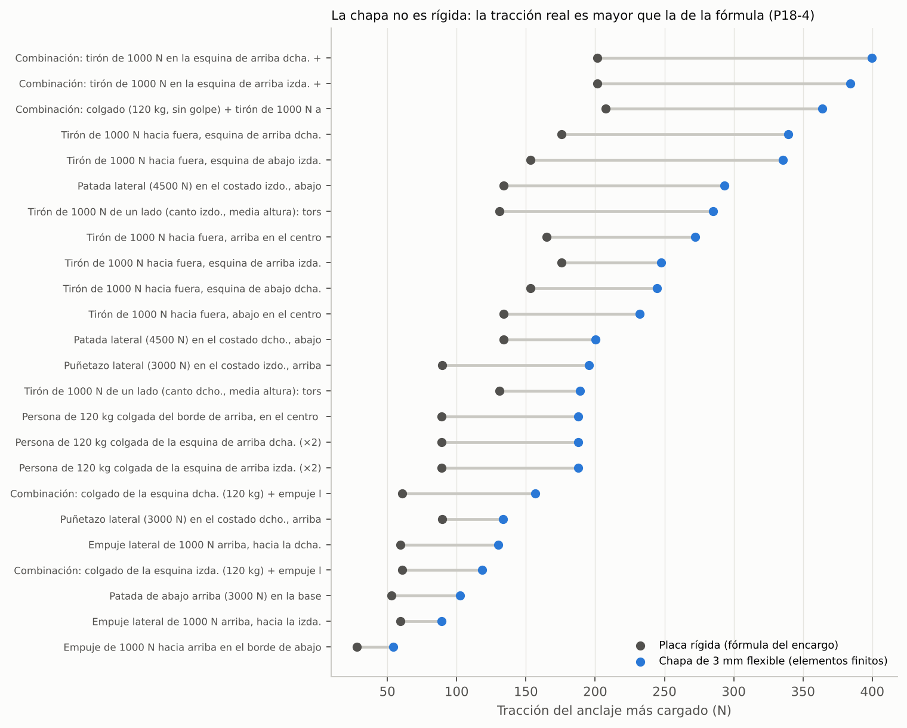
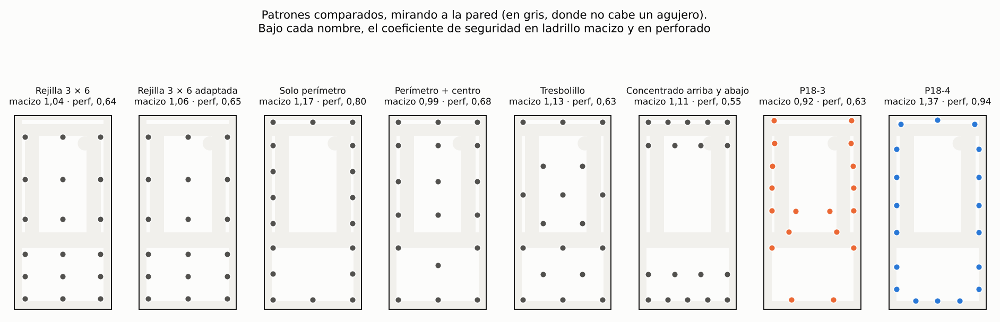
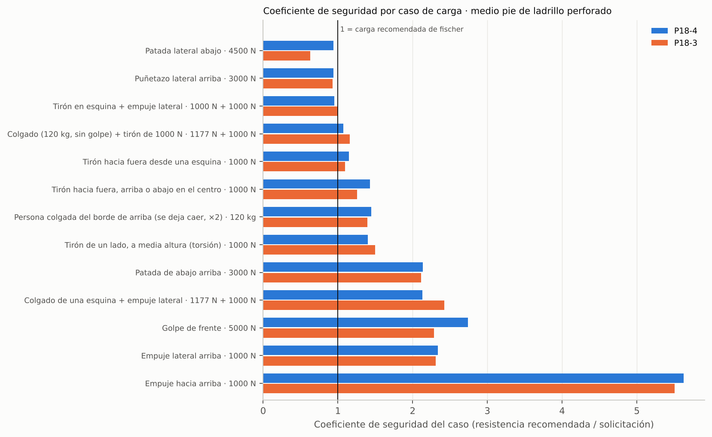
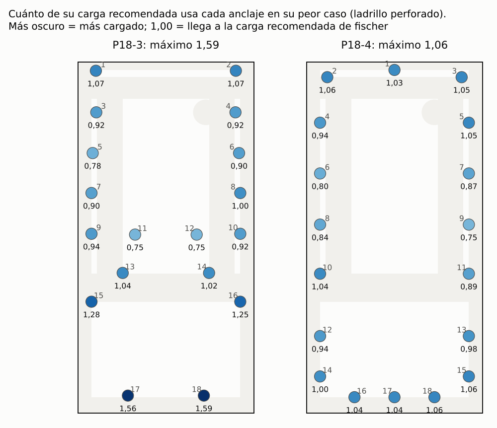
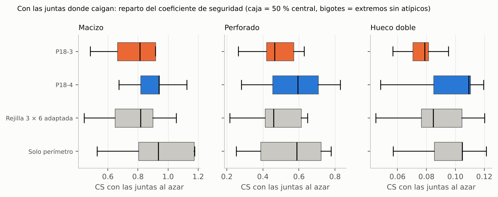
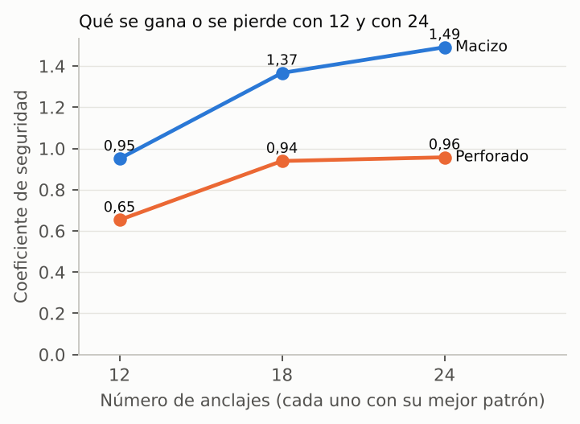

# Bloque 2 · Anclaje a pared: estudio y plantilla de taladros

13-11-2026 · diseño A · trasera de chapa DC01 de 3 mm · 18 tirafondos puestos desde dentro.

**Es trabajo de papel.** No hay ninguna máquina montada ni ningún taco ensayado. Cada dato lleva su origen:
**[CAD]** sale de `diseno.py` / `specs.py` · **[hoja]** leído en la hoja del fabricante · **[norma]** · **[cálculo]** lo saca `anclaje.py` y se puede repetir · **[estimación]** cifra razonada · **[suposición]** lo doy por cierto sin poder comprobarlo.

---

## 0. Lo que tienes que saber en un minuto

1. **El encargo partía de un dato viejo.** Decía que la fijación era una rejilla de 3 × 6 «sin ningún cálculo», con tirafondo 6 × 60 y taco 8 × 40. `DECISIONES.md` dice otra cosa y manda: desde el 03-11 son **tirafondo 6 × 80 y taco SX Plus 8 × 65**, y desde el 04-11 el CAD lleva el **patrón P18-3**, que salió de un cálculo por elementos finitos (`carcasa/diseno-A/calculo-anclajes/`). He partido de ahí, no de la rejilla.
2. **Patrón nuevo: P18-4.** Un anillo pegado al perímetro: 3 arriba, 3 abajo y 6 en cada costado. Con las cargas de este estudio su coeficiente de seguridad es **un 49 % mayor** que el del P18-3 (1,37 frente a 0,92 en ladrillo macizo; 0,94 frente a 0,63 en perforado).
   - Toda la ganancia viene de un caso que el cálculo del 04-11 no miraba: **un golpe lateral fuerte abajo**. El P18-3 solo tiene 2 tornillos abajo y, en ladrillo perforado, se llevan un 59 % más de lo recomendado.
   - En tirones y cuelgues los dos patrones quedan parecidos: según el caso, el P18-4 va de un 12 % peor a un 13 % mejor. Si quitas el golpe lateral bajo, empatan (0,94 y 0,93 en perforado).
3. **Lo que limita no es el patrón, es el taco y la pared.**
   - **Ladrillo macizo:** cumple con margen (CS 1,37).
   - **Ladrillo perforado:** justo (CS 0,94). Los golpes laterales más fuertes pasan un 6 % de la carga recomendada del taco.
   - **Tabique de ladrillo hueco doble: no vale** (CS 0,11). Con tacos de nailon ningún patrón lo arregla; con anclaje químico sube a 0,31, que sigue sin llegar. Ahí no se debe colgar la máquina (apartado 10).
4. **Las juntas quitan mucho.** Bajo el yeso no se ven. De media, 5 o 6 de los 18 tacos tocan una junta. Con eso el coeficiente típico baja a 0,94 en macizo y a 0,59 en perforado.
5. **La chapa no es rígida.** La fórmula del encargo (placa rígida) se queda corta: la tracción real del tornillo más cargado es entre 1,4 y 2,6 veces mayor. Los resultados usan la chapa flexible.
6. **18 está bien elegido.** Con 12 se pierde un 30 %; con 24 se gana un 2 % en perforado y un 9 % en macizo.
7. **Hecho:** plantilla 1:1 (DXF, PDF A2 y PDF en 3 hojas A4), CAD actualizado (0 choques con las 18 cabezas puestas), `DECISIONES.md` e instrucciones de montaje con orden de apriete. Todo en la rama `bloque-2-anclaje`, sin fusionar.

**Qué significa aquí «coeficiente de seguridad» (CS).** Es la resistencia recomendada por el fabricante dividida por lo que le llega al anclaje más cargado, en el peor caso. La carga recomendada de fischer ya lleva dentro su propio margen (en sus tacos de nailon, del orden de 7 veces sobre el arrancamiento medio **[estimación, por sus tablas de la serie SX]**). Así que CS < 1 no significa «se cae»: significa «fuera de lo que el fabricante garantiza». CS ≥ 1 con cargas tan brutas como las de este estudio es un buen resultado.

---

## 1. Datos de partida

| Dato | Valor | Origen |
|---|---|---|
| Medidas exteriores | 220 × 100 × 442,5 mm (ancho × fondo × alto) | [CAD] `SPEC_A`, cotas del modelo |
| Trasera | 220 × 439,5 mm, chapa de 3 mm, parte de la pieza A-C02 (trasera, laterales y suelo en una chapa plegada) | [CAD] `T = 3.0`, `Hw = 439,5` |
| Material | Acero DC01. Límite elástico 140–280 MPa (calculo con 140); rotura 270–410 MPa (calculo con 270) | [norma] EN 10130 |
| Masa | **15,63 kg**: 12,53 de acero, 0,57 de policarbonato, 1,52 de componentes y 1,01 de cables, pintura, pajitas y tornillería | [cálculo] `masa_cdg.py`: volumen de cada pieza del CAD × densidad; componentes por hoja o estimados |
| Centro de gravedad | x = −1,7 mm, z = 207 mm, a **49,7 mm de la pared** | [cálculo] `masa_cdg.py` |
| Valores de cálculo | **18 kg** (+15 %) a 55 mm de la pared y z = 210 mm | [suposición] margen por funda, cableado real y tolerancias |
| Fijación que consta en el repo | 18 agujeros Ø6,5 · tirafondo hexagonal **6 × 80** DIN 571 · taco fischer **SX Plus 8 × 65** (ref. 568108) · arandela ancha M6 DIN 9021 · patrón **P18-3** | [CAD] `FIJACIONES_PARED` y `DECISIONES.md` (03-11 y 04-11) |
| Lo que decía el encargo | 6 × 60, taco 8 × 40, rejilla x = −85 / 0 / +85 y z = 25 / 75 / 125 / 205 / 295 / 391,5 | Era lo vigente hasta el 03-11. **Ya no vale:** los agujeros de x = ±85 caen sobre las guías traseras nuevas |
| Tornillo | Caña lisa Ø6, núcleo de rosca Ø4,2. Resistencia a rotura 400 MPa | [norma] DIN 571 para las medidas · [suposición] para el acero: la norma no fija clase |
| Arandela | Ø18 × 1,6 mm | [norma] DIN 9021 |
| Holgura de las cabezas | Sobresalen 5,6 mm. Quedan 3,4 mm hasta el cajón de pajitas y 3,9 mm hasta el de componentes | [cálculo] `aplicar_cad.py` |

### Zonas prohibidas de la trasera

Comprobadas una a una en `diseno.py`. El centro de un agujero tiene que quedar a 11 mm o más de cualquier pestaña o soldadura (radio de la arandela más 2 mm), y a |x| ≤ 93 mm para que la arandela apoye en lo plano y entre la llave.

| Qué | Dónde (x desde el eje, z desde la base) | Origen |
|---|---|---|
| Pestaña trasera de la bandeja, soldada | z = 150,5 a 163,5, todo el ancho | [CAD] |
| Guías traseras (2 pletinas soldadas) | x = ±64 a ±76, z = 173,5 a 391,5 | [CAD] |
| Apoyo trasero de la tapa interior y su cordón | z = 404,5 a 410,5 | [CAD] |
| Espárrago de tierra | (50; 376,5), círculo de 16 mm | [CAD] |
| Pliegue del suelo y pliegues laterales | z < 20 y \|x\| > 93 | [CAD] |
| Canto de arriba | z > 429,5 (10 mm al borde) | [suposición] distancia mínima al borde |
| Pasamuros de la antena | **Ya no existe.** Desde el 01-11 la antena va por dentro | `DECISIONES.md` |

Quedan tres zonas útiles: detrás del cajón de pajitas (z = 20 a 139,5), detrás del cajón de componentes (z = 174,5 a 393,5, salvo las franjas de las guías) y la franja de arriba (z = 420,5 a 429,5).

**Acceso con herramienta.** Con los dos cajones fuera y la tapa abierta quedan 85,8 mm libres delante de la trasera en la zona de componentes y 94 mm en la de pajitas **[CAD]**. El tirafondo mide 84 mm con la cabeza: entra, pero justo. El primer tramo se da con llave fija o de carraca plana de 10 mm; la llave de vaso con carraca (unos 40 mm de alto) solo cabe en los últimos 45 mm **[estimación]**.

### Ficha del taco (fischer SX Plus)

| Dato | 8 × 65 (el del CAD) | 8 × 40 | Origen |
|---|---|---|---|
| Broca / profundidad mínima / tornillo | Ø8 / 75 mm / Ø4,5–6 | Ø8 / 50 mm / Ø4,5–6 | [hoja] |
| Hormigón ≥ C20/25 | 1,50 kN | 0,75 kN | [hoja] |
| Ladrillo macizo ≥ Mz 12 | **0,80 kN** | 0,60 kN | [hoja] |
| Ladrillo perforado vertical ≥ HLz 12 | **0,40 kN** | 0,25 kN | [hoja] |
| Ladrillo hueco «Forato F8» (8 cm, enlucido) | **sin valor** | **0,10 kN** | [hoja] |
| Distancia mínima al borde (en hormigón) | 50 mm | 40 mm | [hoja] |
| Separación mínima entre tacos | no la publica | no la publica | Tomo 50 mm **[suposición]** |

Notas de la tabla de fischer **[hoja]**: son cargas recomendadas para un taco aislado, ya con sus coeficientes de seguridad, y valen igual para tracción, cortante y carga oblicua.

Para comparar, el anclaje químico de fischer con tamiz (FIS V, tamiz FIS H 12 × 85 K, varilla M6 o M8) en ladrillo perforado HLz ≥ 12 de densidad ≥ 1,0: tracción 0,34 kN, cortante 0,43 kN, separación mínima 100 mm **[hoja]**.

---

## 2. Pared

Ladrillo con enlucido de yeso de 10–15 mm que **no cuenta** (tomo 15, el peor) **[suposición del encargo]**. El yeso tiene dos efectos:

- El taco de 65 mm va a ras del yeso, así que solo 50 mm trabajan en ladrillo.
- El tornillo cruza 15 mm sin apoyo: el cortante lo dobla (apartado 4.3).

| | Macizo | Perforado | Hueco doble |
|---|---|---|---|
| Pared | Medio pie (11,5 cm) | Medio pie (11,5 cm) | Tabique de 7 cm, ladrillo a panderete |
| Cara vista del ladrillo y junta | 240 × 50, junta de 10 | 240 × 70, junta de 10 | 240 × 115, junta de 10 |
| Taco y tornillo | 8 × 65 + 6 × 80 | 8 × 65 + 6 × 80 | 8 × 40 + 6 × 60 |
| Carga recomendada por taco, F_rec | 800 N **[hoja]** | 400 N **[hoja]** | 100 N **[hoja]**, del «Forato F8» italiano, el más parecido de la tabla |
| Separación a partir de la cual dos tacos no se estorban, s_cr | 150 × 150 mm (3 veces los 50 mm anclados) **[suposición]** | 150 × 150 mm **[suposición]** | 240 × 115 mm, un ladrillo **[suposición]**: varios tacos en el mismo ladrillo hueco no suman |
| Cono de ladrillo de un taco aislado, κ·F_rec | κ = 2,4 **[suposición]** | κ = 2,4 **[suposición]** | κ = 1 **[suposición]** |
| Arrancamiento de un ladrillo entero | 1577 N **[cálculo]** | 1577 N **[cálculo]** | 480 N **[cálculo]** |

**Por qué en hueco uso el 8 × 40.** Para el 8 × 65 fischer no da valor en ladrillo hueco. Además, el taladro de 75–85 mm casi atraviesa un tabique de 7 cm con sus dos enlucidos (10 cm en total).

**Juntas.** Un taco en junta aguanta mucho menos. Tomo que conserva el 50 % si el taladro toca una junta horizontal (tendel) y el 30 % si toca una vertical (llaga, que muchas veces está sin rellenar) **[suposición]**. Con taladro de Ø8 y junta de 10 mm, la franja «mala» mide 18 mm de cada 60 (macizo), de cada 80 (perforado) o de cada 125 (hueco).

**Arrancamiento de un ladrillo entero** (EOTA TR 054, llagas sin rellenar, sin contar el peso de la pared de encima):

- Fórmula: N_pb = 2 · l · b · 0,5 · f_vk0 / (γ_M · γ_F)
- Sustitución (medio pie): 2 · 240 · 115 · 0,5 · 0,20 / (2,5 · 1,4)
- Resultado: **1577 N**. En tabique de 7 cm con f_vk0 = 0,10: 2 · 240 · 70 · 0,5 · 0,10 / 3,5 = **480 N**.

f_vk0 es la adherencia del mortero: 0,20 N/mm² para mortero corriente y 0,10 para el del tabique **[suposición, valores de EN 1996-1-1]**.

---

## 3. Casos de carga

**Todos los valores son suposiciones mías.** Los he puesto altos a propósito. Cada caso lleva además el peso propio (18 kg). El punto de aplicación va en (x; distancia a la pared; z).

| Caso | Valor | Dónde | De dónde sale el número |
|---|---|---|---|
| Peso propio | 18 kg = 177 N | Centro de gravedad (0; 55; 210) | Apartado 1 |
| Persona colgada del borde de arriba | 120 kg × 2 = 2354 N hacia abajo | Borde delantero de arriba: centro y cada esquina | El 2 es el factor de una carga aplicada de golpe (se deja caer) |
| Tirón hacia fuera | 1000 N | Arriba y abajo en el centro; las 4 esquinas | Dos manos y un pie en la pared: unos 100 kg de fuerza |
| Tirón de un lado (torsión) | 1000 N hacia fuera | Canto derecho o izquierdo, a media altura | Igual |
| Empuje lateral | 1000 N | Arriba, hacia cada lado | El peso del cuerpo echado encima |
| Empuje hacia arriba | 1000 N | Borde de abajo | Hombro por debajo |
| Patada lateral abajo | 3000 N × 1,5 = 4500 N | Costado, a 110 mm de la base | Pico de una patada fuerte de alguien sin entrenar (2–3 kN); 1,5 por ser un golpe |
| Puñetazo lateral arriba | 2000 N × 1,5 = 3000 N | Costado, a 400 mm de la base | Pico de un puñetazo fuerte; también cubre un hombro lanzado |
| Patada de abajo arriba | 3000 N | En la base | Igual que el puñetazo |
| Golpe de frente | 5000 N hacia la pared | Esquina de arriba | Aplasta la caja contra la pared; se incluye para comprobar que no importa |
| Colgado + tirón | 1177 N (120 kg sin golpe) + 1000 N | Borde de arriba | Alguien trepando y echándose atrás |
| Colgado de una esquina + empuje lateral | 1177 N + 1000 N | Esquina de arriba | |
| Tirón en esquina + empuje lateral | 1000 N + 1000 N | Esquina de arriba | Zarandeo |

En total, 26 casos contando izquierda y derecha. La caja no es simétrica: el lateral izquierdo no existe por debajo de z = 150 (hueco del cajón de pajitas).

**No se cuenta** el rozamiento de la trasera contra la pared ni el apriete de los tornillos. Los dos ayudan, pero no son de fiar a dos años.

---

## 4. Modelo

### 4.1 Reparto con placa rígida (la fórmula del encargo)

- **Tracción.** La placa gira sobre el borde que aprieta contra la pared: N_i = M · d_i / Σd_i², con d_i la distancia del anclaje a ese borde. El script lo resuelve en general (borde o esquina de giro según el caso) como un problema de contacto con las 4 esquinas de la trasera.
- **Cortante.** Reparto directo más torsión alrededor del centro de los anclajes: V_i = F / n + T · r_i / Σr_i².

### 4.2 Comprobación: ¿es rígida la placa?

No. El mismo reparto calculado con la chapa de 3 mm flexible da tracciones bastante mayores. Uso el modelo de elementos finitos que ya estaba en el repo (`calculo-anclajes/codigo/nucleo.py`, verificado contra Timoshenko con un 0,2 % de error): placa de Kirchhoff, caja rígida unida por los pliegues y la bandeja, tornillos que solo tiran, pared que solo empuja y dos hipótesis de borde (pliegue apoyado y empotrado; vale la peor).

| Caso | Placa rígida (N) | Chapa flexible, FEM (N) | FEM / rígida |
|---|---|---|---|
| Persona de 120 kg colgada del borde de arriba, en el centro (×2) | 89 | 188 | 2,10 |
| Persona de 120 kg colgada de la esquina de arriba dcha. (×2) | 89 | 188 | 2,10 |
| Persona de 120 kg colgada de la esquina de arriba izda. (×2) | 89 | 188 | 2,10 |
| Tirón de 1000 N hacia fuera, arriba en el centro | 165 | 272 | 1,65 |
| Tirón de 1000 N hacia fuera, abajo en el centro | 134 | 232 | 1,73 |
| Tirón de 1000 N hacia fuera, esquina de arriba dcha. | 176 | 339 | 1,93 |
| Tirón de 1000 N hacia fuera, esquina de abajo dcha. | 153 | 245 | 1,60 |
| Tirón de 1000 N de un lado (canto dcho., media altura): torsión | 131 | 189 | 1,44 |
| Empuje lateral de 1000 N arriba, hacia la dcha. | 60 | 130 | 2,19 |
| Patada lateral (4500 N) en el costado izdo., abajo | 134 | 293 | 2,19 |
| Puñetazo lateral (3000 N) en el costado izdo., arriba | 89 | 195 | 2,19 |
| Tirón de 1000 N hacia fuera, esquina de arriba izda. | 176 | 248 | 1,41 |
| Tirón de 1000 N hacia fuera, esquina de abajo izda. | 153 | 336 | 2,19 |
| Tirón de 1000 N de un lado (canto izdo., media altura): torsión | 131 | 285 | 2,17 |
| Empuje lateral de 1000 N arriba, hacia la izda. | 60 | 89 | 1,50 |
| Patada lateral (4500 N) en el costado dcho., abajo | 134 | 200 | 1,49 |
| Puñetazo lateral (3000 N) en el costado dcho., arriba | 89 | 134 | 1,50 |
| Empuje de 1000 N hacia arriba en el borde de abajo | 28 | 54 | 1,94 |
| Patada de abajo arriba (3000 N) en la base | 53 | 103 | 1,94 |
| Combinación: colgado (120 kg, sin golpe) + tirón de 1000 N arriba | 208 | 364 | 1,75 |
| Combinación: colgado de la esquina dcha. (120 kg) + empuje lateral de 1000 N | 61 | 157 | 2,58 |
| Combinación: tirón de 1000 N en la esquina de arriba dcha. + empuje lateral de 1000 N | 202 | 400 | 1,98 |
| Combinación: colgado de la esquina izda. (120 kg) + empuje lateral de 1000 N | 61 | 118 | 1,95 |
| Combinación: tirón de 1000 N en la esquina de arriba izda. + empuje lateral de 1000 N | 202 | 384 | 1,91 |



**Todos los coeficientes de este estudio usan la chapa flexible.** El modelo rígido queda como contraste a mano (apartado 5).

Otras comprobaciones de la chapa, con el anclaje más cargado (N ≈ 400 N, V ≈ 417 N):

| Comprobación | Fórmula → sustitución → resultado | Margen |
|---|---|---|
| Paso de la cabeza a través de la chapa (punzonamiento alrededor de la arandela) | F = π · d · t · f_u / √3 → π · 18 · 3 · 270 / 1,73 → **26,4 kN** | 66 veces |
| Aplastamiento del agujero (interior) | F = 2,5 · f_u · d · t → 2,5 · 270 · 6 · 3 → **12,2 kN** | 29 veces |
| Aplastamiento del agujero de arriba (a 10 mm del canto) | F = 2,5 · (e / 3d₀) · f_u · d · t → 2,5 · (10 / 19,5) · 270 · 6 · 3 → **6,2 kN** | 15 veces |
| Flexión de la chapa junto a la arandela | Tensión máxima con 1000 N de tirón en la esquina: **79 MPa** [cálculo, FEM] | La chapa empieza a marcarse a unos **1,8 kN** de tirón en esquina (140 / 79 × 1000) |

La chapa no manda en ningún caso. El único aviso es el último: con tirones de más de 1,8 kN en una esquina la chapa se deforma un poco junto a las arandelas de arriba antes de que cedan los tacos en ladrillo macizo. No es una rotura. Con el P18-3 daba lo mismo (1,8 kN).

### 4.3 Modos de fallo de cada anclaje

| Modo | Condición | Resistencia «recomendada» |
|---|---|---|
| **Taco:** arrancamiento o cortante | √(N² + V²) ≤ α · F_rec | F_rec de fischer [hoja]; α = 1, o 0,5 / 0,3 si cae en junta |
| **Cono de ladrillo** con tacos cercanos | N ≤ α · κ · F_rec · ψ_i | ψ_i = parte de su trozo de pared que le queda a cada taco |
| **Tornillo:** tracción más flexión en el yeso | N / N_s + V / V_s ≤ 1 | N_s = 2639 N, V_s = 597 N [cálculo] |
| **Ladrillo entero arrancado** | Suma de N de los tacos del mismo ladrillo ≤ N_pb | 1577 N o 480 N (apartado 2). Solo se puede comprobar sabiendo dónde caen las juntas: entra en el Monte Carlo |

**Solape de conos (ψ).** A cada taco le toca el trozo de pared que está más cerca de él que de cualquier otro, recortado a un rectángulo s_cr centrado en el taco. ψ = ese área / (s_cr,x · s_cr,z). En el P18-4, ψ va de 0,33 a 0,54 en ladrillo macizo: con 18 tacos en 220 × 440 mm, todos se pisan.

**Tornillo.**

- Tracción: N_s = A_s · f_u / (1,5 · 1,4) → 13,85 · 400 / 2,1 → **2639 N**.
- Cortante con brazo de palanca (EN 1992-4). Brazo l = yeso + media chapa + medio diámetro = 15 + 1,5 + 3 = 19,5 mm. Momento resistente M = 1,2 · W · f_u = 1,2 · 21,2 · 400 = 10 179 N·mm. V_s = 2 · M / l / (1,25 · 1,4) → 2 · 10 179 / 19,5 / 1,75 → **597 N**.

En ladrillo macizo manda este modo y no el taco: la resistencia del tornillo doblándose en el yeso (597 N) es menor que la del taco (800 N).

### 4.4 Coeficiente de seguridad de un patrón

CS = mínimo, sobre los 26 casos, las dos hipótesis de borde, los 18 anclajes y los modos de fallo, de resistencia / solicitación.

**Ejemplo: el número que manda en el P18-4.** Patada lateral de 4500 N en el costado derecho, anclaje n.º 18 (X 160; Z 20):

- Del modelo: N = 85 N, V = 417 N.
- Ladrillo perforado, taco: √(85² + 417²) / 400 = 425,6 / 400 = 1,06 → **CS = 0,94**.
- Ladrillo macizo, tornillo: 85 / 2639 + 417 / 597 = 0,03 + 0,70 = 0,73 → **CS = 1,37**. (El taco iría a 425,6 / 800 = 0,53.)
- Ladrillo hueco, donde manda otro caso (tirón en esquina + empuje lateral, anclaje n.º 5): N = 400 N; cono: 400 / (100 · 1 · 0,45) = 8,9 → **CS = 0,11**.

---

## 5. Contraste a mano

Tres casos simples hechos con las fórmulas del apartado 4.1 y comparados con el código (`python anclaje/anclaje.py --mano`). Patrón P18-4.

| Caso | Fórmula | Sustitución | A mano | Código |
|---|---|---|---|---|
| Tirón de 1000 N arriba en el centro (tracción del anclaje más alto) | N = M·z_max / Σz²,  M = F·H + m·g·e | M = 1000·442,5 + 18·9,81·55 = 452212 N·mm;  N = 452212·429,5 / 1178724 | 164,8 N | 164,8 N |
| Persona colgada en el centro (cortante de cada anclaje) | V = (P·DAF + m·g) / n | V = (120·9,81·2 + 18·9,81) / 18 = 2531 / 18 | 140,6 N | 140,6 N |
| Patada lateral de 4500 N a 110 mm de la base (cortante del anclaje más bajo, x = -50, z = 20) | V_x = F/n + T·(z0 − z_i)/J;  V_z = −m·g/n + T·(x_i − x0)/J;  V = √(V_x² + V_z²);  T = F·(z0 − 110);  J = Σ[(x−x0)² + (z−z0)²] | z0 = 209,1; J = 514739 mm²; T = 4500·(209,1 − 110) = 445875 N·mm; V_x = 250,0 + 163,8 = 413,8; V_z = -9,8 + (-43,3) = -53,1 | 417,2 N | 417,2 N |

El primero lo he repetido además con calculadora, fuera del script: Σz² = 1 178 724 mm² y N = 452 212 · 429,5 / 1 178 724 = 164,8 N. El tercero es el caso simétrico al del ejemplo del apartado 4.4 (patada por el otro costado): mismo cortante, 417 N.

Unidades revisadas: fuerzas en N, longitudes en mm, momentos en N·mm; masa × 9,81 para pasar a N.

---

## 6. Optimización

- **Variables:** la posición (x, z) de los 18 puntos. Patrones simétricos: parejas (±x, z) y puntos en el eje.
- **Restricciones:** cada punto se lleva al sitio permitido más cercano (apartado 1); separación mínima de 50 mm entre agujeros.
- **Objetivo:** la mejora del CS respecto al P18-3 que se cumple **a la vez** en ladrillo macizo y en perforado. Vale 1,00 para el P18-3.
- **Método:** búsqueda por coordenadas desde patrones de perímetro, con «saltos» para salir de óptimos locales, y una evolución diferencial sembrada con lo anterior para ver si encontraba algo mejor.

| Búsqueda | Evaluaciones | Tiempo | Mejora sobre el P18-3 |
|---|---|---|---|
| Coordenadas + 12 saltos, 8 parejas + 2 en el eje | 5521 | 8 min | **1,492** → P18-4 |
| Coordenadas + 8 saltos, 9 parejas sin eje | 4257 | 7 min | 1,488 |
| Evolución diferencial, 60 generaciones, sembrada con las anteriores | 6588 | 24 min | 1,492 (no encuentra nada mejor) |
| Evolución diferencial sembrada solo con los patrones a mano | parada a las 60 generaciones | 24 min | 1,275 (no pasó del «solo perímetro» de partida) |

Dos formas distintas de patrón llegan al mismo valor (1,49) y la evolución diferencial no lo mejora: es un buen indicio, **no una demostración** de óptimo global.

**Simetría.** Soltando la simetría y moviendo cada agujero por separado desde el P18-4, la mejora pasa de 1,4915 a 1,4928 (+0,1 %). No compensa: se queda simétrico.

### Patrones comparados

Modelo fino (malla de 10 mm, arandela rígida), 26 casos.

| Patrón | Cabe | Sep. mín. (mm) | CS macizo | CS perforado | CS hueco doble | Caso que manda (perforado) | Modo de fallo que manda (perforado) | CS con placa rígida (perforado) |
|---|---|---|---|---|---|---|---|---|
| Rejilla 3 × 6 (la del encargo; ya no cabe) | no | 50,0 | 1,04 | 0,64 | 0,10 | Combinación: tirón de 1000 N en la esquina de arriba dcha. + empuje lateral de 1000 N | taco (arrancamiento o cortante) | 0,74 |
| Rejilla 3 × 6 adaptada (x = ±89,5) | sí | 50,0 | 1,06 | 0,65 | 0,11 | Combinación: tirón de 1000 N en la esquina de arriba dcha. + empuje lateral de 1000 N | taco (arrancamiento o cortante) | 0,75 |
| Solo perímetro | sí | 53,0 | 1,17 | 0,80 | 0,11 | Patada lateral (4500 N) en el costado dcho., abajo | taco (arrancamiento o cortante) | 0,81 |
| Perímetro + centro | sí | 53,0 | 0,99 | 0,68 | 0,11 | Patada lateral (4500 N) en el costado dcho., abajo | taco (arrancamiento o cortante) | 0,69 |
| Tresbolillo | sí | 71,5 | 1,13 | 0,63 | 0,08 | Combinación: tirón de 1000 N en la esquina de arriba dcha. + empuje lateral de 1000 N | taco (arrancamiento o cortante) | 0,80 |
| Concentrado arriba y abajo | no | 45,0 | 1,11 | 0,55 | 0,06 | Combinación: tirón de 1000 N en la esquina de arriba izda. + empuje lateral de 1000 N | taco (arrancamiento o cortante) | 0,90 |
| P18-3 (el del CAD, 04-11) | sí | 50,0 | 0,92 | 0,63 | 0,08 | Patada lateral (4500 N) en el costado dcho., abajo | taco (arrancamiento o cortante) | 0,63 |
| P18-4 (óptimo numérico) | sí | 50,0 | 1,37 | 0,94 | 0,11 | Patada lateral (4500 N) en el costado dcho., abajo | taco (arrancamiento o cortante) | 0,93 |



Coeficiente de cada caso en cada patrón (ladrillo perforado). La carga de fallo de un caso es su carga supuesta multiplicada por el coeficiente. En ladrillo macizo, los casos en los que manda el taco o el cono salen al doble; los de golpe lateral, donde manda el tornillo, alrededor de un 46 % más (tablas del apartado 7).

| Caso · carga supuesta | Rejilla 3 × 6 | Rejilla 3 × 6 adaptada | Solo perímetro | Perímetro + centro | Tresbolillo | Concentrado arriba y abajo | P18-3 | P18-4 |
|---|---|---|---|---|---|---|---|---|
| Peso propio · 18 kg | 26,87 | 27,06 | 33,20 | 32,00 | 26,43 | 27,75 | 34,71 | 32,49 |
| Persona colgada del borde de arriba (se deja caer, ×2) · 120 kg | 1,07 | 1,08 | 1,44 | 1,36 | 1,06 | 1,21 | 1,40 | 1,45 |
| Tirón hacia fuera, arriba o abajo en el centro · 1000 N | 0,97 | 0,99 | 1,41 | 1,29 | 0,94 | 1,05 | 1,26 | 1,43 |
| Tirón hacia fuera desde una esquina · 1000 N | 0,79 | 0,80 | 1,13 | 1,02 | 0,77 | 0,79 | 1,09 | 1,15 |
| Tirón de un lado, a media altura (torsión) · 1000 N | 1,27 | 1,39 | 1,47 | 1,41 | 1,24 | 0,83 | 1,50 | 1,40 |
| Empuje lateral arriba · 1000 N | 1,75 | 1,76 | 2,43 | 2,42 | 1,86 | 1,62 | 2,31 | 2,34 |
| Empuje hacia arriba · 1000 N | 5,75 | 5,68 | 5,40 | 4,83 | 4,94 | 4,17 | 5,51 | 5,63 |
| Patada lateral abajo · 4500 N | 0,91 | 0,92 | 0,80 | 0,68 | 0,79 | 0,76 | 0,63 | 0,94 |
| Puñetazo lateral arriba · 3000 N | 0,72 | 0,72 | 0,99 | 1,01 | 0,77 | 0,90 | 0,93 | 0,94 |
| Patada de abajo arriba · 3000 N | 2,16 | 2,14 | 2,09 | 1,96 | 2,10 | 1,79 | 2,11 | 2,13 |
| Golpe de frente · 5000 N | 2,64 | 2,68 | 2,32 | 2,40 | 2,14 | 1,89 | 2,29 | 2,74 |
| Colgado (120 kg, sin golpe) + tirón de 1000 N · 1177 N + 1000 N | 0,72 | 0,73 | 1,05 | 0,96 | 0,70 | 0,76 | 1,16 | 1,07 |
| Colgado de una esquina + empuje lateral · 1177 N + 1000 N | 1,50 | 1,52 | 2,21 | 2,08 | 1,49 | 1,60 | 2,42 | 2,13 |
| Tirón en esquina + empuje lateral · 1000 N + 1000 N | 0,64 | 0,65 | 0,96 | 0,87 | 0,63 | 0,55 | 1,00 | 0,95 |
| **Mínimo** | **0,64** | **0,65** | **0,80** | **0,68** | **0,63** | **0,55** | **0,63** | **0,94** |

- La rejilla 3 × 6 del encargo ya no se puede taladrar (6 agujeros caen sobre las guías). La «adaptada» lleva las columnas a x = ±89,5.
- «Concentrado arriba y abajo» incumple la separación mínima (45 mm): se deja como referencia.
- La última columna enseña el error de usar la placa rígida: no distingue bien entre patrones cuando manda la tracción (el tresbolillo sale 0,80 con placa rígida y 0,63 de verdad).

**Con el criterio del estudio del 04-11** (solo sus 9 casos, sin golpes laterales ni solape de conos), el P18-4 da λ = 8,64 y el P18-3, 10,56. Es decir: en tirones puros desde una esquina, el P18-3 reparte un 18 % mejor el tornillo más cargado. El P18-4 gana en el conjunto porque no tiene el punto flaco de abajo. Lo digo para que conste el compromiso.

---

## 7. Resultados por caso

«Carga que agota» = carga supuesta × CS del caso: la que lleva al anclaje más cargado a su carga recomendada.

**P18-4 (nuevo)**

| Caso | Carga supuesta | CS macizo | CS perforado | CS hueco | Carga que agota (macizo) | Carga que agota (perforado) | Modo que manda (perforado) |
|---|---|---|---|---|---|---|---|
| Peso propio | 18 kg | 51,91 | 32,49 | 6,00 | 934 kg | 585 kg | taco (arrancamiento o cortante) |
| Persona colgada del borde de arriba (se deja caer, ×2) | 120 kg | 2,41 | 1,45 | 0,24 | 290 kg | 174 kg | taco (arrancamiento o cortante) |
| Tirón hacia fuera, arriba o abajo en el centro | 1000 N | 2,86 | 1,43 | 0,13 | 2862 N | 1431 N | cono de ladrillo (tacos juntos) |
| Tirón hacia fuera desde una esquina | 1000 N | 2,29 | 1,15 | 0,13 | 2294 N | 1147 N | cono de ladrillo (tacos juntos) |
| Tirón de un lado, a media altura (torsión) | 1000 N | 2,81 | 1,40 | 0,19 | 2806 N | 1403 N | taco (arrancamiento o cortante) |
| Empuje lateral arriba | 1000 N | 3,49 | 2,34 | 0,42 | 3490 N | 2337 N | taco (arrancamiento o cortante) |
| Empuje hacia arriba | 1000 N | 10,28 | 5,63 | 0,55 | 10278 N | 5627 N | taco (arrancamiento o cortante) |
| Patada lateral abajo | 4500 N | 1,37 | 0,94 | 0,19 | 6151 N | 4227 N | taco (arrancamiento o cortante) |
| Puñetazo lateral arriba | 3000 N | 1,37 | 0,94 | 0,24 | 4107 N | 2820 N | taco (arrancamiento o cortante) |
| Patada de abajo arriba | 3000 N | 3,31 | 2,13 | 0,29 | 9940 N | 6402 N | taco (arrancamiento o cortante) |
| Golpe de frente | 5000 N | 5,48 | 2,74 | 0,25 | 27380 N | 13690 N | taco (arrancamiento o cortante) |
| Colgado (120 kg, sin golpe) + tirón de 1000 N | 1177 N + 1000 N | 2,14 | 1,07 | 0,12 | las dos × 2,14 | las dos × 1,07 | cono de ladrillo (tacos juntos) |
| Colgado de una esquina + empuje lateral | 1177 N + 1000 N | 3,95 | 2,13 | 0,29 | las dos × 3,95 | las dos × 2,13 | taco (arrancamiento o cortante) |
| Tirón en esquina + empuje lateral | 1000 N + 1000 N | 1,90 | 0,95 | 0,11 | las dos × 1,90 | las dos × 0,95 | taco (arrancamiento o cortante) |
| **Mínimo** | | **1,37** | **0,94** | **0,11** | | | |

**P18-3 (el que había)**

| Caso | Carga supuesta | CS macizo | CS perforado | CS hueco | Carga que agota (macizo) | Carga que agota (perforado) | Modo que manda (perforado) |
|---|---|---|---|---|---|---|---|
| Peso propio | 18 kg | 53,37 | 34,71 | 6,92 | 961 kg | 625 kg | taco (arrancamiento o cortante) |
| Persona colgada del borde de arriba (se deja caer, ×2) | 120 kg | 2,15 | 1,40 | 0,27 | 258 kg | 168 kg | taco (arrancamiento o cortante) |
| Tirón hacia fuera, arriba o abajo en el centro | 1000 N | 2,51 | 1,26 | 0,10 | 2513 N | 1257 N | cono de ladrillo (tacos juntos) |
| Tirón hacia fuera desde una esquina | 1000 N | 2,19 | 1,09 | 0,08 | 2189 N | 1094 N | cono de ladrillo (tacos juntos) |
| Tirón de un lado, a media altura (torsión) | 1000 N | 3,00 | 1,50 | 0,12 | 2995 N | 1498 N | cono de ladrillo (tacos juntos) |
| Empuje lateral arriba | 1000 N | 3,40 | 2,31 | 0,26 | 3395 N | 2311 N | taco (arrancamiento o cortante) |
| Empuje hacia arriba | 1000 N | 10,20 | 5,51 | 0,44 | 10198 N | 5508 N | taco (arrancamiento o cortante) |
| Patada lateral abajo | 4500 N | 0,92 | 0,63 | 0,11 | 4129 N | 2837 N | taco (arrancamiento o cortante) |
| Puñetazo lateral arriba | 3000 N | 1,35 | 0,93 | 0,17 | 4064 N | 2794 N | taco (arrancamiento o cortante) |
| Patada de abajo arriba | 3000 N | 3,30 | 2,11 | 0,23 | 9893 N | 6332 N | taco (arrancamiento o cortante) |
| Golpe de frente | 5000 N | 4,57 | 2,29 | 0,18 | 22853 N | 11427 N | cono de ladrillo (tacos juntos) |
| Colgado (120 kg, sin golpe) + tirón de 1000 N | 1177 N + 1000 N | 2,32 | 1,16 | 0,14 | las dos × 2,32 | las dos × 1,16 | cono de ladrillo (tacos juntos) |
| Colgado de una esquina + empuje lateral | 1177 N + 1000 N | 4,10 | 2,42 | 0,28 | las dos × 4,10 | las dos × 2,42 | taco (arrancamiento o cortante) |
| Tirón en esquina + empuje lateral | 1000 N + 1000 N | 1,99 | 1,00 | 0,09 | las dos × 1,99 | las dos × 1,00 | cono de ladrillo (tacos juntos) |
| **Mínimo** | | **0,92** | **0,63** | **0,08** | | | |





Lectura:

- **Persona colgada:** cubierta en macizo y en perforado. En perforado aguanta el equivalente a una persona de 174 kg dejándose caer.
- **Tirones de 1000 N:** cubiertos en macizo y en perforado (CS 1,15 a 1,43 en perforado).
- **Golpes laterales:** es lo que manda. En perforado, la patada de 4500 N y el puñetazo de 3000 N quedan un 6 % por encima de lo recomendado.
- **Golpe de frente:** no importa (CS 2,7 o más).
- **Hueco doble:** nada llega a 1, salvo el peso propio.

---

## 8. Robustez

### 8.1 Juntas al azar (Monte Carlo)

150 posiciones al azar del aparejo respecto a la plantilla. Los tacos que tocan junta valen el 50 % o el 30 % (apartado 2). Si el que manda es uno de esos, se da por cedido y se recalcula sin él, hasta 4 veces. El resultado es lo que aguanta el conjunto cuando los tacos malos ya han cedido.

| Pared | Patrón | Tacos en junta (media / máx.) | CS mediana | CS percentil 5 | CS mínimo | Tacos que ceden (media) |
|---|---|---|---|---|---|---|
| Macizo | P18-3 (el del CAD, 04-11) | 6,5 / 11 | 0,81 | 0,55 | 0,48 | 2,2 |
| Macizo | P18-4 (óptimo numérico) | 6,0 / 12 | 0,94 | 0,57 | 0,56 | 3,6 |
| Macizo | Rejilla 3 × 6 adaptada (x = ±89,5) | 6,4 / 13 | 0,82 | 0,52 | 0,44 | 3,4 |
| Macizo | Solo perímetro | 6,3 / 18 | 0,93 | 0,62 | 0,53 | 2,7 |
| Perforado | P18-3 (el del CAD, 04-11) | 5,1 / 10 | 0,46 | 0,27 | 0,27 | 3,3 |
| Perforado | P18-4 (óptimo numérico) | 5,3 / 13 | 0,59 | 0,36 | 0,28 | 3,6 |
| Perforado | Rejilla 3 × 6 adaptada (x = ±89,5) | 5,1 / 11 | 0,46 | 0,28 | 0,22 | 3,1 |
| Perforado | Solo perímetro | 4,8 / 11 | 0,59 | 0,27 | 0,25 | 3,3 |
| Hueco doble | P18-3 (el del CAD, 04-11) | 3,7 / 9 | 0,08 | 0,06 | 0,05 | 2,4 |
| Hueco doble | P18-4 (óptimo numérico) | 3,7 / 10 | 0,11 | 0,06 | 0,05 | 2,3 |
| Hueco doble | Rejilla 3 × 6 adaptada (x = ±89,5) | 3,9 / 9 | 0,08 | 0,06 | 0,05 | 2,3 |
| Hueco doble | Solo perímetro | 3,8 / 8 | 0,10 | 0,06 | 0,05 | 2,5 |



- De media, entre 5 y 6,5 de los 18 tacos tocan junta en medio pie, y 3,7 en hueco doble.
- En la mediana, el P18-4 queda arriba o empatado en las tres paredes. En el percentil 5 gana en perforado (0,36) y queda algo por debajo del «solo perímetro» en macizo (0,57 frente a 0,62). Con 150 muestras, diferencias de ±0,05 en el percentil 5 son ruido **[estimación]**.
- En perforado, el primer taco en junta llega a su carga reducida con CS ≈ 0,33 (mediana). Después el resto recoge la carga y el conjunto queda en 0,59.
- Probé a decalar 30 mm las dos columnas para que no compartan hilada: no mejora y deja agujeros a 28 mm. Descartado.

### 8.2 Con los peores anclajes fallados

Cada vez se quita el anclaje cuya falta más baja el coeficiente.

| Patrón | Pared | Intacto | Sin 1 | Sin 2 | Sin 3 | Sin 4 | Anclajes quitados (n.º de plantilla) |
|---|---|---|---|---|---|---|---|
| P18-3 (el del CAD, 04-11) | Macizo | 0,92 | 0,74 | 0,65 | 0,57 | 0,51 | 17, 16, 15, 14 |
| P18-3 (el del CAD, 04-11) | Perforado | 0,63 | 0,51 | 0,45 | 0,39 | 0,35 | 17, 16, 15, 14 |
| P18-4 (óptimo numérico) | Macizo | 1,37 | 1,17 | 0,97 | 0,82 | 0,67 | 1, 3, 4, 5 |
| P18-4 (óptimo numérico) | Perforado | 0,94 | 0,76 | 0,62 | 0,51 | 0,43 | 3, 7, 9, 11 |

El P18-4 sin sus 2 peores anclajes (0,62 en perforado) aguanta lo mismo que el P18-3 intacto (0,63). Con 4 fallados conserva el 46 %.

### 8.3 Sensibilidad

| Suposición | Patrón | CS macizo (modo) | CS perforado (modo) | CS hueco (modo) |
|---|---|---|---|---|
| Base | P18-3 | 0,92 (tornillo) | 0,63 (taco) | 0,08 (cono de ladrillo) |
| Base | P18-4 | 1,37 (tornillo) | 0,94 (taco) | 0,11 (cono de ladrillo) |
| Ladrillo un 50 % más flojo | P18-3 | 0,63 (taco) | 0,32 (taco) | 0,04 (cono de ladrillo) |
| Ladrillo un 50 % más flojo | P18-4 | 0,94 (taco) | 0,47 (taco) | 0,06 (cono de ladrillo) |
| Ladrillo un 50 % más fuerte | P18-3 | 0,92 (tornillo) | 0,92 (tornillo) | 0,12 (cono de ladrillo) |
| Ladrillo un 50 % más fuerte | P18-4 | 1,37 (tornillo) | 1,37 (tornillo) | 0,17 (cono de ladrillo) |
| Cono de ladrillo un 50 % más flojo (κ × 0,5) | P18-3 | 0,92 (tornillo) | 0,49 (cono de ladrillo) | 0,04 (cono de ladrillo) |
| Cono de ladrillo un 50 % más flojo (κ × 0,5) | P18-4 | 0,96 (cono de ladrillo) | 0,48 (cono de ladrillo) | 0,06 (cono de ladrillo) |
| Cono de ladrillo un 50 % más fuerte (κ × 1,5) | P18-3 | 0,92 (tornillo) | 0,63 (taco) | 0,12 (cono de ladrillo) |
| Cono de ladrillo un 50 % más fuerte (κ × 1,5) | P18-4 | 1,37 (tornillo) | 0,94 (taco) | 0,17 (cono de ladrillo) |
| Enlucido de 10 mm en vez de 15 | P18-3 | 1,22 (tornillo) | 0,63 (taco) | 0,08 (cono de ladrillo) |
| Enlucido de 10 mm en vez de 15 | P18-4 | 1,81 (tornillo) | 0,94 (taco) | 0,11 (cono de ladrillo) |
| Si el yeso sí sujetara el tornillo (sin flexión) | P18-3 | 1,26 (taco) | 0,63 (taco) | 0,08 (cono de ladrillo) |
| Si el yeso sí sujetara el tornillo (sin flexión) | P18-4 | 1,88 (taco) | 0,94 (taco) | 0,11 (cono de ladrillo) |
| Sin el caso de la patada lateral baja | P18-3 | 1,36 (tornillo) | 0,93 (taco) | 0,08 (cono de ladrillo) |
| Sin el caso de la patada lateral baja | P18-4 | 1,37 (tornillo) | 0,94 (taco) | 0,11 (cono de ladrillo) |
| Sin patada lateral baja y sin efecto de cono (κ × 3) | P18-3 | 1,36 (tornillo) | 0,93 (taco) | 0,23 (taco) |
| Sin patada lateral baja y sin efecto de cono (κ × 3) | P18-4 | 1,37 (tornillo) | 0,94 (taco) | 0,24 (taco) |

- **Ladrillo ±50 %:** el CS en perforado va de 0,47 a 1,37. La resistencia del ladrillo pesa mucho más que el patrón.
- **El P18-4 queda por encima del P18-3 o empatado en todas las variantes.** El único empate a la baja: 0,48 frente a 0,49 en perforado con el cono un 50 % más flojo.
- **El yeso importa en macizo.** Con 10 mm en vez de 15, el CS sube de 1,37 a 1,81.

---

## 9. Con 12 y con 24 anclajes

Cada número con su mejor patrón, buscado con el mismo método.

| N.º | CS macizo | CS perforado | CS hueco | Respecto a 18 (perforado) |
|---|---|---|---|---|
| 12 | 0,95 | 0,65 | 0,12 | -30 % |
| 18 | 1,37 | 0,94 | 0,11 | 0 % |
| 24 | 1,49 | 0,96 | 0,09 | 2 % |



- **12:** se pierde un 30 %. Doce bien puestos (0,65 en perforado) igualan a los 18 del P18-3 (0,63).
- **24:** casi no gana. En perforado, +2 %; en macizo, +9 %; en hueco, peor (se estorban más).
- **18 es buen número.** Más tacos no arreglan una pared floja.

---

## 10. Lo que limita es el taco y la pared

| Pared | CS del P18-4 | CS típico con juntas | Veredicto |
|---|---|---|---|
| Hormigón (no era del encargo; F_rec 1500 N) | El tornillo manda, como en macizo: ≈ 1,4 | — | Vale |
| Medio pie de ladrillo macizo | 1,37 | 0,94 (0,57 en el 5 % peor) | **Vale** |
| Medio pie de ladrillo perforado | 0,94 | 0,59 (0,36 en el 5 % peor) | **Justo.** Vale para colgarse y tirar; los golpes laterales más fuertes pasan de lo recomendado |
| Tabique de hueco doble | 0,11 | 0,11 (0,06) | **No vale** |

**Alternativas. No he comprado ni cambiado nada: son decisiones tuyas.**

| Opción | Qué es | Coste por máquina | Riesgo | Mi consejo |
|---|---|---|---|---|
| A | **No colgar en tabique de hueco.** Regla de instalación: buscar pared de medio pie, pilar o muro | 0 € | Limita el sitio dentro del bar | **Sí.** Es la única opción segura hoy |
| B | **Anclaje químico con tamiz** en hueco: resina fischer FIS V o FIS VL, tamiz FIS H 12 × 50 K (tabique de 7 cm) y varilla M6 con tuerca baja. Solo en los 8 agujeros que distan 100 mm o más (n.º 2, 3, 6, 7, 10, 11, 16 y 18) | Unos 25–35 € **[estimación; tamices a 28 € las 50 uds. en ManoMano; Amazon sin comprobar]** | CS 0,31 con el dato de fischer para ladrillo perforado, que no es el hueco español: hace falta ensayo. La tuerca y la punta de la varilla tienen que caber en 8 mm | Solo como último recurso, y con ensayo |
| C | **Varilla pasante** M6 a través del tabique con contraplaca al otro lado | Unos 10 € | Hace falta acceso al otro lado | Si se puede, es lo que más aguanta |
| D | **Taco más gordo** (SX Plus 10 × 80, tirafondo de 8): +25 % en perforado y +75 % en macizo **[hoja]** | Parecido | Agujeros de Ø8,5–9 y cabeza más alta: no cabe en los 8 mm de detrás del cajón de pajitas sin tocar el CAD | No ahora. Si el ensayo en perforado sale flojo, se estudia en el bloque 3 |
| E | **Tirafondo inoxidable A2** en vez de cincado | Céntimos | Ninguno | Sí: no se oxida y sube el modo que manda en macizo (el tornillo doblándose en el yeso). Con 500 MPa en vez de 400, el CS en macizo pasa de 1,37 a unos 1,7 **[cálculo a mano]**. En perforado no cambia nada: ahí manda el taco |

---

## 11. Patrón ganador: P18-4

| N.º | X (mm) | Z (mm) | x CAD (mm) | | N.º | X (mm) | Z (mm) | x CAD (mm) |
|---|---|---|---|---|---|---|---|---|
| 1 | 110,0 | 429,5 | 0,0 | | 10 | 17,0 | 174,5 | -93,0 |
| 2 | 26,0 | 420,5 | -84,0 | | 11 | 203,0 | 174,5 | 93,0 |
| 3 | 194,0 | 420,5 | 84,0 | | 12 | 17,0 | 96,5 | -93,0 |
| 4 | 17,0 | 363,5 | -93,0 | | 13 | 203,0 | 96,5 | 93,0 |
| 5 | 203,0 | 363,5 | 93,0 | | 14 | 17,0 | 46,0 | -93,0 |
| 6 | 17,0 | 300,0 | -93,0 | | 15 | 203,0 | 46,0 | 93,0 |
| 7 | 203,0 | 300,0 | 93,0 | | 16 | 60,0 | 20,0 | -50,0 |
| 8 | 17,0 | 236,0 | -93,0 | | 17 | 110,0 | 20,0 | 0,0 |
| 9 | 203,0 | 236,0 | 93,0 | | 18 | 160,0 | 20,0 | 50,0 |

También en `anclaje/coordenadas.csv`. En el CAD: `FIJACIONES_PARED` de `carcasa/diseno-A/modelo/diseno.py`.

**Plantilla de taladros 1:1** (`anclaje/plantilla/`), dibujada tal como se ve mirando a la pared:

| Archivo | Para qué |
|---|---|
| `Plantilla_taladros_A4_mosaico_1a1.pdf` | 3 hojas A4 apaisadas con marcas de solape. Para imprimir en casa |
| `Plantilla_taladros_A2_1a1.pdf` | Una sola hoja A2, con la tabla de coordenadas. Para una copistería |
| `Plantilla_taladros_1a1.dxf` | Para un plotter o para el taller, por capas |

- **En A3 no cabe:** la trasera mide 439,5 mm de alto y el A3, 420.
- Lleva el contorno de la trasera, las 18 cruces numeradas con sus cotas desde la esquina inferior izquierda, línea de nivel, eje, flecha «ARRIBA», dos reglas de control de 100 mm (una vertical y otra horizontal), broca y profundidad.
- **Imprimir al 100 %**, sin «ajustar a página», y medir las reglas antes de taladrar.
- Para no montarla en espejo: a la izquierda queda el lado del cajón de pajitas y los candados; a la derecha, el del enchufe y la cerradura. Va escrito en la plantilla.
- **Ya no se usa el DXF de la pieza A-C02 como plantilla** (el README lo decía hasta hoy): es el desarrollo de la chapa entera.

**En el CAD** (`python anclaje/aplicar_cad.py --comprobar`):

- El patrón del CAD coincide con el del estudio.
- 0 agujeros en zona prohibida; separación mínima 50,0 mm.
- 0 choques entre las 131 piezas con las 18 cabezas y arandelas añadidas.
- Barridos limpios de la tapa, la tapa interior y los dos cajones.
- Ningún cable pasa por una cabeza.

Regenerados: DXF y STEP de A-C02 (los dos juegos), los dos conjuntos STEP, el PDF de planos, las dos listas, el zip para el taller, el STEP de FreeCAD y el visor 3D.

---

## 12. Ensayo real que propongo

Nada de lo anterior está verificado con hardware. Para validar el modelo, por orden:

1. **Saber qué pared es.** Un taladro de prueba de Ø6 donde vaya a quedar tapado. Polvo rojo y resistencia continua: macizo. La broca «cae» a tramos: perforado o hueco. Medir a qué profundidad está el primer hueco y el grueso del yeso.
2. **Arrancamiento de tacos sueltos** (lo que decide). En la zona que tapará la máquina, 5 tacos con cáncamo de rosca de madera de 6 mm en posiciones de la plantilla alejadas entre sí (por ejemplo n.º 2, 3, 8, 16 y 18). Tirar de cada uno, perpendicular a la pared, con un extractor de anclajes o con un dinamómetro de gancho (300 kg) y una palanca apoyada a más de 15 cm del taco. Mantener 1 minuto.
   - Carga de prueba: **el doble de la recomendada** (1,6 kN en macizo, 0,8 kN en perforado) **[criterio mío, en la línea de los ensayos de obra de ETAG 020 anexo B]**.
   - Pasa si los 5 aguantan sin moverse más de 1 mm. Si alguno cede por debajo de 0,4 kN, esa pared se trata como hueca: opción A o B.
   - Los 5 agujeros se reutilizan para la máquina.
3. **Máquina montada, validación del modelo.** Con un reloj comparador o galgas en la esquina de arriba a la derecha, tirar de esa esquina hacia fuera con una eslinga y el dinamómetro hasta 1000 N. El modelo predice que la trasera se separa de la pared entre **0,20 y 0,33 mm** y que vuelve a su sitio **[cálculo, con la rigidez del taco supuesta en 2000 N/mm]**. Si se separa mucho más, los tacos son más blandos de lo supuesto y la chapa trabaja peor de lo calculado.
4. **Prueba de carga.** Colgar 120 kg (sacos) del borde de arriba durante 10 minutos y dar un empujón lateral fuerte abajo. Después, repasar el apriete de los 18 y mirar si alguno gira loco.
5. **Apuntar** el tipo de pared, el grueso del yeso, cuántos taladros dieron en junta (polvo gris, la broca entra blanda) y las cargas alcanzadas. Con dos o tres bares se pueden sustituir las suposiciones de este estudio por datos.

---

## 13. Límites de este estudio

- **Las cargas son suposiciones.** Los golpes laterales son los que mandan y son los más inciertos.
- **Las resistencias de la pared son las recomendadas de fischer para un taco aislado.** El reparto entre tacos, el solape de conos (κ, s_cr) y el efecto de las juntas (α) son suposiciones mías.
- **El ladrillo hueco español no está en la tabla de fischer.** Uso el «Forato F8» italiano como el más parecido.
- **El acero del tirafondo** se supone de 400 MPa; DIN 571 no lo fija.
- **La rigidez del taco** (2000 N/mm) viene del estudio del 04-11 y fischer no la publica. Aquel estudio vio que cambiarla entre 500 y 10 000 N/mm mueve el resultado entre un +9 % y un −13 %, sin cambiar el orden de los patrones.
- La caja se supone rígida, y la pestaña de la bandeja, una unión rígida.
- No se cuenta el rozamiento ni el apriete (a favor de la seguridad).
- La búsqueda es heurística: no demuestra un óptimo global.
- No he calculado la pared en sí (un tabique de 7 cm con una persona colgada).

---

## 14. Cómo repetirlo

Python ≥ 3.10 con `numpy`, `scipy`, `matplotlib` y `ezdxf`; para el CAD, además `cadquery` y `openpyxl`. Desde la raíz del repositorio:

```
python anclaje/masa_cdg.py                 # masa y centro de gravedad desde el CAD
python anclaje/anclaje.py                  # números, tablas, figuras y plantilla (unos 13 min; usa las búsquedas guardadas)
python anclaje/anclaje.py --optimizar      # repite además las búsquedas (alrededor de una hora más)
python anclaje/anclaje.py --mano           # solo el contraste a mano
python anclaje/anclaje.py --figuras        # rehace figuras, tablas y plantilla sin recalcular
python anclaje/aplicar_cad.py --comprobar  # patrón del CAD = estudio, choques, barridos y cables
python anclaje/aplicar_cad.py --regenerar SALIDA --copiar   # DXF, STEP, planos y listas de la trasera
```

| Archivo | Qué es |
|---|---|
| `anclaje.py` | Datos, casos de carga, modelos, resistencias, búsqueda, robustez, figuras, plantilla y tablas |
| `masa_cdg.py` | Masa y centro de gravedad |
| `aplicar_cad.py` | Comprobación y regeneración del CAD |
| `resultados/resumen.json`, `resultados/tablas.md` | Todos los números de este documento |
| `resultados/busqueda_*.json` | Resultado de cada búsqueda |
| `coordenadas.csv` | Los 18 puntos |
| `plantilla/`, `figuras/` | Plantilla 1:1 y gráficas |

`anclaje.py` importa el modelo de elementos finitos y las zonas de `carcasa/diseno-A/calculo-anclajes/codigo/nucleo.py` (estudio del 04-11). Las semillas aleatorias están fijadas.

---

## 15. Fuentes

- fischer, tabla de cargas del taco SX Plus: [LT_SX-PLUS_EN_T1.pdf](https://fiproductmedia.azureedge.net/media/Load%20Tables/Load%20Tables%20fischer/LT_SX-PLUS_EN_T1.pdf). Consultada el 13-11-2026.
- fischer, sistema de inyección FIS V Plus con varilla FIS A en fábrica maciza y perforada: [tabla de cargas](https://multifors.com.au/wp-content/uploads/2023/12/Injection-system-FIS-V-Plus-with-threaded-rod-FIS-A-in-solid-and-perforated-masonry.pdf) (copia en un distribuidor).
- fischer España, taco SX: [cargas recomendadas y valores medios de arranque](https://media.adeo.com/media/4532668/media.pdf) (de ahí sale el margen de unas 7 veces).
- EOTA, [TR 054](https://www.eota.eu/sites/default/files/uploads/Technical%20reports/TR054_2026-03%20-Design%20method%20for%20anchorages%20with%20metal%20injection%20anchors.pdf), método de cálculo de anclajes en fábrica; fórmula del arrancamiento de un ladrillo según el [resumen de Hilti](https://files-ask.hilti.com/original/a6/a6lvsbxcc7.pdf).
- [ManoMano, tamiz fischer FIS H 12 × 85 K](https://www.manomano.es/p/fischer-8x-manguito-de-inyeccion-fis-hk-16-x-85-b-bolsa-044583-12263538) (precio orientativo).
- Normas citadas de memoria, sin abrir hoy el texto: EN 10130 (DC01), DIN 571, DIN 9021, EN 1992-4 (cortante con brazo de palanca), EN 1993-1-8 (aplastamiento), EN 1996-1-1 (adherencia del mortero), ETAG 020 (anclajes de plástico).
- Este repositorio: `DECISIONES.md`, `carcasa/diseno-A/modelo/` y `carcasa/diseno-A/calculo-anclajes/` (estudio del 04-11-2026).
