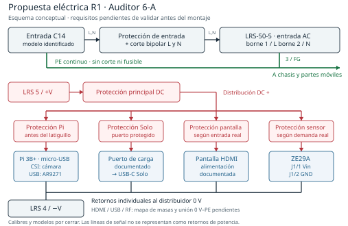

# Auditoría eléctrica integral del alcoholímetro

**Auditor 6-A · 21 de octubre de 2026 · Revisión 1**

Repositorio: [GuillermoAladro/Alcoholimetro](https://github.com/GuillermoAladro/Alcoholimetro). Base examinada: `84be97669a9efec43e79b3dadc4af5e87458c41a`, rama `main`. Documento de conexiones principal: `MONTAJE-GENERAL.md`. Esta auditoría es una entrega independiente: no sustituye silenciosamente las fichas originales ni certifica un equipo físico.

## 1. Dictamen

**NO APTO para montar y dar por validado siguiendo indistintamente los documentos actuales.** La arquitectura Pi + ZE29A + pantalla + Solo es viable en principio, y el mapa UART del documento principal es coherente. Sin embargo, hay errores documentales capaces de producir conexiones peligrosas, decisiones eléctricas pendientes y fallos reproducidos en el ejemplo de recepción UART. No hay evidencia suficiente para afirmar que la máquina completa funciona.

El problema más grave está confirmado: la ficha de la LRS-50-5 invierte los números de entrada de red y salida de continua. `MONTAJE-GENERAL.md` y el dibujo del fabricante sí dan los números correctos. Seguir la tabla equivocada puede conectar 230 V a los bornes de salida de 5 V. También es incorrecto interpretar el dibujo provisional del C14 como esquema ejecutable.

He reconstruido las 29 conexiones W1-W29, ejecutado un modelo eléctrico resistivo de las cuatro ramas, contrastado documentos originales y probado funciones del ejemplo UART. **No he montado físicamente el circuito, no he conectado los componentes ni he medido tensiones reales.** No hay acceso a hardware, osciloscopio, carga electrónica o banco de seguridad en este entorno. Los resultados numéricos son pruebas de modelos y de código, identificadas como tales.

La corrección propuesta reduce los riesgos y pasa los escenarios DC indicados bajo sus hipótesis. Sigue pendiente validar protección, transitorios, carga USB, tierra, temperatura y medición de alcohol. No se emite un certificado eléctrico, de conformidad ni de precisión metrológica.

**Actualización antes de publicar:** durante la entrega apareció el commit [7326593 de Auditor 6.1-S](https://github.com/GuillermoAladro/Alcoholimetro/commit/73265933dc0953665b8d8ea4e7f5619c7a8e5619). He comprobado su corrección del orden de bornes en las fichas de fuente/cable y en pendientes. A6A-01 queda corregido documentalmente en esos textos; el cotejo físico y los restantes cierres siguen pendientes. Esta auditoría conserva como evidencia la base `84be976`, a la que corresponden sus 234 archivos y líneas. La auditoría añadida por 6.1-S no está incluida en ese inventario ni se presenta aquí como revisada íntegramente.

## 2. Alcance, cobertura y trazabilidad

Se ha fijado una instantánea del árbol completo de la rama principal, sin incluir todas las revisiones históricas de Git. El inventario adjunto identifica cada archivo por ruta, tamaño, SHA-256 y hash Git. El repositorio contiene **234 archivos**: 69 Markdown, 150 PDF, 4 ZIP, 4 PNG, 4 SVG, un DXF, un XLSX y un script de descarga. No hay firmware de aplicación, netlist EDA, modelos SPICE de las placas ni registros de ensayos físicos.

Se revisaron el montaje, las cuatro figuras, la lista de compra, los pendientes y las 31 fichas, con distribución del contraste técnico por alimentación, señales y periféricos. Se extrajo el texto de las 1.541 páginas de PDF exteriores y de 2.212 páginas PDF dentro de ZIP: 3.753 páginas en total, sin descontar duplicados. Se inventariaron 58 miembros de los cuatro ZIP. No hubo error de apertura; 19 páginas de PDF exteriores tienen menos de 60 caracteres extraíbles. Se abrieron la BOM XLSX y los datos geométricos disponibles. El script `descargar.sh` se trató como texto, sin ejecutarlo.

**Límite de la lectura:** inventario íntegro y extracción completa no significan lectura semántica de cada párrafo de miles de páginas de normas y catálogos, ni inspección visual de cada página o entidad STEP. La revisión técnica de esos documentos se centró en lo pertinente al circuito; las páginas gráficas decisivas se comprobaron visualmente. Los anexos de cobertura registran este límite y los archivos con poca o ninguna capa de texto. No sería veraz afirmar una lectura visual exhaustiva de absolutamente todo ese material.

Las fichas incluyen datos de productos de referencia y fuentes secundarias que no identifican necesariamente el artículo Amazon comprado. Un datasheet de otro conector USB, otra pantalla o un material PA66 no certifica el ASIN del proyecto. Los enlaces externos listados en `enlaces.md` tampoco son documentos locales leídos por el mero hecho de figurar allí.

No constan en esta instantánea `diseno-cajon-A.md`, `decisiones-diseno.md`, `cajon/specs.py`, la guía de montaje v2 original ni `Lista_de_piezas.xlsx`. Su contenido solo se conoce por citas en los archivos presentes. Se evalúa como base el cableado W1-W29 existente y, por separado, los cambios de diseño A descritos en §6.3.

### Entregables reproducibles

- Este informe en Markdown y PDF, firmado **Auditor 6-A**, y diagrama vectorial `esquema-r1.svg`.
- `modelo_dc.py`, `resultados_dc.json` y `conexiones_originales.csv`: reconstrucción documental y análisis de tensión.
- `pruebas_uart.py` y `resultados_uart.json`: reproducción de fallos y parser de referencia corregido, sin controlar hardware.
- `inventario_archivos.csv` e `inventario_archivos.json`: cobertura, hashes y miembros de archivos comprimidos.
- `anexos/`: revisiones técnicas independientes con referencias de líneas, páginas y límites de lectura.

## 3. Circuito reconstruido y qué sí es coherente

El camino nominal es: red → C14 y protección de entrada → fuente aislada → dos distribuidores de continua → cuatro cargas. PE se distribuye aparte a las partes metálicas. La cámara y el adaptador Wi-Fi reciben energía desde la Pi y forman parte del consumo de su rama.

| Interfaz | Conexión correcta de referencia | Resultado de auditoría |
|---|---|---|
| LRS-50-5, bornes numerados | 1 AC/L; 2 AC/N; 3 FG; 4 DC −V; 5 DC +V | Confirmado en dibujo del fabricante; ficha individual contradictoria |
| ZE29A, J1 | 1 Vin; 2 GND; 3 TXD; 4 RXD | Confirmado en manual V1.1; verificar orientación y conector de la pieza recibida |
| UART | Pi físico 8/GPIO14 TX → ZE29A 4 RX; ZE29A 3 TX → Pi físico 10/GPIO15 RX | Coherente a 9600 baudios, 8N1, lógica 3,3 V |
| Referencia UART | Pi GND y ZE29A GND unidos mediante retornos de alimentación | Existe en el esquema; depende de continuidad de ambos retornos |
| Botón del diseño base | Contacto seco entre físico 11/GPIO17 y físico 9/GND | Coherente con entrada y pull-up; LED separado y sin alimentar |
| Cámara | CSI de Pi → FFC 15 contactos → Camera Module 3 | Coherente; la cámara recibe 3,3 V por CSI, no una rama externa de 5 V |
| Pantalla | HDMI desde Pi; alimentación independiente por USB-C | Arquitectura coherente, características de placa/USB por confirmar |
| AR9271 | Puerto USB de Pi y coaxial hacia antena exterior | Coherente; consume de la rama Pi y puede cerrar unión de masa al chasis |
| Solo | Alimentación separada; cobro por red | No necesita cable de datos a Pi; alimentación y software aún sin validar |
| WAGO | Una regleta para positivo y otra para retorno; todos los contactos de cada una al mismo potencial | Correcto; la borna no proporciona protección individual |

La tabla no autoriza colocar cables basándose en una vista especular o en colores. La numeración debe cotejarse con la serigrafía de cada pieza y su plano correspondiente.

## 4. Hallazgos y soluciones

Severidades: **crítica**, puede inducir daño grave al seguir la documentación; **alta**, impide dar por válido el sistema o una protección; **media**, reduce fiabilidad o deja una especificación sin cerrar. «Confirmado» se refiere al documento o a la prueba realizada, nunca a una avería física no observada.

### A6A-01 · Crítica · Numeración peligrosa de la fuente

**Confirmado en la base auditada; corrección documental posterior indicada en §1.** `componentes/meanwell-lrs-50-5/README.md`, líneas 74 y 113, asigna 1=−V, 2=+V, 3=FG, 4=AC/L y 5=AC/N. Repite el orden en su discusión de bornes. El dibujo LRS-50 de 2025, página 4, asigna **1=L, 2=N, 3=FG, 4=−V, 5=+V**. `MONTAJE-GENERAL.md`, W4/W5/W11/W12 y §5.1, coincide con el fabricante.

**Consecuencia:** riesgo de aplicar red a la salida DC al seguir la ficha. **Solución:** reemplazar todas las tablas y descripciones derivadas por el mapa correcto, mantener la separación AC/DC y añadir la vista y orientación del fabricante. Actualizar también la ficha del cable 0,75 mm², que reproduce el orden equivocado. **Cierre exigido:** búsqueda global sin contradicciones y cotejo independiente de cada borne antes de conectar red. La presente auditoría conserva el original como evidencia; no debe utilizarse su tabla errónea.

### A6A-02 · Crítica · C14 sin esquema identificado y dibujos engañosos

**Confirmado documentalmente.** El C14 comercial no tiene esquema interno confirmado. En `componentes/modulo-c14-fusible-interruptor/README.md`, dibujo de §4.2, la unión gráfica entre las líneas L? y N? puede leerse como cortocircuito. `MONTAJE-GENERAL.md`, §2.A, describe un interruptor de cuatro terminales con dos polos y lámpara en «otros terminales»: esa descripción no identifica el componente. Un DPST iluminado de cuatro terminales puede tener lámpara interna compartiendo conexiones; SCI R13-117 es un contraejemplo documentado.

**Solución:** retirar ese dibujo como guía de montaje y usar un conjunto bipolar con plano del fabricante y terminales identificados. Verificar continuidad en frío y trazabilidad del fusible; una lectura OL no identifica por sí sola un neón. No aceptar como opción de auditoría «asumir el riesgo» de corte monopolar con Schuko reversible. El bipolar tampoco convierte el interior en seguro para trabajar: hay bornes anteriores al interruptor. **Cierre:** plano del modelo exacto, matriz de contactos y comprobación independiente. PE permanece continuo, sin interruptor ni fusible. No se exige indiscriminadamente un segundo fusible: la coordinación corresponde al diseño documentado.

### A6A-03 · Alta · Las ramas y el troncal DC no están protegidos de forma demostrada

**Confirmado en el diseño base; parcialmente atendido en A.** W11-W18 carecen de protección por rama. La LRS tiene 50 W nominales y protección por sobrecarga de 110-150 % de potencia con modo de reintento. A 5,2 V, 55-75 W equivalen a 10,58-14,42 A como referencia; no es una curva garantizada de corriente de cortocircuito. El fusible AC de entrada no sustituye las protecciones de cableado DC.

Diseño A añade fusibles 3/3/3/2 A, pero faltan fabricante, curva, capacidad de corte DC, pérdidas, corriente de arranque y coordinación con el modo de reintento de la fuente. Su suma, 11 A, no protege automáticamente un troncal citado para 6 A (esa cifra procede de una categoría de instalación de la tabla Bayka, no acredita cualquier cable genérico); una suma de calibres tampoco es consumo real.

**Solución:** protección principal junto a +V y protección de cada rama antes de reducir sección; valorar distribución electrónica con limitación y desconexión sostenida, además de protección de los cables. Seleccionar valores con corrientes medidas y curvas, no solo con la etiqueta «3 A». Un troncal de cobre documentado de 1,5 mm² y corto es una propuesta de reducción de caída, no prueba de capacidad térmica en la caja. **Cierre:** ensayo controlado de sobrecarga/corto en banco con cargas ficticias y verificación de selectividad, temperatura y recuperación.

### A6A-04 · Alta · Ajustar a 5,20 V no garantiza margen superior

**Confirmado como insuficiencia de margen.** El texto §4.3 ajusta 5,20 V en la fuente sin carga; figura 1, SVG línea 50, pide ajustar 5,20 V midiendo en la Pi. Son instrucciones diferentes. Compensar toda la caída de la Pi puede elevar más la tensión de las demás cargas.

Con las especificaciones de regulación de línea 0,5 %, carga 1 % y coeficiente térmico 0,03 %/°C, una envolvente conservadora de 25 a 50 °C es `5,20 × (1+0,005+0,010+0,0075) = 5,317 V`, antes de rizado. No se suma además ±2 %, porque esa tolerancia ya incluye ajuste/línea/carga. Es un escenario de márgenes, no una predicción ni una medida. Supera el techo de proyecto 5,25 V y el máximo publicado 5,3 V del ZE29A.

La nota 7 de LRS-50 permite rizado fuera de especificación entre 0 y 50 % de carga para las variantes 3,3/5 V. El consumo típico de la guía, 2,3 A, cae en ese intervalo. La OVP de la fuente, 5,9-7,3 V, no protege por sí sola al sensor frente a un exceso sobre 5,3 V.

**Solución:** empezar la ingeniería con 5,10 V en la fuente, reducir resistencias y medir mínimos/máximos en todas las cargas, con osciloscopio y estados de carga. Cambiar la fuente o añadir regulación/protección adecuada si no cumple; no elevar el trimmer para ocultar una caída. 5,10 V es candidato, no ajuste ya aprobado. 5,25 V se mantiene como límite de proyecto conservador, no como afirmación universal de todas las revisiones USB.

### A6A-05 · Alta · Alimentación del Solo y pantalla no validada por «puente USB»

**Pendiente funcional con supuestos documentales incorrectos.** El puente D+/D− identifica un puerto de carga de tipo DCP bajo condiciones de BC1.2, pero no demuestra que el Solo cargue correctamente ni que el borne soporte sus picos. BC1.2 distingue corriente nominal del DCP de 0,5-5 A y límite del dispositivo consumidor `IDEV_CHG=1,5 A`; no procede decir que todo DCP o todo USB-A solo soporta 1,5 A. La capacidad depende del componente exacto.

El cable legacy A-C requiere Rp de 56 kΩ ±5 %. Tener 480 Mbit/s y 5 V no demuestra que el extremo opuesto sea A: también existen C-C con USB 2.0. La inferencia del resumen de anuncios sobre #10 no cierra la compra. Dejar el tornillo S sin conectar no demuestra blindaje flotante; Type-C prescribe uniones SHIELD-GND en los plugs legacy pertinentes. La ficha de pantalla reconoce que 0,5 A y 5,25 V proceden de Waveshare 7 C, no de la GeeekPi comprada; faltan identificación de placa, pico de arranque y rango de tensión.

También debe corregirse el diagnóstico de la ficha del borne USB-A, líneas 344/375: que la corriente no cambie con y sin puente no demuestra que el dispositivo no lo use. Hay que repetir detección desconectando, controlar batería, temperatura y demanda, y verificar D+/D−. «Sin cambio» es inconcluso sobre el protocolo.

**Solución:** usar puerto/módulo de carga documentado y protegido, cable identificado y conectores con corriente nominal conocida; priorizar la alimentación recomendada por el fabricante si la alternativa no queda validada. **Cierre:** comprobar carga sostenida del Solo con batería baja y alta, operación/cobro, temperatura y ausencia de reinicios; en pantalla, brillo máximo y arranques. Los 2 A y 0,5 A actuales son escenarios, no máximos certificados.

### A6A-06 · Alta · Masa flotante y tierra se contradicen

**Confirmado como contradicción.** W26 indica malla del RP-SMA unida al techo a PE; §4.12 exige circuito abierto entre Pi GND y caja. El camino USB/adaptador/coaxial puede cerrar esa unión. HDMI añade otra conexión de masa Pi-pantalla. Los separadores de nylon solo eliminan el camino mecánico local: no aíslan los cables.

**Solución:** documentar un mapa de continuidad de chasis, carcasas de conectores y 0 V. Para conservar 0 V flotante, aislar mecánicamente el pasamuros RF y verificar las demás rutas; si se adopta unión funcional 0 V-PE, definirla y revisar EMC y corrientes de retorno. Ninguna elección permite quitar PE de las partes metálicas que lo requieren. Sustituir la exigencia genérica «todo montado debe dar abierto» por un criterio coherente con la arquitectura elegida. **Cierre:** mapa medido por etapas, sin confundir continuidad DC con impedancia de alta frecuencia o corrientes capacitivas.

### A6A-07 · Alta · Fallo de un retorno o una rama puede alimentar por señales

**Riesgo de integración sin caracterizar.** El negativo de W13 no es el único retorno posible: HDMI y otras conexiones comparten masas. Si se abre ese negativo, puede circular retorno por un cable de señal. Abrir solo el positivo de Pi o ZE29A deja TX/RX conectados a un equipo aún alimentado; no se ha probado la tolerancia de entrada sin alimentación. No se dispone del esquema real de la pantalla, por lo que no se puede afirmar ni descartar alimentación inversa por +5 V HDMI.

**Solución:** apagado conjunto para manipular interconexiones y mantenimiento; estudiar buffers UART con especificación Ioff si se requiere independencia de ramas; asegurar conectores de retorno y rutas de corriente. La protección de ramas sigue siendo necesaria, pero hay que ensayar el estado cuando una se abre. **Cierre:** ensayo limitado en corriente de combinaciones de alimentación y retornos, con interconexiones previstas, sin utilizar pistas HDMI/UART como protección ni como retorno de potencia.

### A6A-08 · Alta · Dos diseños no equivalentes y fuentes de decisión ausentes

**Confirmado.** §6.3 cambia fusibles, botón, longitudes FFC, reparto PE, ubicación y red. La figura 2 desactiva el Wi-Fi interno, mientras diseño A necesita a la Pi como punto de acceso y al AR9271 como salida. La lista de compra no incluye todos los elementos de A. En figura 4 se escribe chapa de 1,5 mm mientras las fichas mantienen el espesor pendiente.

**Solución de esta auditoría:** tomar W1-W29 como base auditable y tratar A como variante no liberada; la propuesta R1 siguiente conserva las interfaces de esa base y añade requisitos de seguridad. Antes de fabricar, incorporar al Git el diseño elegido, su BOM y planos, sincronizando figuras y configuración. No mezclar medidas de la base con fusibles y red de A. **Cierre:** una revisión única y controlada con rutas, longitudes y secciones.

### A6A-09 · Alta · Parser UART de ejemplo pierde respuestas válidas

**Reproducido sin hardware.** Las funciones del ejemplo en `componentes/winsen-ze29a/README.md` usan lecturas que suponen una trama completa tras encontrar `0xFF`. Una lectura fragmentada o un `0xFF` espurio delante de una trama válida hace perder datos. Además, el flujo de ejemplo solicita 0x86 tras iniciar prueba sin implementar la espera indicada solo en un comentario y puede acceder a `f[2]` cuando `f` es `None`.

Las 18 tramas/comandos de referencia contrastados tienen checksum correcto. El problema reproducido es de recepción y estados, no del cableado ni del sensor real. **Solución:** buffer persistente, resincronización de un byte, validación de cabecera, longitud, checksum y comando/estado, timeout y control explícito de `None`. El anexo incluye un parser de referencia y pruebas de fragmentación/ruido. No es una aplicación completa ni reemplaza la máquina de estados del ensayo. **Cierre:** ejecutar la batería, después capturas UART reales y estados de calentamiento, insuficiente soplido, fin, error y reintento.

### A6A-10 · Alta · No hay programa integral que pueda probarse

**Confirmado en el árbol Git.** Los directorios `firmware/`, `hardware/`, `carcasa/` y `docs/` anunciados en README no están implementados en esta base. Hay ejemplos en fichas, no una aplicación instalable que coordine cobro, soplido, foto, resultado y recuperación. No puede ejecutarse una prueba extremo a extremo del producto desde este repositorio.

**Solución:** incorporar firmware/aplicación y configuración versionados, con simuladores de dependencias para fallos y un procedimiento real de despliegue a Pi. Bloquear el resultado de alcohol cuando haya trama inválida, calentamiento o soplido insuficiente. Registrar identificador de operación y evitar cobros duplicados al reintentar tras perder red. **Cierre:** pruebas con mocks, luego integración con equipos y entorno de pago de pruebas. Esta auditoría no realiza cobros.

### A6A-11 · Alta · La neumática impide validar la medida aunque haya UART

**Confirmado como especificación incompleta.** W28 solo dice boquilla → toma de aire. El manual ZE29A V1.1, página 10, prescribe orden de detección y muestreo y una barrera adecuada; la variante A menciona una T de presión, reductor, T de alcohol y escape, pero no demuestra caudal, presión, dimensiones ni comportamiento con condensación.

**Solución:** definir un conjunto neumático conforme a la revisión concreta del módulo, con material y geometría documentados; validar primero detección de soplido y después concentración con patrones trazables. Evitar condensados sobre electrónica y materiales que alteren la muestra. **Cierre:** resultados de blanco, repetibilidad, referencias de alcohol, soplido insuficiente, limpieza y envejecimiento. Que responda un número por UART no valida su concentración ni un uso para decidir si conducir.

### A6A-12 · Alta · Seguridad de red y PE requiere un expediente del producto

**No demostrada por continuidad a baja corriente.** El objetivo 0,1 Ω y el rango «10 a 25 A» aparecen sin un procedimiento de producto cerrado: puntos, duración, compensación de puntas, norma aplicable y equipos sensibles que deben separarse. Cinco ojales, una soldadura y un faston de un cajón requieren verificación mecánica; añadir un segundo espárrago no basta por sí solo.

**Solución:** caja de red con barrera y retención de conductores, bornes inaccesibles, entrada fijada y PE dedicado a las piezas móviles. Identificar normas y procedimiento de ensayo aplicables al equipo completo con un profesional competente. Un puente PE desmontable debe conservar integridad durante el uso y mantenimiento previsto. No adoptar mínimos de instalaciones fijas como prescripción automática de conductor interno de producto, ni aplicar una prueba de aislamiento indiscriminada con placas conectadas. **Cierre:** inspección y ensayos de protección, aislamiento/corriente de contacto según procedimiento pertinente, documentados por persona competente antes de operar a 230 V.

La ficha del cable 0,75 mm², línea 381, confunde tocar FG con poner 230 V en la regleta: FG es tierra funcional/protectora de la fuente, no fase. Un contacto con FG altera la referencia de masa; el peligro de aplicar red corresponde a L/N. También deben retirarse como criterios de aceptación los ensayos caseros de llama, olor u horno doméstico: no acreditan aislamiento, material, RoHS ni comportamiento de incendio.

### A6A-13 · Media · Punteras, crimpado y WAGO no son intercambiables

WAGO 221 admite cobre flexible sin puntera y prescribe pelado de 11 mm. Una puntera de 8 mm elegida para otro borne no garantiza la inserción requerida. La crimpadora de punteras de la lista no demuestra compatibilidad con faston, ojales, JST ni Dupont. Los extremos preestañados de latiguillos merecen preparación conforme al borne, no asumir que equivalen a una puntera.

**Solución:** tabla de terminaciones por fabricante, sección, longitud de contacto y matriz/herramienta; usar flexible pelado conforme a WAGO cuando proceda. Fijar las regletas y comprobar retención, caída de tensión y calentamiento. No imponer cifras de extracción de terminales de otro fabricante como certificación del lote. **Cierre:** muestras crimpadas inspeccionadas y ensayo conforme a la especificación real.

### A6A-14 · Media · Dimensiones y protección mecánica sin cierre

La ficha de tornillería, líneas 187/197, propone provisionalmente 3 mm de penetración lateral y 5 mm en base. El plano LRS-50 p.4 indica lo contrario: base 99×82 mm, `L=3.0`; lateral 99×30 mm, `L=5`. Debe corregirse antes de elegir tornillos; se trata de penetración, no longitud total. Grosor de chapa, fijaciones del sensor, conector JST exacto, orientación del FFC y recorridos de cables siguen pendientes. Un pasacables de borde no reemplaza un anclaje de tracción ni una barrera eléctrica. El separador de nylon tampoco evita un puente si dos tornillos metálicos se tocan dentro.

**Solución:** plano de montaje dimensionado, topes de profundidad para fijaciones, protección en ranuras rectangulares y holgura controlada en cajón. Para FFC, probar primero la cinta oficial corta y validar después la longitud elegida. No deducir una pieza concreta de una foto o del nombre «XH». **Cierre:** inspección dimensional y pruebas de movimiento/retención sin alimentación antes de energizar.

La misma ficha de tornillería, línea 330, traslada pares de la tabla imperial UNC de Nord-Lock a tornillos M3/M4/M5 porque comparten referencia de arandela. La tabla de página 10 corresponde a #5-40, #8-32 y #10-24; no es una tabla métrica. Deben usarse rosca, material, lubricación y unión reales para fijar el par. El anexo mecánico documenta además errores al medir paso de rosca y al convertir un ejemplo geométrico en espesor de chapa.

### A6A-15 · Media · Consumos y tolerancias presentados con demasiada certeza

`MONTAJE-GENERAL.md` dice «La Pi no alimenta nada», aunque sí alimenta cámara y AR9271. W16 concluye que no hay problema de corriente por estimar 0,5 A en la pantalla. Ninguna de estas frases constituye presupuesto de potencia. La fuente tiene que disipar pérdidas además de alimentar cargas; 50 W nominales no equivalen a 50 W térmicos disipados en la caja. Si se ajusta a 5,20 V, respetar 50 W equivale a 9,615 A, no 10 A continuos: tampoco debe olvidarse la reducción por temperatura.

**Solución:** presupuesto por estados con cámara/Wi-Fi dentro de la rama Pi, Solo con batería baja, brillo máximo y arranque simultáneo. Dimensionar con márgenes y temperatura real. La reducción de potencia de LRS depende de orientación y temperatura; para la curva horizontal a 230 V hay reducción por encima de 50 °C. **Cierre:** corriente, tensión y temperatura registradas en caja cerrada, incluyendo arranques y uso prolongado.

### A6A-16 · Media · Persistencia y recuperación no ensayadas

Una microSD «High Endurance» no resuelve cortes durante escritura. `vcgencmd get_throttled=0x0` es una comprobación útil del estado de la Pi, no una medida de la tensión de otras cargas, de todos los transitorios o de la seguridad eléctrica.

**Solución:** limitar escrituras, usar sistema de archivos de solo lectura cuando proceda, separar datos persistentes y prever apagado/recuperación. Registrar arranque, sensor, red y estado de cobro; comprobar bits actuales e históricos tras el ensayo. **Cierre:** ciclos de arranque y recuperación controlados con integridad de datos y sin estados de cobro duplicados.

## 5. Pruebas ejecutadas y resultados

### 5.1 Modelo eléctrico construido

Se implementó una red nodal resistiva con fuente ideal, resistencia de positivo y retorno del troncal, y cuatro ramas con su cable, contacto y carga de corriente constante. En el barrido principal se conservaron separados los retornos para calcular desplazamientos de masa: corresponde a una estrella idealizada, sin los caminos paralelos de HDMI/USB/RF del ensamblaje. Se añadieron seis escenarios específicos con retorno HDMI para estudiar ese efecto. La lista de conexiones se extrajo de W1-W29 con número de línea; no se inventaron medidas del montaje.

Cada solución nodal se comparó con una ecuación independiente de circuito en estrella:

`V_carga = V_fuente − I_total × R_troncal_lazo − I_rama × R_rama_lazo`

Se verificó conservación de corriente tanto en positivo como en retorno. **112 circuitos** cumplen ambas comprobaciones con diferencia inferior a 10⁻⁹. Esto valida la implementación matemática del modelo, no la máquina.

Resistencias de referencia a 20 °C: cobre flexible 0,75 mm², 26 mΩ/m; 1,5 mm², 13,3 mΩ/m, de tabla LAPP T11. AWG22: 53 mΩ/m como valor de referencia usado en el análisis. Coeficiente térmico del cobre supuesto: 0,00393/K. Contactos, longitudes y consumos son hipótesis editables. No son mediciones de las piezas Amazon.

Barrido de 108 escenarios: troncal 0,25/0,5/1 m; 20/60 °C de temperatura del conductor; resistencia total de contactos por rama 20/100/200 mΩ; fuente 5,08/5,20 V; y tres repartos de corriente. Los dos primeros son los estimados por las fichas (2,3 A típico, 5 A pico). El tercero reserva 2,5 A para la rama Pi y suma 5,5 A; es escenario de diseño, no consumo máximo medido. En todos se modelan 4 mΩ adicionales en el lazo de troncal.

**51 de 108 escenarios** salen del objetivo de proyecto 4,75-5,25 V en alguna carga. Esa fracción no es una probabilidad de fallo: las hipótesis no son una distribución estadística ni un muestreo de piezas. Demuestra sensibilidad al tendido y al contacto.

| Escenario | Pi (V) | Solo (V) | Pantalla (V) | ZE29A (V) | Interpretación |
|---|---:|---:|---:|---:|---|
| Base, 5,20 V; troncal 0,5 m; 20 °C; contactos 40 mΩ; total 5 A | 4,938 | 4,875 | 5,006 | 5,022 | Compatible con ventana de ingeniería en este caso |
| Base desfavorable: 5,08 V; 1 m; 60 °C; contactos 200 mΩ; 5 A | 4,322 | 4,249 | 4,632 | 4,650 | Caída excesiva; no prueba que esas resistencias existan |
| Propuesta: 5,10 V; troncal 1,5 mm²/0,25 m; 20 °C; contactos 40 mΩ; 5,5 A | 4,902 | 4,867 | 4,998 | 5,013 | Pasa condicionalmente |
| Misma propuesta, 60 °C y fuente 5,009 V | 4,799 | 4,755 | 4,897 | 4,915 | Pasa con margen pequeño en Solo; no basta para liberación |

Para la propuesta se supuso regulación residual ±1 % y rizado ±40 mV: máximo 5,191 V, mínimo 5,009 V. **Es una exigencia a validar, no una garantía de la LRS**, particularmente por su nota de baja carga. Las ramas Solo/pantalla modelan 0,30 m de cable 0,75 mm² y 0,30 m AWG22; la Pi/sensor, 0,15 m AWG22. La caída de fusibles, módulos de carga y conectores debe caber en el presupuesto de resistencia o añadirse al modelo.

### 5.2 Sobrecarga y desconexión

Un lazo de 0,5 m de tendido 0,75 mm² al máximo de resistencia de referencia tiene 26 mΩ: disipa 0,65 W a 5 A y 3,744 W a 12 A. Esto es potencia eléctrica, **no temperatura calculada**. Falta un modelo térmico del tendido, del aislamiento y del ciclo de reintento. No se ha demostrado que un fusible abra antes de una temperatura peligrosa ni que el resto del sistema sobreviva a una rama en corto.

Se ejecutaron además seis escenarios de retorno HDMI: resistencia hipotética de 0,05/0,2/1 Ω, con retorno Pi intacto o abierto. Se conserva KCL en los seis; al abrir el retorno Pi, sus 2 A impuestos circulan por la masa HDMI en este modelo. Esto demuestra el camino alternativo si existe la continuidad interna supuesta; no predice que una Pi real siga consumiendo 2 A tras caer su tensión. La resistencia real y las corrientes son ensayos pendientes. Total: 118 soluciones DC, 112 de estrella y 6 con retorno paralelo.

No se ha simulado el interior de la LRS, la lámpara/interruptor C14, el cargador del Solo, el convertidor de pantalla, señales de alta velocidad CSI/HDMI ni la química del sensor. Presentar curvas SPICE genéricas de esos dispositivos como validación de estas placas sería engañoso.

### 5.3 Comunicación del sensor

Se comprobaron 18 checksums de referencia y se ejecutó el receptor de ejemplo contra un puerto serie simulado. Original: 5/8 escenarios correctos; referencia corregida: 8/8. Fallan el prefijo `0xFF` adicional, una lectura parcial y un comando inesperado antes del esperado. La lectura parcial representa un timeout antes de disponer de los ocho bytes, no el fraccionamiento UART normal que una lectura bloqueante completa. El parser de referencia adjunto conserva el buffer, resincroniza y valida checksum; la salida JSON documenta los casos positivos y negativos. No se envió un solo byte a un sensor real.

### 5.4 Estado de validación

| Verificación | Estado | Evidencia |
|---|---|---|
| Inventario y hashes del árbol base | Ejecutada | Inventario adjunto, sin omitir formatos binarios |
| Reconstrucción W1-W29 | Ejecutada | CSV extraído, 29 identificadores únicos |
| Numeración de fuente contra plano | Error confirmado en ficha | PDF LRS p.4, contraste visual |
| Mapa UART nominal | Coherente documentalmente | Winsen J1 y esquema reducido Pi |
| Cálculo DC y comprobación independiente | Ejecutada | 112 casos de estrella y 6 con retorno HDMI; 118 soluciones |
| Receptor UART de ejemplo | Fallos reproducidos; referencia corregida probada | Script y JSON UART |
| Continuidad, PE, aislamiento, polaridad real | No ejecutada | Requiere montaje y herramientas |
| Transitorios, rizado, protección y USB real | No ejecutada | No hay modelos ni medidas de equipos |
| Aplicación, pago, cámara y soplido integrados | No ejecutada | No hay implementación integral en Git |
| Exactitud de concentración de alcohol | No ejecutada | Requiere patrones, procedimiento y neumática |

## 6. Propuesta eléctrica R1 para cerrar el diseño

Esta es una especificación de corrección auditable, no un plano de fabricación liberado. Conserva las cuatro ramas y las interfaces del documento principal. No se asignan patillas físicas al C14 sin plano del modelo exacto.

```text
RED: C14 documentado -> protección entrada + corte bipolar -> LRS 1/L y 2/N
PE:  C14 PE -> distribución PE dedicada -> FG/3, chasis y piezas móviles
DC+: LRS 5/+V -> protección principal -> distribuidor positivo
       -> protección Pi       -> micro-USB Pi -> cámara CSI y AR9271 USB
       -> protección Solo     -> puerto de carga documentado -> USB-C Solo
       -> protección pantalla -> entrada de alimentación documentada
       -> protección sensor   -> ZE29A J1/1 Vin
DC0: LRS 4/-V -> distribuidor retorno -> cada retorno de carga
UART: Pi físico8 TX -> ZE29A J1/4 RX; J1/3 TX -> Pi físico10 RX
HDMI: Pi -> pantalla. CSI: Pi -> cámara. Antena: AR9271 -> RP-SMA
0V-PE: política explícita + mapa de continuidad; nunca retirar PE para aislar 0V
```



### 6.1 Lista de cambios por conexión

| Conexiones | Acción en R1 | Condición de cierre |
|---|---|---|
| W1 | Conservar cordón trazable y entrada fija al compartimento de red | Identificación, retención y acceso a desconexión |
| W2-W5 | Redibujar con C14 bipolar documentado; salida a LRS 1/L y 2/N | Plano y matriz de continuidad; sin puentes L-N |
| W6-W10 | Distribución PE dedicada, unión a panel/cajón/caja según diseño elegido | Procedimiento de seguridad y resistencia/retención verificadas |
| W11-W12 | Troncal corto y documentado; positivo protegido; retorno identificado | Caída, capacidad térmica y coordinación de protección |
| W13 | Rama Pi protegida antes del latiguillo; micro-USB 1 VBUS/5 GND | Polaridad y tensión bajo carga; cámara/Wi-Fi incluidos |
| W14-W15 | Puerto de carga trazable para Solo; cable A-C confirmado o solución C-C compatible | Carga real, CC y corriente/temperatura de conectores |
| W16-W17 | Puerto/alimentación compatible con pantalla exacta | Brillo máximo, arranque y cable retenido |
| W18 | Protección específica de sensor; Vin/GND por posición verificada | Paso y pinout de conector, tensión y consumo de arranque |
| W19-W20 | Mantener cruce TX-RX de 3,3 V; validar estados sin alimentación | UART libre de consola, parser y estados, referencia común |
| W21-W22 | Conservar botón en base; eliminar solo si diseño A queda liberado | Contacto seco correcto, pull-up, antirrebote y función de inicio |
| W23 | Conservar HDMI; incluir masas en mapa de retorno | Probar alimentación parcial y evitar retorno de potencia por señal |
| W24 | Empezar con cable oficial corto; validar longitud final y orientación | CSI funcional sin errores y fijación mecánica |
| W25 | AR9271 en Pi, incluido en presupuesto de esa rama | Enumeración estable, consumo y reconexión |
| W26 | Pasamuros y política de unión a PE definidos | Continuidad/aislamiento coherente, no criterio contradictorio |
| W27 | Sistema y datos en microSD con recuperación documentada | Arranques y cortes controlados, sin corrupción |
| W28 | Sustituir indicación genérica por plano neumático del ZE29A | Presión, muestra, barrera y condensación validadas |
| W29 | Fijar red de base o de A y configuración reproducible | Recuperación de Wi-Fi/API sin cobros duplicados |

### 6.2 Material y especificaciones que faltan

Añadir al expediente: entrada/interruptor bipolar con esquema; protección principal y cuatro protecciones DC con curvas o módulos de limitación; distribución y soportes fijados; puerto de carga compatible y documentado; cableado de cobre trazable y longitudes; terminales y herramientas adecuados; protección de bornes y segregación de red; conexiones PE y elementos neumáticos del diseño elegido. No se compra ni se recomienda un ASIN nuevo sin verificar sus especificaciones.

Los fusibles 3/3/3/2 A de A se conservan como **valores propuestos por el documento**, no valores aprobados por Auditor 6-A. No se sustituye esta ingeniería por poner un fusible más grande si aparece un disparo.

## 7. Matriz de los 31 componentes

La revisión de cada carpeta aporta contexto, pero el estado del lote físico sigue pendiente. «Coherente» significa compatibilidad documental de la función, no aceptación del artículo recibido.

| # | Componente | Juicio y acción principal |
|---:|---|---|
| 1 | Pi 3B+ | Coherente; presupuesto con CSI/USB, UART y recuperación (07,09,10,15,16) |
| 2 | microSD High Endurance | Coherente; no garantiza cortes de energía (16) |
| 3 | Camera Module 3 | Compatible documentalmente; alimentación CSI y software actual (10,14,15) |
| 4 | FFC 50 cm | Tipo/orientación y longitud final por validar (08,14) |
| 5 | Pantalla HDMI | Placa exacta, consumo y alimentación parcial sin verificar (05,07,15) |
| 6 | ZE29A | Pinout coherente; UART, secuencia, alimentación y muestra pendientes (04,07,09,11) |
| 7 | JST-XH de 4 vías | Paso/marca/orientación no demostrados por foto (14) |
| 8 | Tubo silicona | No basta diámetro nominal; validar neumática y material (11) |
| 9 | SumUp Solo | Alimentación y flujo de cobro sin ensayo (05,10) |
| 10 | Cable USB acodado | Extremos y Rp no confirmados (05) |
| 11 | Pulsador | Función eléctrica coherente; medir contacto, LED sin conectar (08,14) |
| 12 | AR9271 | Coherente; identidad del adaptador, presupuesto y red (06,08,15) |
| 13 | RP-SMA 30 cm | Conectores y continuidad al chasis deben cerrarse (06,14) |
| 14 | LRS-50-5 | Corregir error de bornes; margen/rizado/protección (01,03,04,15) |
| 15 | C14 con interruptor | Bloqueante hasta identificar o sustituir (02,12) |
| 16 | T2,5 A 5×20 | Curva, capacidad de corte e inrush pendientes (02,03) |
| 17 | Schuko-C13 | Reversible; no permite suponer fase fija (02,12) |
| 18 | Bornes USB-A | Corriente nominal/placa y carga no acreditadas (05,13) |
| 19 | Latiguillo micro-USB | Polaridad, metal, resistencia y terminación (03,07,13) |
| 20 | WAGO 221 | Función correcta; fijación, pelado y autenticidad documentada (13) |
| 21 | Cable 0,75 mm² | Troncal/protección y orden de bornes heredado (01,03,15) |
| 22 | H05VV-F 3G1,5 | Trazabilidad y recorrido de red; PE según equipo (12) |
| 23 | Ojales M4 | Sección y crimpadora compatibles; no extrapolar ensayos ajenos (12,13) |
| 24 | Arandelas dentadas | Contacto y retención PE se validan en conjunto (12) |
| 25 | Espárragos M4×20 | Soldadura y chapa no validadas (12,14) |
| 26 | Tornillería inox | Penetración LRS y pares de unión específicos (14) |
| 27 | Faston | Ancho/espesor/herramienta y retención por comprobar (02,12,13) |
| 28 | Crimpadora/punteras | No cubre automáticamente todos los terminales (13) |
| 29 | Dupont | Solo señales, orientación retenida, herramienta compatible (07,13,14) |
| 30 | Separadores nylon | Aislamiento mecánico local; no asegura 0 V flotante (06,14) |
| 31 | Pasacables | Ajuste a chapa/ranura; no reemplaza anclaje o barrera (12,14) |

## 8. Plan de validación física y criterios de salida

Ninguna fila siguiente se presenta como ya ejecutada. La parte de red y ensayos de protección corresponde a personal competente con equipo apropiado. El objetivo es probar el sistema y sus protecciones antes de atribuir un fallo a una pieza.

| Fase | Ensayo propuesto | Criterio de aceptación y registro |
|---|---|---|
| B0 Documentación | Congelar revisión, BOM, dibujos, conectores y longitudes | Cero contradicciones de bornes; todos los elementos críticos identificados |
| B1 Sin tensión | Inspección, continuidad, polaridad, C14, retención y mapa PE/0 V | Coincide con esquema; ninguna ruta AC-DC accidental; informe de puntos medidos |
| B2 Fuente y cargas ficticias | Alimentar únicamente tras aprobar seguridad de red; barrido de cargas con carga electrónica | Tensión en fuente y extremos dentro de especificación real; conservar trazas de arranque, mínimo, máximo y rizado |
| B3 Protección DC | Sobrecarga y corto controlados por rama con cargas ficticias | El ramal se aísla antes de superar límites de cables/conectores; troncal protegido; recuperación conocida |
| B4 Integración parcial | Incorporar cada carga con limitación; secuencias de alimentación | Sin alimentación no prevista por UART/HDMI; retornos y protecciones coherentes |
| B5 UART y sensor | Loopback Pi aislada del sensor; luego ZE29A, tramas y estados | Respuestas válidas, timeout y recuperación; no mostrar resultado en estado inválido |
| B6 Cámara/pantalla/Wi-Fi | Captura y salida de imagen, brillo máximo, reconexión de red | Sin reinicios, errores CSI/USB persistentes ni caídas de tensión; logs y trazas |
| B7 Solo | Carga prolongada, batería baja/alta y operación en entorno de prueba | Carga estable y temperatura admisible; identificación inequívoca del estado de pago |
| B8 Caja cerrada | Carga simultánea sostenida hasta estabilización térmica | Límites de cada fabricante, márgenes registrados y estado Pi documentado |
| B9 Corte/recuperación | Reinicios y cortes controlados en estados distintos | Sistema vuelve a estado seguro, SD íntegra, sin doble cobro ni resultado antiguo |
| B10 Medición de alcohol | Validación de neumática, blanco y patrones trazables | Error/repetibilidad y criterio de aceptación definidos para el uso previsto |
| B11 Liberación | Revisión de evidencias y ensayos de seguridad aplicables | Cierre explícito de críticos y altos; versión, fecha y responsable identificados |

Para cada prueba guardar: revisión de hardware/software, números de serie/lote, instrumento y calibración, ambiente, punto de medida, condición de carga, valor y unidad, límites, incertidumbre relevante, resultado y evidencia. No marcar «pasa» cuando el instrumento o la especificación necesarios estén ausentes.

El umbral de subtensión de Pi, aproximadamente 4,63 V con tolerancia, es una alarma del equipo y no el objetivo de diseño del bus. La ventana de ingeniería de este informe busca margen; deben prevalecer los rangos reales documentados de cada carga. La ausencia de alarma en Pi no confirma el estado de Solo, sensor o pantalla.

## 9. Correcciones documentales exactas que deben propagarse

1. Fuente: sustituir cualquier tabla `1 −V / 2 +V / 3 FG / 4 L / 5 N` por `1 AC/L / 2 AC/N / 3 FG / 4 DC−V / 5 DC+V`, indicando vista del plano.
2. C14: eliminar el puente gráfico L-N y la inferencia por número de patillas; incluir plano del modelo exacto y corte bipolar en la revisión liberada.
3. Figura 1: eliminar «ajustar a 5,20 V midiendo en la Pi»; definir ajuste y envolvente medidos en fuente y cargas, sin compensación indiscriminada.
4. Alimentación Pi: sustituir «no alimenta nada» por «alimenta cámara por CSI y AR9271 por USB; incluirlos en la rama Pi».
5. Masa: sustituir el criterio aislado de pin6-chasis por el mapa de continuidad elegido; incluir RP-SMA, USB y HDMI.
6. Protecciones: sincronizar base/A y añadir referencias/curvas, no solo calibres propuestos.
7. USB: retirar deducciones sobre A-C basadas en velocidad o potencia, y sobre corriente máxima universal del conector; identificar el conjunto concreto.
8. Firmware: corregir parser y secuencias; añadir implementación versionada antes de declarar pruebas integrales.
9. Figuras y montaje: sincronizar chapa, ubicación, botón, cámara y red; el plano de A citado debe estar disponible.

La publicación de este informe y sus modelos es aditiva. **Los hallazgos no quedan cerrados por publicar la auditoría.** Las fuentes originales se conservan para trazabilidad y requieren una revisión posterior coherente antes de usarse como instrucciones de montaje.

## 10. Fuentes principales y localización de evidencia

Las referencias de líneas corresponden exclusivamente al commit base. Los anexos amplían los localizadores. Documentos de fabricantes se parafrasean; no se vuelven a distribuir sus manuales en esta entrega.

- [Montaje general en la base auditada](https://github.com/GuillermoAladro/Alcoholimetro/blob/84be97669a9efec43e79b3dadc4af5e87458c41a/MONTAJE-GENERAL.md): W1-W29, §4 y §6.3.
- [Ficha de fuente en la base auditada](https://github.com/GuillermoAladro/Alcoholimetro/blob/84be97669a9efec43e79b3dadc4af5e87458c41a/componentes/meanwell-lrs-50-5/README.md): contradicción de bornes y cálculos históricos.
- [Mean Well LRS-50, fabricante](https://www.meanwell.com/Upload/PDF/LRS-50/LRS-50-SPEC.PDF): especificaciones/nota 7, curva de reducción y dibujo de bornes; copia local de 2025, páginas 2-4. Sustenta A6A-01/03/04/15, no características de otros componentes.
- [SCI R13-117, fabricante](https://www.sci.com.tw/product/r13-117-series-rocker-switch/): ejemplo DPST iluminado de cuatro terminales; no es identificación del C14 adquirido.
- [Winsen ZE29A, manual](https://www.winsen-sensor.com/d/files/manual/ze29a-c2h5oh.pdf): V1.1, alimentación, J1, comandos y esquema neumático de página 10.
- [Raspberry Pi, UART](https://www.raspberrypi.com/documentation/computers/configuration.html#configuring-uarts): configuración de UART, consola y Bluetooth.
- [Raspberry Pi, documentación de hardware](https://www.raspberrypi.com/documentation/computers/raspberry-pi.html): alimentación y detección de subtensión; planos locales RP-008339 y cámara RP-008969 para interconexiones.
- [WAGO, familia 221](https://www.wago.com/gb/products/electrical-interconnections/splicing-connectors-221) y [preparación de punteras](https://www.wago.com/de-en/building-technology/electrical-installers/helpful-tips/ferrules): rangos de conductor y preparación; hojas locales 221-415 en alemán/chino.
- [USB-IF, documentos](https://www.usb.org/documents): copias locales BC1.2+errata, tabla 5-2 (página PDF 56), y Type-C R2.5, tabla 3-13 (página PDF 87); también ECN VBUS de USB2. Estas fuentes distinguen protocolo, cable y capacidad de corriente.
- Tabla local LAPP `componentes/cable-2x0-75-rojo-negro-10m/datasheets/T11.pdf`: resistencia de conductor flexible; no acredita el cable comprado.

**Firma: Auditor 6-A.** Estado al emitir: revisión documental y pruebas reproducibles de modelo/código completadas; montaje físico y validación integral pendientes. El diseño no queda liberado para construcción u operación con los documentos actuales.
