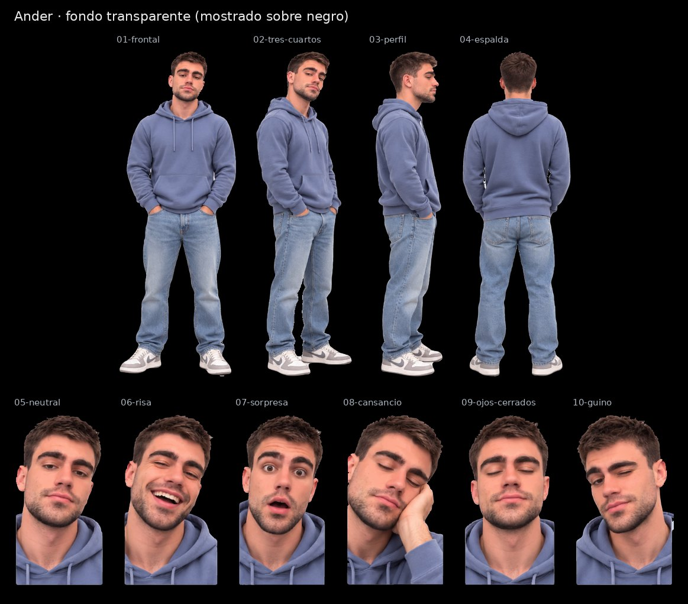

# Ander · SVG con fondo transparente

Cuatro vistas de cuerpo entero y seis expresiones, recortadas de la [hoja maestra](../Ander.svg) con fondo transparente para la pantalla negra de la máquina. Conservan los trazados y degradados de la hoja; no llevan imágenes incrustadas.

| Archivo | Pieza | viewBox (x · y · ancho · alto en la hoja) | Peso |
|---|---|---|---|
| [01-frontal.svg](01-frontal.svg) | Vista frontal | 110 · 37 · 311 · 840 | 5.7 MB |
| [02-tres-cuartos.svg](02-tres-cuartos.svg) | Vista de tres cuartos | 406 · 38 · 257 · 839 | 5.1 MB |
| [03-perfil.svg](03-perfil.svg) | Vista de perfil | 650 · 41 · 193 · 839 | 4.2 MB |
| [04-espalda.svg](04-espalda.svg) | Vista de espalda | 841 · 39 · 281 · 832 | 5.6 MB |
| [05-neutral.svg](05-neutral.svg) | Expresión neutral | 0 · 913 · 187 · 360 | 2.1 MB |
| [06-risa.svg](06-risa.svg) | Risa | 177 · 917 · 202 · 356 | 2.2 MB |
| [07-sorpresa.svg](07-sorpresa.svg) | Sorpresa | 369 · 912 · 190 · 361 | 2.3 MB |
| [08-cansancio.svg](08-cansancio.svg) | Cansancio, mano en la mejilla | 549 · 941 · 195 · 332 | 2.1 MB |
| [09-ojos-cerrados.svg](09-ojos-cerrados.svg) | Ojos cerrados | 735 · 918 · 194 · 355 | 2.1 MB |
| [10-guino.svg](10-guino.svg) | Guiño | 919 · 916 · 203 · 357 | 2.2 MB |

El `viewBox` de cada pieza usa las coordenadas de la hoja con 8 px de margen alrededor de la silueta, así que todas las piezas de un avatar comparten escala. La hoja de referencia es [`animaciones/Avatar Ander.png`](../../animaciones/Avatar%20Ander.png).

[Control de calidad](control-calidad.json) · [Revisión del 30-10-2026](../REVISION-TRANSPARENTE-2026-10-30.md)
