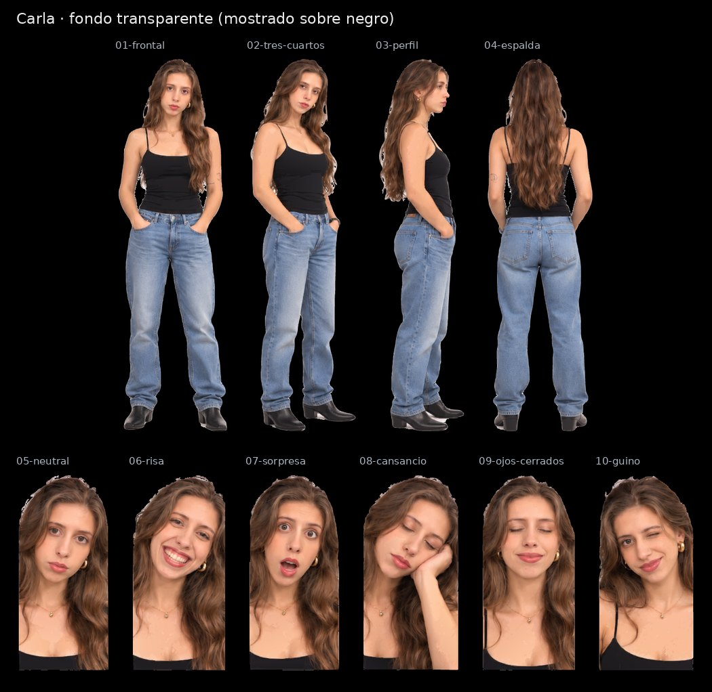

# Carla · SVG con fondo transparente

Cuatro vistas de cuerpo entero y seis expresiones, recortadas de la [hoja maestra](../Carla.svg) con fondo transparente para la pantalla negra de la máquina. Conservan los trazados y degradados de la hoja; no llevan imágenes incrustadas.

| Archivo | Pieza | viewBox (x · y · ancho · alto en la hoja) | Peso |
|---|---|---|---|
| [01-frontal.svg](01-frontal.svg) | Vista frontal | 148 · 41 · 249 · 819 | 4.6 MB |
| [02-tres-cuartos.svg](02-tres-cuartos.svg) | Vista de tres cuartos | 407 · 43 · 241 · 814 | 4.3 MB |
| [03-perfil.svg](03-perfil.svg) | Vista de perfil | 638 · 41 · 199 · 818 | 3.6 MB |
| [04-espalda.svg](04-espalda.svg) | Vista de espalda | 863 · 39 · 242 · 820 | 4.9 MB |
| [05-neutral.svg](05-neutral.svg) | Expresión neutral | 0 · 910 · 191 · 404 | 2.5 MB |
| [06-risa.svg](06-risa.svg) | Risa | 180 · 911 · 199 · 403 | 2.6 MB |
| [07-sorpresa.svg](07-sorpresa.svg) | Sorpresa | 369 · 911 · 193 · 403 | 2.6 MB |
| [08-cansancio.svg](08-cansancio.svg) | Cansancio, mano en la mejilla | 552 · 932 · 193 · 382 | 2.4 MB |
| [09-ojos-cerrados.svg](09-ojos-cerrados.svg) | Ojos cerrados | 735 · 908 · 200 · 406 | 2.5 MB |
| [10-guino.svg](10-guino.svg) | Guiño | 924 · 911 · 198 · 402 | 2.2 MB |

El `viewBox` de cada pieza usa las coordenadas de la hoja con 8 px de margen alrededor de la silueta, así que todas las piezas de un avatar comparten escala. La hoja de referencia es [`animaciones/Avatar Carla.png`](../../animaciones/Avatar%20Carla.png).

[Control de calidad](control-calidad.json) · [Revisión del 30-10-2026](../REVISION-TRANSPARENTE-2026-10-30.md)
