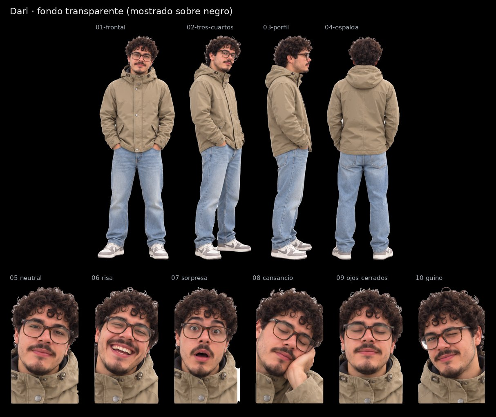

# Dari · SVG con fondo transparente

Cuatro vistas de cuerpo entero y seis expresiones, recortadas de la [hoja maestra](../Dari.svg) con fondo transparente para la pantalla negra de la máquina. Conservan los trazados y degradados de la hoja; no llevan imágenes incrustadas.

| Archivo | Pieza | viewBox (x · y · ancho · alto en la hoja) | Peso |
|---|---|---|---|
| [01-frontal.svg](01-frontal.svg) | Vista frontal | 125 · 31 · 305 · 859 | 6.0 MB |
| [02-tres-cuartos.svg](02-tres-cuartos.svg) | Vista de tres cuartos | 415 · 40 · 248 · 853 | 5.4 MB |
| [03-perfil.svg](03-perfil.svg) | Vista de perfil | 658 · 47 · 192 · 846 | 4.1 MB |
| [04-espalda.svg](04-espalda.svg) | Vista de espalda | 846 · 47 · 276 · 839 | 5.4 MB |
| [05-neutral.svg](05-neutral.svg) | Expresión neutral | 0 · 952 · 201 · 342 | 2.6 MB |
| [06-risa.svg](06-risa.svg) | Risa | 191 · 955 · 193 · 339 | 2.5 MB |
| [07-sorpresa.svg](07-sorpresa.svg) | Sorpresa | 374 · 955 · 198 · 339 | 2.5 MB |
| [08-cansancio.svg](08-cansancio.svg) | Cansancio, mano en la mejilla | 555 · 974 · 193 · 320 | 2.3 MB |
| [09-ojos-cerrados.svg](09-ojos-cerrados.svg) | Ojos cerrados | 738 · 953 · 193 · 341 | 2.4 MB |
| [10-guino.svg](10-guino.svg) | Guiño | 921 · 947 · 201 · 348 | 2.6 MB |

El `viewBox` de cada pieza usa las coordenadas de la hoja con 8 px de margen alrededor de la silueta, así que todas las piezas de un avatar comparten escala. La hoja de referencia es [`animaciones/Avatar Dari.png`](../../animaciones/Avatar%20Dari.png).

[Control de calidad](control-calidad.json) · [Revisión del 30-10-2026](../REVISION-TRANSPARENTE-2026-10-30.md)
