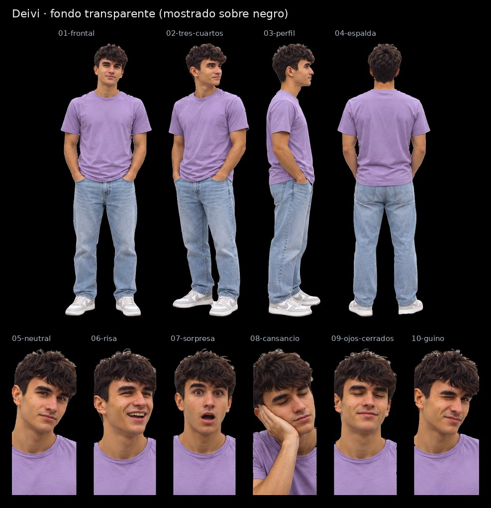

# Deivi · SVG con fondo transparente

Cuatro vistas de cuerpo entero y seis expresiones, recortadas de la [hoja maestra](../Deivi.svg) con fondo transparente para la pantalla negra de la máquina. Conservan los trazados y degradados de la hoja; no llevan imágenes incrustadas.

| Archivo | Pieza | viewBox (x · y · ancho · alto en la hoja) | Peso |
|---|---|---|---|
| [01-frontal.svg](01-frontal.svg) | Vista frontal | 11 · 104 · 291 · 843 | 6.1 MB |
| [02-tres-cuartos.svg](02-tres-cuartos.svg) | Vista de tres cuartos | 309 · 103 · 263 · 856 | 6.2 MB |
| [03-perfil.svg](03-perfil.svg) | Vista de perfil | 604 · 102 · 180 · 849 | 4.4 MB |
| [04-espalda.svg](04-espalda.svg) | Vista de espalda | 814 · 103 · 297 · 844 | 6.1 MB |
| [05-neutral.svg](05-neutral.svg) | Expresión neutral | 0 · 972 · 194 · 430 | 3.0 MB |
| [06-risa.svg](06-risa.svg) | Risa | 184 · 971 · 196 · 431 | 3.0 MB |
| [07-sorpresa.svg](07-sorpresa.svg) | Sorpresa | 370 · 970 · 196 · 432 | 3.0 MB |
| [08-cansancio.svg](08-cansancio.svg) | Cansancio, mano en la mejilla | 556 · 978 · 197 · 424 | 3.3 MB |
| [09-ojos-cerrados.svg](09-ojos-cerrados.svg) | Ojos cerrados | 743 · 972 · 196 · 430 | 2.9 MB |
| [10-guino.svg](10-guino.svg) | Guiño | 929 · 976 · 193 · 426 | 3.0 MB |

En los retratos `05` y `10` la camiseta llega al borde inferior de la hoja original, así que esas esquinas inferiores son opacas a propósito.

El `viewBox` de cada pieza usa las coordenadas de la hoja con 8 px de margen alrededor de la silueta, así que todas las piezas de un avatar comparten escala. La hoja de referencia es [`animaciones/Avatar Deivi.png`](../../animaciones/Avatar%20Deivi.png).

[Control de calidad](control-calidad.json) · [Revisión del 30-10-2026](../REVISION-TRANSPARENTE-2026-10-30.md)
