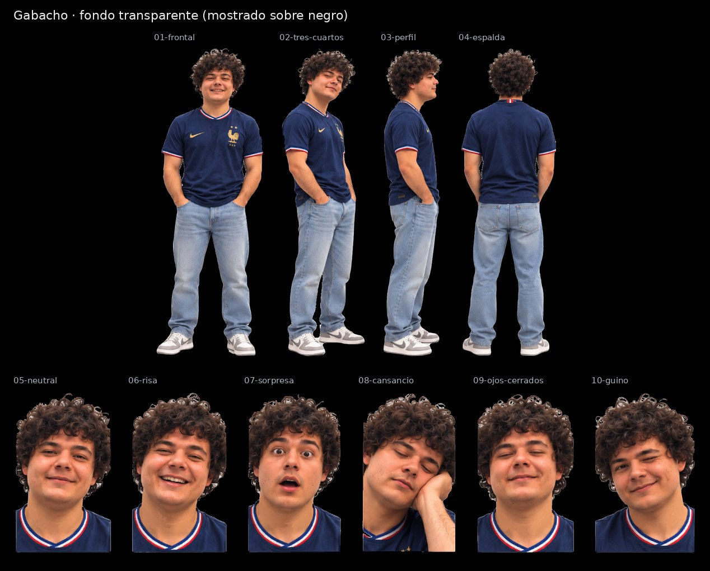

# Gabacho · SVG con fondo transparente

Cuatro vistas de cuerpo entero y seis expresiones, recortadas de la [hoja maestra](../Gabacho.svg) con fondo transparente para la pantalla negra de la máquina. Conservan los trazados y degradados de la hoja; no llevan imágenes incrustadas.

| Archivo | Pieza | viewBox (x · y · ancho · alto en la hoja) | Peso |
|---|---|---|---|
| [01-frontal.svg](01-frontal.svg) | Vista frontal | 122 · 25 · 323 · 905 | 7.0 MB |
| [02-tres-cuartos.svg](02-tres-cuartos.svg) | Vista de tres cuartos | 418 · 28 · 253 · 904 | 5.9 MB |
| [03-perfil.svg](03-perfil.svg) | Vista de perfil | 667 · 34 · 185 · 899 | 4.5 MB |
| [04-espalda.svg](04-espalda.svg) | Vista de espalda | 845 · 37 · 277 · 889 | 6.0 MB |
| [05-neutral.svg](05-neutral.svg) | Expresión neutral | 0 · 970 · 198 · 328 | 2.2 MB |
| [06-risa.svg](06-risa.svg) | Risa | 187 · 973 · 198 · 325 | 2.2 MB |
| [07-sorpresa.svg](07-sorpresa.svg) | Sorpresa | 374 · 976 · 193 · 322 | 2.1 MB |
| [08-cansancio.svg](08-cansancio.svg) | Cansancio, mano en la mejilla | 555 · 994 · 183 · 304 | 2.1 MB |
| [09-ojos-cerrados.svg](09-ojos-cerrados.svg) | Ojos cerrados | 727 · 975 · 201 · 323 | 2.2 MB |
| [10-guino.svg](10-guino.svg) | Guiño | 918 · 972 · 204 · 326 | 2.2 MB |

El `viewBox` de cada pieza usa las coordenadas de la hoja con 8 px de margen alrededor de la silueta, así que todas las piezas de un avatar comparten escala. La hoja de referencia es [`animaciones/Avatar Gabacho.png`](../../animaciones/Avatar%20Gabacho.png).

[Control de calidad](control-calidad.json) · [Revisión del 30-10-2026](../REVISION-TRANSPARENTE-2026-10-30.md)
