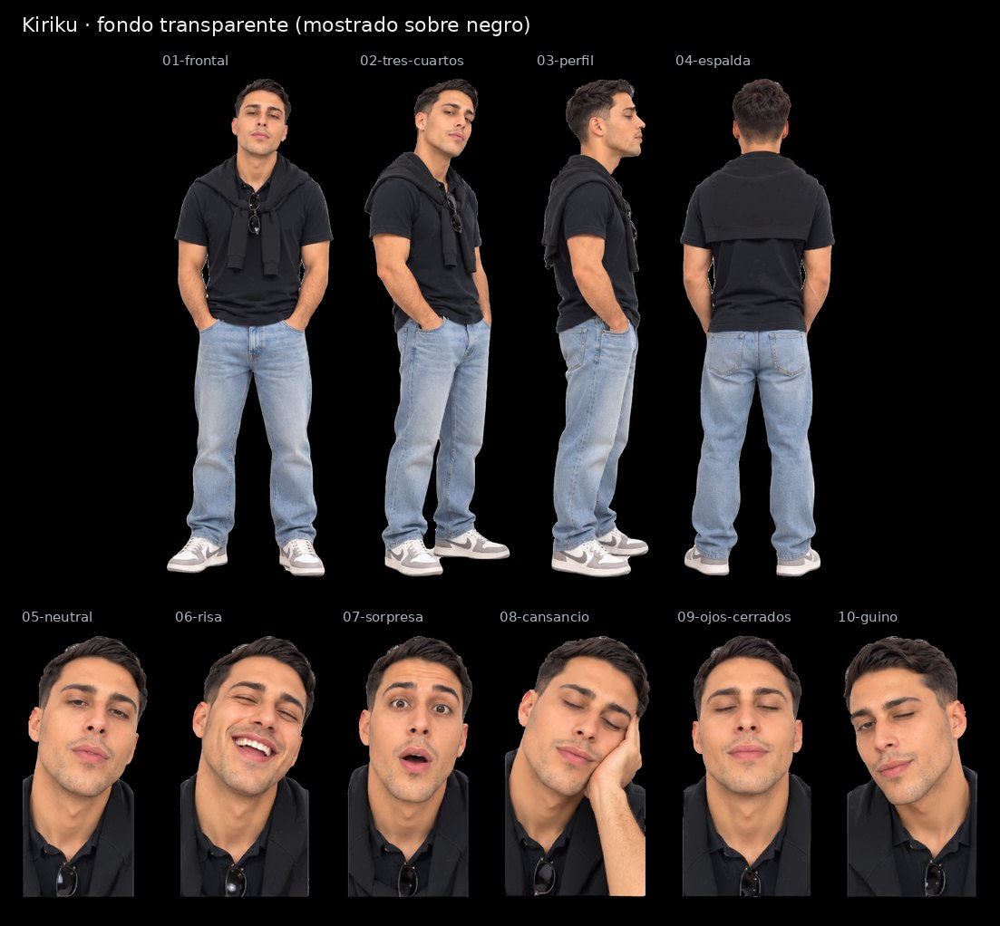

# Kiriku · SVG con fondo transparente

Cuatro vistas de cuerpo entero y seis expresiones, recortadas de la [hoja maestra](../Kiriku.svg) con fondo transparente para la pantalla negra de la máquina. Conservan los trazados y degradados de la hoja; no llevan imágenes incrustadas.

| Archivo | Pieza | viewBox (x · y · ancho · alto en la hoja) | Peso |
|---|---|---|---|
| [01-frontal.svg](01-frontal.svg) | Vista frontal | 130 · 47 · 297 · 857 | 5.3 MB |
| [02-tres-cuartos.svg](02-tres-cuartos.svg) | Vista de tres cuartos | 404 · 53 · 260 · 850 | 4.8 MB |
| [03-perfil.svg](03-perfil.svg) | Vista de perfil | 652 · 60 · 194 · 844 | 3.9 MB |
| [04-espalda.svg](04-espalda.svg) | Vista de espalda | 851 · 51 · 271 · 846 | 4.6 MB |
| [05-neutral.svg](05-neutral.svg) | Expresión neutral | 0 · 948 · 192 · 398 | 2.0 MB |
| [06-risa.svg](06-risa.svg) | Risa | 160 · 948 · 213 · 398 | 2.3 MB |
| [07-sorpresa.svg](07-sorpresa.svg) | Sorpresa | 352 · 948 · 198 · 398 | 2.1 MB |
| [08-cansancio.svg](08-cansancio.svg) | Cansancio, mano en la mejilla | 533 · 970 · 216 · 377 | 2.2 MB |
| [09-ojos-cerrados.svg](09-ojos-cerrados.svg) | Ojos cerrados | 732 · 948 · 204 · 399 | 2.0 MB |
| [10-guino.svg](10-guino.svg) | Guiño | 920 · 954 · 202 · 392 | 2.0 MB |

El `viewBox` de cada pieza usa las coordenadas de la hoja con 8 px de margen alrededor de la silueta, así que todas las piezas de un avatar comparten escala. La hoja de referencia es [`animaciones/Avatar Kiriku.png`](../../animaciones/Avatar%20Kiriku.png).

[Control de calidad](control-calidad.json) · [Revisión del 30-10-2026](../REVISION-TRANSPARENTE-2026-10-30.md)
