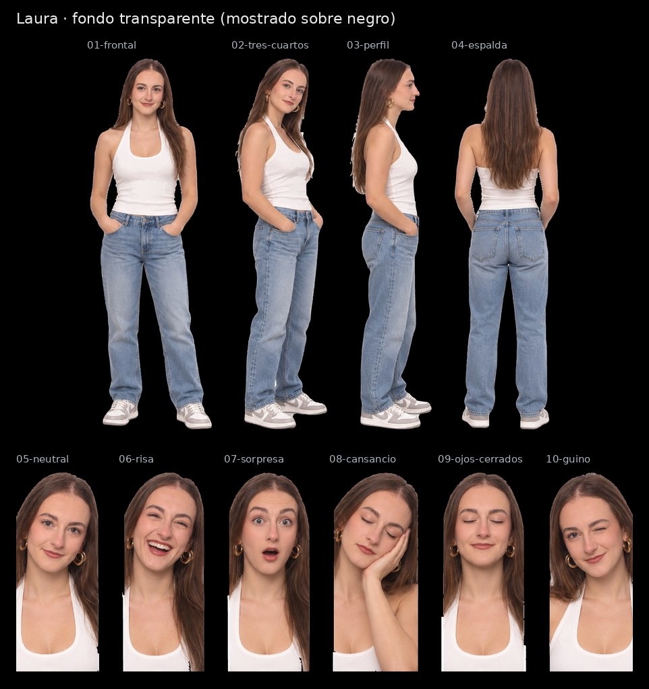

# Laura · SVG con fondo transparente

Cuatro vistas de cuerpo entero y seis expresiones, recortadas de la [hoja maestra](../Laura.svg) con fondo transparente para la pantalla negra de la máquina. Conservan los trazados y degradados de la hoja; no llevan imágenes incrustadas.

| Archivo | Pieza | viewBox (x · y · ancho · alto en la hoja) | Peso |
|---|---|---|---|
| [01-frontal.svg](01-frontal.svg) | Vista frontal | 138 · 32 · 300 · 883 | 6.3 MB |
| [02-tres-cuartos.svg](02-tres-cuartos.svg) | Vista de tres cuartos | 418 · 37 · 229 · 874 | 5.3 MB |
| [03-perfil.svg](03-perfil.svg) | Vista de perfil | 650 · 40 · 204 · 871 | 4.5 MB |
| [04-espalda.svg](04-espalda.svg) | Vista de espalda | 867 · 40 · 255 · 870 | 6.2 MB |
| [05-neutral.svg](05-neutral.svg) | Expresión neutral | 0 · 941 · 197 · 461 | 3.1 MB |
| [06-risa.svg](06-risa.svg) | Risa | 179 · 944 · 202 · 458 | 3.2 MB |
| [07-sorpresa.svg](07-sorpresa.svg) | Sorpresa | 365 · 942 · 202 · 460 | 3.1 MB |
| [08-cansancio.svg](08-cansancio.svg) | Cansancio, mano en la mejilla | 553 · 964 · 200 · 438 | 3.1 MB |
| [09-ojos-cerrados.svg](09-ojos-cerrados.svg) | Ojos cerrados | 737 · 947 · 206 · 455 | 3.0 MB |
| [10-guino.svg](10-guino.svg) | Guiño | 926 · 945 · 196 · 457 | 3.0 MB |

La camiseta blanca se conserva entera en las seis expresiones aunque sea del mismo tono que el fondo de la hoja.

En los retratos `05` y `10` la camiseta llega al borde inferior de la hoja original, así que esas esquinas inferiores son opacas a propósito.

El `viewBox` de cada pieza usa las coordenadas de la hoja con 8 px de margen alrededor de la silueta, así que todas las piezas de un avatar comparten escala. La hoja de referencia es [`animaciones/Avatar Laura.png`](../../animaciones/Avatar%20Laura.png).

[Control de calidad](control-calidad.json) · [Revisión del 30-10-2026](../REVISION-TRANSPARENTE-2026-10-30.md)
