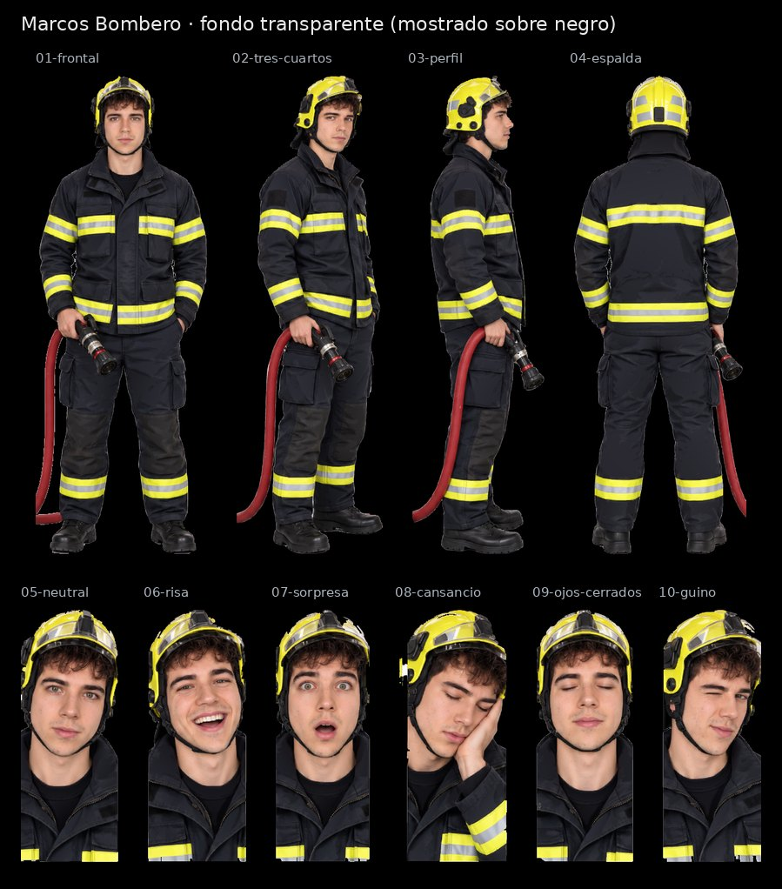

# Marcos Bombero · SVG con fondo transparente

Cuatro vistas de cuerpo entero y seis expresiones, recortadas de la [hoja maestra](../Marcos-Bombero.svg) con fondo transparente para la pantalla negra de la máquina. Conservan los trazados y degradados de la hoja; no llevan imágenes incrustadas.

| Archivo | Pieza | viewBox (x · y · ancho · alto en la hoja) | Peso |
|---|---|---|---|
| [01-frontal.svg](01-frontal.svg) | Vista frontal | 0 · 127 · 309 · 856 | 5.4 MB |
| [02-tres-cuartos.svg](02-tres-cuartos.svg) | Vista de tres cuartos | 265 · 123 · 277 · 871 | 5.0 MB |
| [03-perfil.svg](03-perfil.svg) | Vista de perfil | 520 · 124 · 251 · 867 | 3.8 MB |
| [04-espalda.svg](04-espalda.svg) | Vista de espalda | 759 · 123 · 312 · 860 | 3.8 MB |
| [05-neutral.svg](05-neutral.svg) | Expresión neutral | 0 · 1001 · 182 · 467 | 2.6 MB |
| [06-risa.svg](06-risa.svg) | Risa | 172 · 1001 · 191 · 467 | 2.7 MB |
| [07-sorpresa.svg](07-sorpresa.svg) | Sorpresa | 355 · 1001 · 183 · 467 | 2.5 MB |
| [08-cansancio.svg](08-cansancio.svg) | Cansancio, mano en la mejilla | 516 · 1013 · 203 · 455 | 2.9 MB |
| [09-ojos-cerrados.svg](09-ojos-cerrados.svg) | Ojos cerrados | 710 · 1002 · 188 · 466 | 2.7 MB |
| [10-guino.svg](10-guino.svg) | Guiño | 889 · 1003 · 182 · 464 | 2.5 MB |

Hoja propia de 1071 × 1469 (las demás son de 1122 × 1402). Se conservan la visera transparente del casco y la manguera completa; se quita la sombra de contacto bajo las botas.

El `viewBox` de cada pieza usa las coordenadas de la hoja con 8 px de margen alrededor de la silueta, así que todas las piezas de un avatar comparten escala. La hoja de referencia es [`animaciones/Avatar Marcos Bombero.png`](../../animaciones/Avatar%20Marcos%20Bombero.png).

[Control de calidad](control-calidad.json) · [Revisión del 30-10-2026](../REVISION-TRANSPARENTE-2026-10-30.md)
