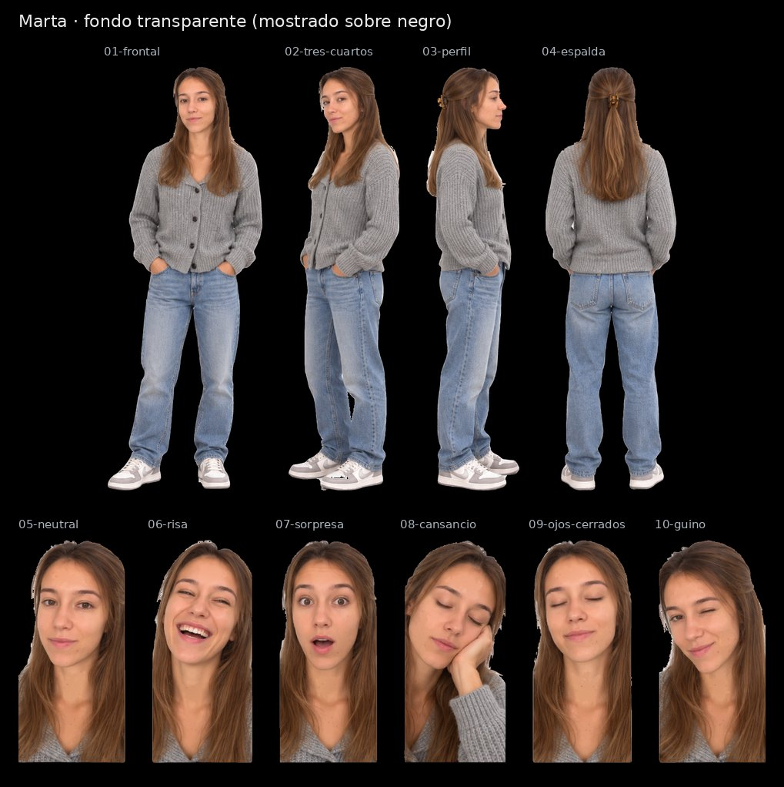

# Marta · SVG con fondo transparente

Cuatro vistas de cuerpo entero y seis expresiones, recortadas de la [hoja maestra](../Marta.svg) con fondo transparente para la pantalla negra de la máquina. Conservan los trazados y degradados de la hoja; no llevan imágenes incrustadas.

| Archivo | Pieza | viewBox (x · y · ancho · alto en la hoja) | Peso |
|---|---|---|---|
| [01-frontal.svg](01-frontal.svg) | Vista frontal | 109 · 26 · 322 · 853 | 7.3 MB |
| [02-tres-cuartos.svg](02-tres-cuartos.svg) | Vista de tres cuartos | 408 · 29 · 234 · 847 | 6.4 MB |
| [03-perfil.svg](03-perfil.svg) | Vista de perfil | 648 · 30 · 199 · 850 | 5.0 MB |
| [04-espalda.svg](04-espalda.svg) | Vista de espalda | 846 · 30 · 271 · 845 | 6.9 MB |
| [05-neutral.svg](05-neutral.svg) | Expresión neutral | 0 · 925 · 200 · 417 | 2.8 MB |
| [06-risa.svg](06-risa.svg) | Risa | 191 · 927 · 196 · 415 | 2.7 MB |
| [07-sorpresa.svg](07-sorpresa.svg) | Sorpresa | 378 · 930 · 190 · 412 | 2.7 MB |
| [08-cansancio.svg](08-cansancio.svg) | Cansancio, mano en la mejilla | 559 · 943 · 190 · 399 | 2.8 MB |
| [09-ojos-cerrados.svg](09-ojos-cerrados.svg) | Ojos cerrados | 741 · 934 · 190 · 408 | 2.6 MB |
| [10-guino.svg](10-guino.svg) | Guiño | 922 · 926 · 200 · 416 | 2.9 MB |

El `viewBox` de cada pieza usa las coordenadas de la hoja con 8 px de margen alrededor de la silueta, así que todas las piezas de un avatar comparten escala. La hoja de referencia es [`animaciones/Avatar Marta.png`](../../animaciones/Avatar%20Marta.png).

[Control de calidad](control-calidad.json) · [Revisión del 30-10-2026](../REVISION-TRANSPARENTE-2026-10-30.md)
