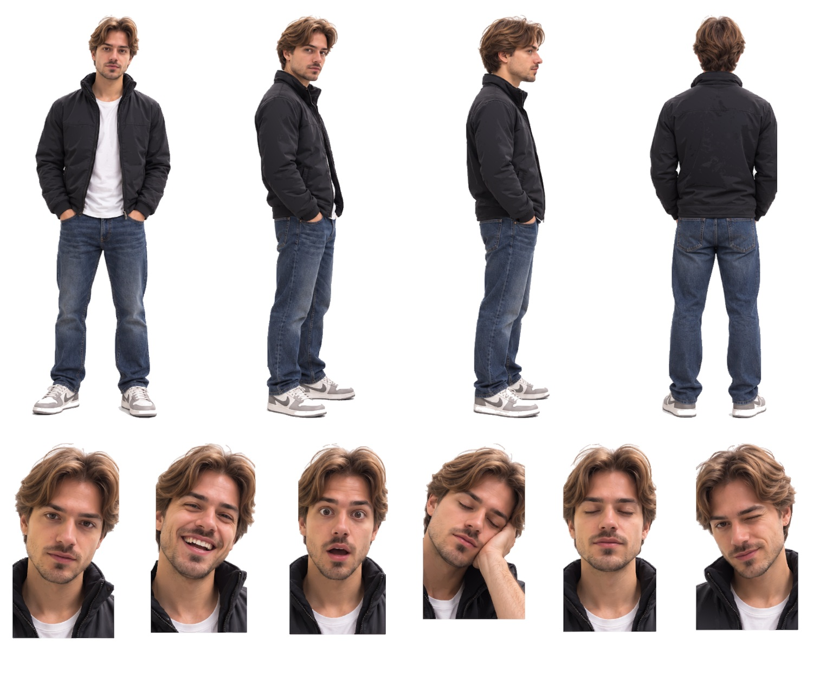

# Paradigma · vistas SVG individuales

Diez ilustraciones estáticas extraídas de la hoja maestra detallada, sin simplificar los trazados ni los gradientes. Conservan la referencia, las proporciones, el vestuario y las expresiones.

- [01-frontal.svg](01-frontal.svg)
- [02-tres-cuartos.svg](02-tres-cuartos.svg)
- [03-perfil.svg](03-perfil.svg)
- [04-espalda.svg](04-espalda.svg)
- [05-neutral.svg](05-neutral.svg)
- [06-risa.svg](06-risa.svg)
- [07-sorpresa.svg](07-sorpresa.svg)
- [08-cansancio.svg](08-cansancio.svg)
- [09-ojos-cerrados.svg](09-ojos-cerrados.svg)
- [10-guino.svg](10-guino.svg)

Cada SVG es autónomo y contiene geometría vectorial real. No es un esqueleto articulado para animación. El fondo blanco coincide con la presentación de Guillermo. Las sombras del suelo de la hoja completa no se añaden a los recortes.

[Control de calidad y procedencia](control-calidad.json) · [Hoja maestra](../Paradigma.svg)

La revisión final recuperó los tonos claros y las costuras de la camiseta blanca en las seis expresiones. Se corrigió únicamente el recorte; los trazados, gradientes y sombras de la ilustración se conservaron. [Comprobación de la corrección](correccion-camiseta.json).
