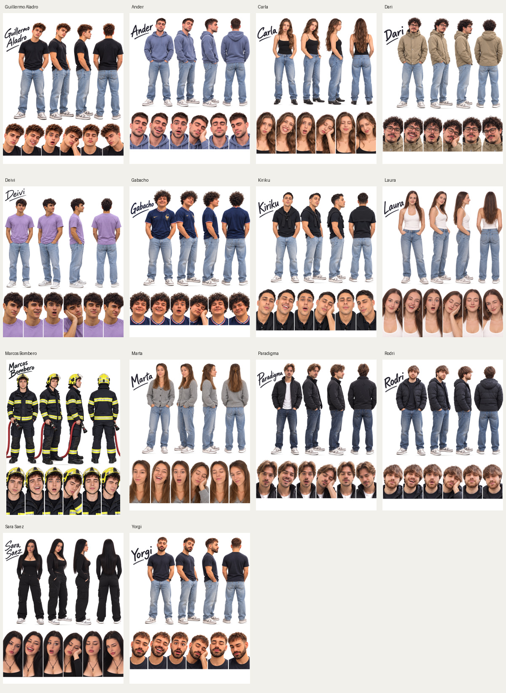

# Avatares SVG · Astra

Colección de **14 avatares**, comenzada por Guillermo Aladro, vectorizada a partir de las referencias actuales de `animaciones/`. Cada hoja conserva sus cuatro vistas de cuerpo completo, sus seis expresiones y sus rasgos, ropa y accesorios originales. Los 14 personajes cuentan también con diez SVG individuales: **154 SVG estáticos en total**. Se han procesado y publicado de uno en uno, y después se ha realizado una segunda revisión de los archivos publicados.

[Revisión individual del 30 de octubre de 2026](REVISION-INDIVIDUAL-2026-10-30.md) · [Informe por archivo](revision-individual-2026-10-30.json) · [Revisión anterior](REVISION-FINAL.md)

La revisión más reciente cubre **los 156 SVG**, uno a uno: las 14 hojas, sus 140 vistas individuales y las dos escenas animadas. Los 154 SVG estáticos se conservan tras comprobar sus referencias, recortes y consistencia visual. En las dos escenas se corrige la compatibilidad del personaje y sus recortes entre motores SVG; en la frontal se cierra la unión del hombro y se eliminan tres pequeños restos blancos. Su vídeo y vista previa se han regenerado.



| Avatar | SVG completo | Vista previa | Vistas individuales |
|---|---|---|---|
| Guillermo Aladro | [SVG](Guillermo-Aladro.svg) | [PNG](Guillermo-Aladro-preview.png) | [4 vistas + 6 expresiones](Guillermo-Aladro/) |
| Ander | [SVG](Ander.svg) | [PNG](Ander-preview.png) | [4 vistas + 6 expresiones](Ander/) |
| Carla | [SVG](Carla.svg) | [PNG](Carla-preview.png) | [4 vistas + 6 expresiones](Carla/) |
| Dari | [SVG](Dari.svg) | [PNG](Dari-preview.png) | [4 vistas + 6 expresiones](Dari/) |
| Deivi | [SVG](Deivi.svg) | [PNG](Deivi-preview.png) | [4 vistas + 6 expresiones](Deivi/) |
| Gabacho | [SVG](Gabacho.svg) | [PNG](Gabacho-preview.png) | [4 vistas + 6 expresiones](Gabacho/) |
| Kiriku | [SVG](Kiriku.svg) | [PNG](Kiriku-preview.png) | [4 vistas + 6 expresiones](Kiriku/) |
| Laura | [SVG](Laura.svg) | [PNG](Laura-preview.png) | [4 vistas + 6 expresiones](Laura/) |
| Marcos Bombero | [SVG](Marcos-Bombero.svg) | [PNG](Marcos-Bombero-preview.png) | [4 vistas + 6 expresiones](Marcos-Bombero/) |
| Marta | [SVG](Marta.svg) | [PNG](Marta-preview.png) | [4 vistas + 6 expresiones](Marta/) |
| Paradigma | [SVG](Paradigma.svg) | [PNG](Paradigma-preview.png) | [4 vistas + 6 expresiones](Paradigma/) |
| Rodri | [SVG](Rodri.svg) | [PNG](Rodri-preview.png) | [4 vistas + 6 expresiones](Rodri/) |
| Sara Saez | [SVG](Sara-Saez.svg) | [PNG](Sara-Saez-preview.png) | [4 vistas + 6 expresiones](Sara-Saez/) |
| Yorgi | [SVG](Yorgi.svg) | [PNG](Yorgi-preview.png) | [4 vistas + 6 expresiones](Yorgi/) |

Todos los SVG contienen trazados y gradientes autónomos. Los archivos PNG/JPG son únicamente vistas previas separadas. Las hojas maestras y las nuevas vistas conservan metadatos de procedencia; el informe final verifica también las cuatro vistas originales de Guillermo que no tenían esos metadatos. Las dimensiones siguen las de cada hoja original.

Se han revisado las caras, expresiones, siluetas, ropa y accesorios frente a las referencias. Las prendas blancas de Laura y Paradigma disponen de recortes específicos para conservar sus tonos y costuras. Marcos Bombero utiliza la referencia actual con casco y manguera. Los retratos de Guillermo se han revisado para conservar el cabello completo y eliminar restos vecinos.

El [informe de las hojas maestras](control-calidad-coleccion.json) registra su procedencia, huellas y métricas. El [informe final por archivo](revision-final-publicada.json) cubre también las 140 vistas individuales y las dos escenas preexistentes.

## Guillermo Aladro

[Abrir el SVG completo](Guillermo-Aladro.svg) · [Vista previa](Guillermo-Aladro-preview.png) · [Vistas y expresiones individuales](Guillermo-Aladro/)

Vectorización de alta densidad de la referencia actual del repositorio: **cuatro vistas de cuerpo completo y seis expresiones**, manteniendo el rostro, el peinado, el vestuario, el reloj, las zapatillas, las poses y el nombre originales. Se han limpiado el fondo y las sombras de apoyo.

- **125.827 trazados de ilustración y 87.822 gradientes de tono**, además de los recortes y las sombras vectoriales.
- SVG autónomo: geometría y gradientes reales; no contiene un PNG/JPG incrustado, fuentes externas, scripts ni recursos remotos.
- Hoja maestra de `1122 × 1402` unidades, con `viewBox` y capas identificadas.
- Diez SVG individuales: frontal, tres cuartos, perfil, espalda, serio, sonrisa, sorpresa, cansancio, ojos cerrados y ceño fruncido.
- Fondo blanco. Las vistas individuales son ilustraciones estáticas de las poses existentes, no un esqueleto de animación articulado.

### Referencia y revisión

Referencia: [`animaciones/Avatar Guillermo Aladro.png`](../animaciones/Avatar%20Guillermo%20Aladro.png), blob Git `92ff45ef7481f430f566b3fa383be7f8ea242685`.

Se han comparado la hoja completa y ampliaciones de las caras, el pelo, los dedos, el reloj, las costuras y el calzado. Los recortes individuales se han revisado para eliminar fragmentos de figuras vecinas. Se han comprobado XML, identificadores, referencias internas y ausencia de imágenes incrustadas. La hoja maestra se contrastó con CairoSVG y librsvg; la revisión final volvió a renderizar la hoja y las diez vistas publicadas con Inkscape.

El [informe de comprobaciones](control-calidad-Guillermo-Aladro.json) registra archivos, huellas y métricas de comparación con la referencia. Estas métricas miden similitud de imagen; no certifican identidad facial ni perfección artística. El detalle procede de la referencia disponible, sin inventar rasgos que no aparecen en ella.

La hoja maestra ocupa aproximadamente **37 MB**. Para consultar el resultado rápidamente se puede abrir la vista previa; para editar una pose se puede utilizar su archivo individual.

### Reproducción

```bash
python -m pip install -r 'avatares SVG - Astra/herramientas/requirements.txt'
python 'avatares SVG - Astra/herramientas/generar_guillermo.py' /tmp/guillermo-svg-build
```

La reconstrucción utiliza la referencia ya guardada en el repositorio. Los PNG intermedios se guardan fuera de esta carpeta y no forman parte de los SVG.


Para reconstruir las demás hojas:

```bash
python 'avatares SVG - Astra/herramientas/generar_coleccion.py' /tmp/avatares-astra-build
```

Para extraer las vistas individuales desde una hoja ya vectorizada, se utiliza [separar_avatar_individual.py](herramientas/separar_avatar_individual.py) con las regiones revisadas de la carpeta de cada personaje. Guillermo utiliza [revisar_recortes_guillermo.py](herramientas/revisar_recortes_guillermo.py), que respeta sus capas originales. La corrección de la camiseta de Paradigma está documentada en [recuperar_camiseta_paradigma.py](herramientas/recuperar_camiseta_paradigma.py). Cada exportación requiere inspeccionar su comparativa antes de publicarla.
