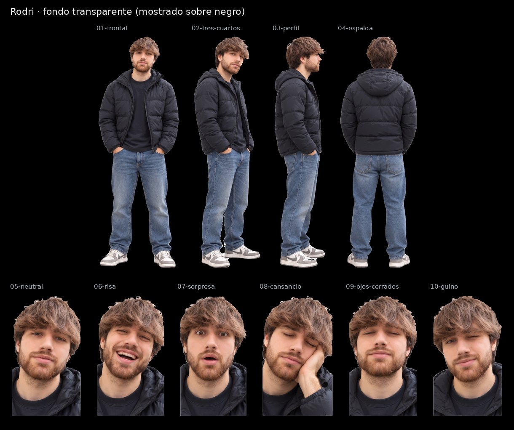

# Rodri · SVG con fondo transparente

Cuatro vistas de cuerpo entero y seis expresiones, recortadas de la [hoja maestra](../Rodri.svg) con fondo transparente para la pantalla negra de la máquina. Conservan los trazados y degradados de la hoja; no llevan imágenes incrustadas.

| Archivo | Pieza | viewBox (x · y · ancho · alto en la hoja) | Peso |
|---|---|---|---|
| [01-frontal.svg](01-frontal.svg) | Vista frontal | 117 · 46 · 307 · 850 | 6.3 MB |
| [02-tres-cuartos.svg](02-tres-cuartos.svg) | Vista de tres cuartos | 410 · 45 · 256 · 853 | 5.5 MB |
| [03-perfil.svg](03-perfil.svg) | Vista de perfil | 656 · 54 · 197 · 841 | 4.3 MB |
| [04-espalda.svg](04-espalda.svg) | Vista de espalda | 843 · 54 · 279 · 833 | 5.3 MB |
| [05-neutral.svg](05-neutral.svg) | Expresión neutral | 0 · 963 · 197 · 338 | 2.4 MB |
| [06-risa.svg](06-risa.svg) | Risa | 185 · 960 · 198 · 341 | 2.5 MB |
| [07-sorpresa.svg](07-sorpresa.svg) | Sorpresa | 372 · 961 · 194 · 340 | 2.4 MB |
| [08-cansancio.svg](08-cansancio.svg) | Cansancio, mano en la mejilla | 556 · 977 · 196 · 324 | 2.4 MB |
| [09-ojos-cerrados.svg](09-ojos-cerrados.svg) | Ojos cerrados | 741 · 968 · 195 · 333 | 2.4 MB |
| [10-guino.svg](10-guino.svg) | Guiño | 926 · 965 · 196 · 336 | 2.3 MB |

El `viewBox` de cada pieza usa las coordenadas de la hoja con 8 px de margen alrededor de la silueta, así que todas las piezas de un avatar comparten escala. La hoja de referencia es [`animaciones/Avatar Rodri.png`](../../animaciones/Avatar%20Rodri.png).

[Control de calidad](control-calidad.json) · [Revisión del 30-10-2026](../REVISION-TRANSPARENTE-2026-10-30.md)
