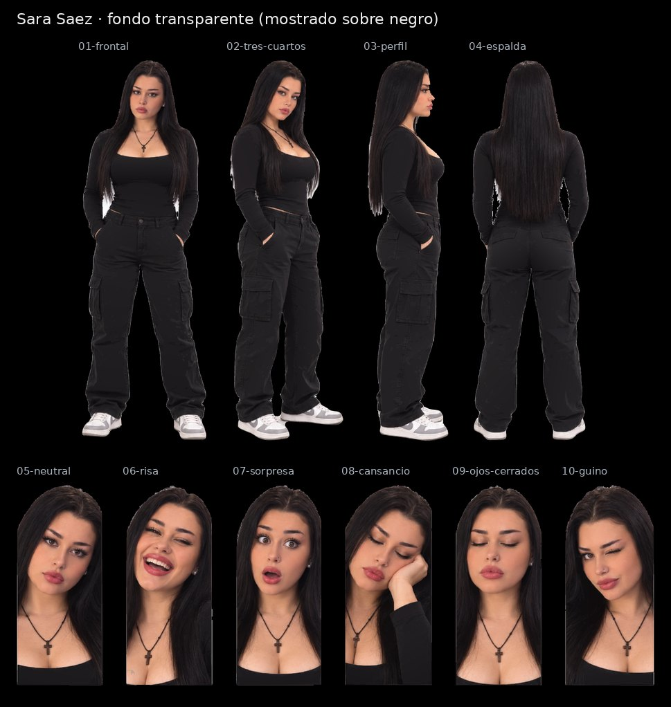

# Sara Saez · SVG con fondo transparente

Cuatro vistas de cuerpo entero y seis expresiones, recortadas de la [hoja maestra](../Sara-Saez.svg) con fondo transparente para la pantalla negra de la máquina. Conservan los trazados y degradados de la hoja; no llevan imágenes incrustadas.

| Archivo | Pieza | viewBox (x · y · ancho · alto en la hoja) | Peso |
|---|---|---|---|
| [01-frontal.svg](01-frontal.svg) | Vista frontal | 118 · 51 · 273 · 806 | 3.2 MB |
| [02-tres-cuartos.svg](02-tres-cuartos.svg) | Vista de tres cuartos | 398 · 46 · 253 · 815 | 3.0 MB |
| [03-perfil.svg](03-perfil.svg) | Vista de perfil | 645 · 48 · 187 · 815 | 2.2 MB |
| [04-espalda.svg](04-espalda.svg) | Vista de espalda | 859 · 48 · 256 · 803 | 2.7 MB |
| [05-neutral.svg](05-neutral.svg) | Expresión neutral | 0 · 902 · 192 · 445 | 2.5 MB |
| [06-risa.svg](06-risa.svg) | Risa | 180 · 903 · 200 · 444 | 2.7 MB |
| [07-sorpresa.svg](07-sorpresa.svg) | Sorpresa | 368 · 900 · 198 · 447 | 2.6 MB |
| [08-cansancio.svg](08-cansancio.svg) | Cansancio, mano en la mejilla | 555 · 921 · 193 · 425 | 2.3 MB |
| [09-ojos-cerrados.svg](09-ojos-cerrados.svg) | Ojos cerrados | 736 · 902 · 199 · 444 | 2.6 MB |
| [10-guino.svg](10-guino.svg) | Guiño | 923 · 901 · 199 · 445 | 2.5 MB |

El `viewBox` de cada pieza usa las coordenadas de la hoja con 8 px de margen alrededor de la silueta, así que todas las piezas de un avatar comparten escala. La hoja de referencia es [`animaciones/Avatar Sara Saez.png`](../../animaciones/Avatar%20Sara%20Saez.png).

[Control de calidad](control-calidad.json) · [Revisión del 30-10-2026](../REVISION-TRANSPARENTE-2026-10-30.md)
