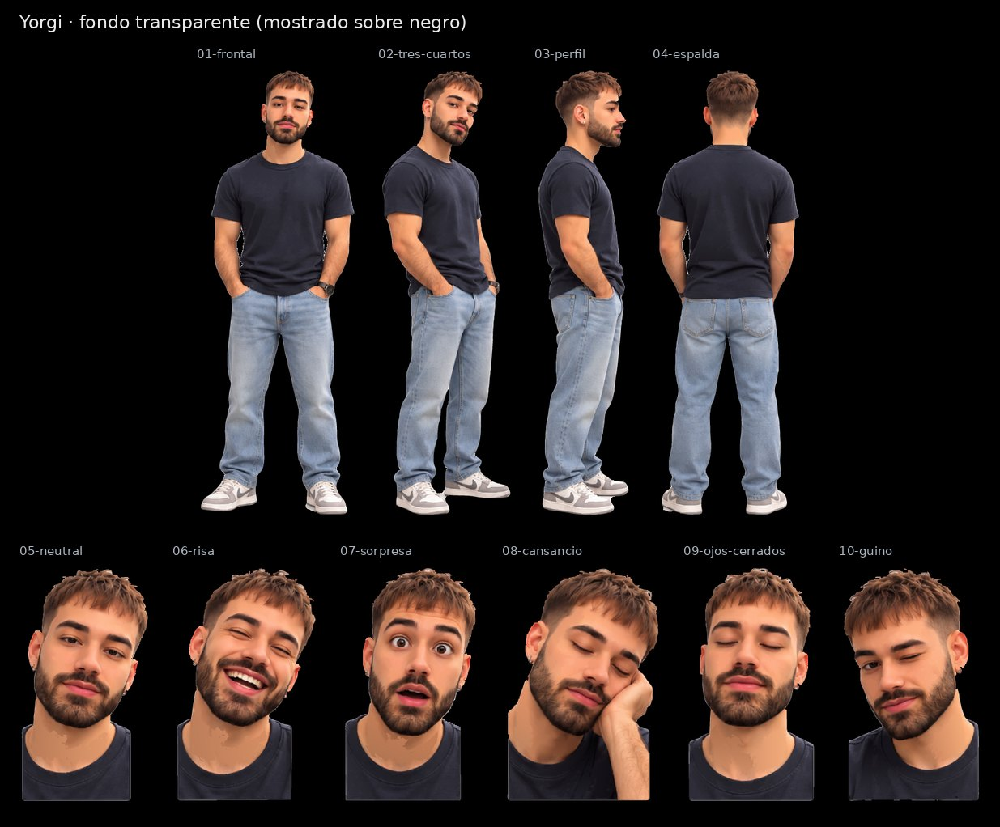

# Yorgi · SVG con fondo transparente

Cuatro vistas de cuerpo entero y seis expresiones, recortadas de la [hoja maestra](../Yorgi.svg) con fondo transparente para la pantalla negra de la máquina. Conservan los trazados y degradados de la hoja; no llevan imágenes incrustadas.

| Archivo | Pieza | viewBox (x · y · ancho · alto en la hoja) | Peso |
|---|---|---|---|
| [01-frontal.svg](01-frontal.svg) | Vista frontal | 137 · 30 · 296 · 827 | 5.0 MB |
| [02-tres-cuartos.svg](02-tres-cuartos.svg) | Vista de tres cuartos | 420 · 35 · 248 · 820 | 4.7 MB |
| [03-perfil.svg](03-perfil.svg) | Vista de perfil | 668 · 39 · 178 · 817 | 3.7 MB |
| [04-espalda.svg](04-espalda.svg) | Vista de espalda | 852 · 37 · 270 · 811 | 4.5 MB |
| [05-neutral.svg](05-neutral.svg) | Expresión neutral | 0 · 907 · 202 · 368 | 2.0 MB |
| [06-risa.svg](06-risa.svg) | Risa | 167 · 910 · 223 · 365 | 2.4 MB |
| [07-sorpresa.svg](07-sorpresa.svg) | Sorpresa | 344 · 910 · 213 · 364 | 2.3 MB |
| [08-cansancio.svg](08-cansancio.svg) | Cansancio, mano en la mejilla | 522 · 939 · 223 · 335 | 2.3 MB |
| [09-ojos-cerrados.svg](09-ojos-cerrados.svg) | Ojos cerrados | 722 · 911 · 204 · 364 | 2.1 MB |
| [10-guino.svg](10-guino.svg) | Guiño | 910 · 912 · 212 · 363 | 2.1 MB |

El `viewBox` de cada pieza usa las coordenadas de la hoja con 8 px de margen alrededor de la silueta, así que todas las piezas de un avatar comparten escala. La hoja de referencia es [`animaciones/Avatar Yorgi.png`](../../animaciones/Avatar%20Yorgi.png).

[Control de calidad](control-calidad.json) · [Revisión del 30-10-2026](../REVISION-TRANSPARENTE-2026-10-30.md)
