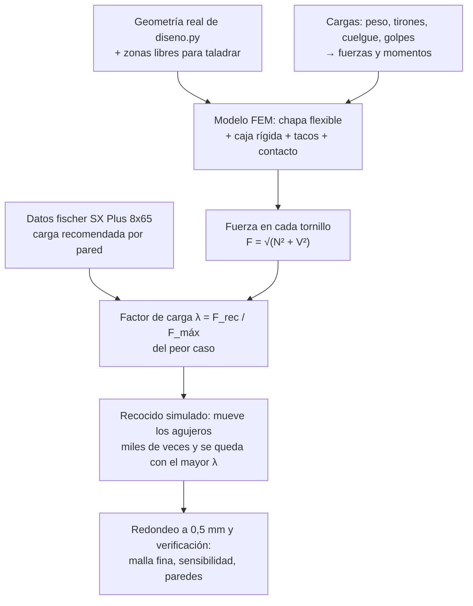
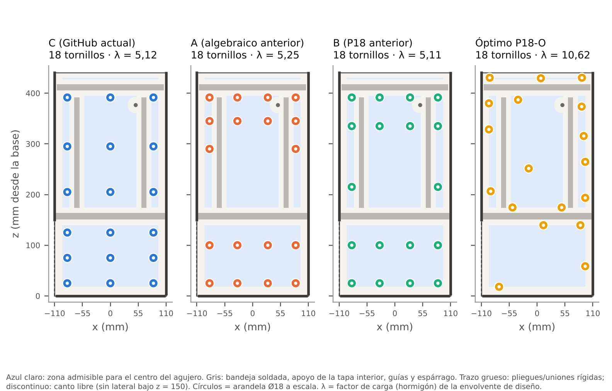
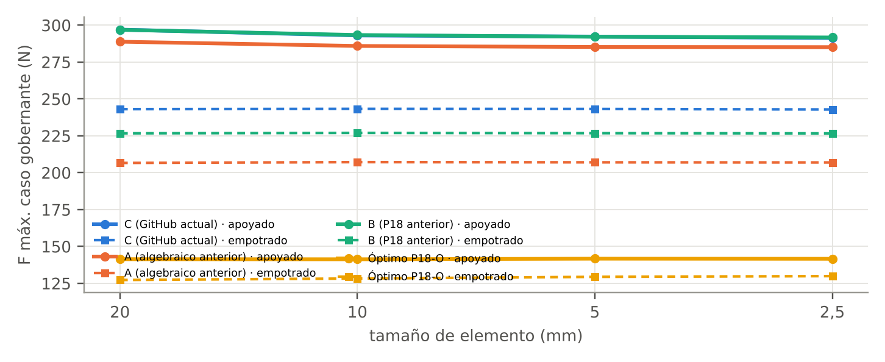
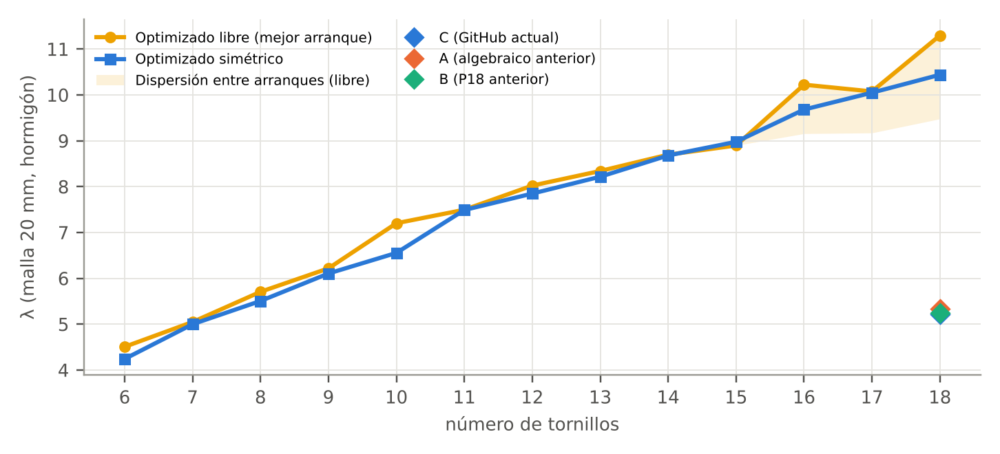
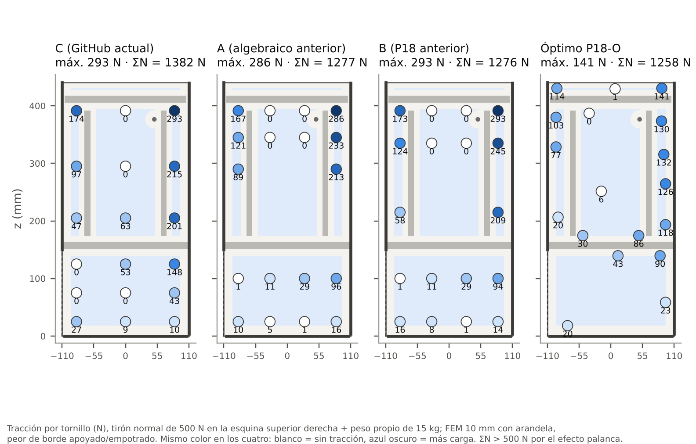
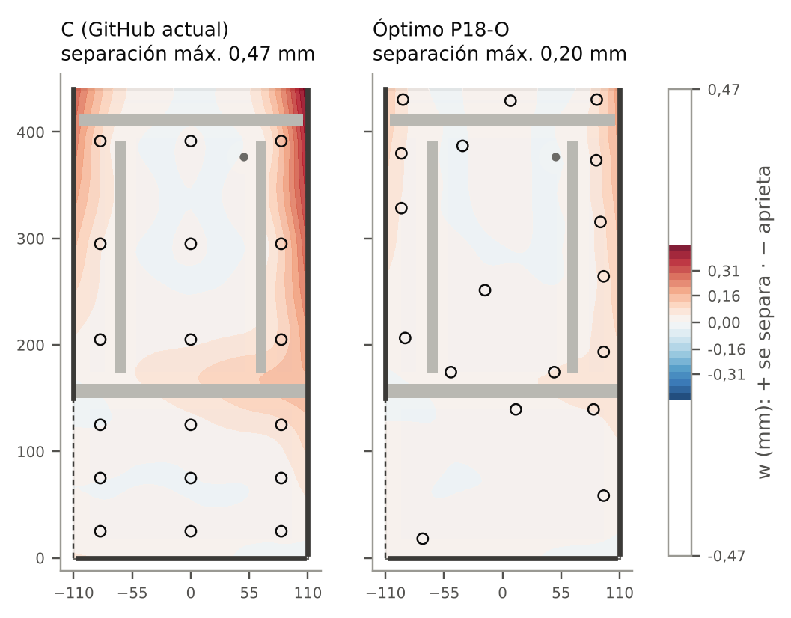

# Cálculo del patrón de anclaje a pared · cómo se ha hecho

04-11-2026 · diseño A (Compacta) · trasera de chapa DC01 de 2 mm, 18 tacos fischer SX Plus 8×65 con tirafondo DIN 571 6×80 y arandela DIN 9021 M6.

Este documento explica **paso a paso cómo se calculó** el patrón de agujeros propuesto (**Óptimo P18-O**): de dónde salen los datos, qué modelo mecánico se usó, cómo se buscó el patrón, cómo se comprobó y qué queda sin verificar. Los resultados completos están en el [informe técnico en PDF](Informe_anclajes_alcoholimetro.pdf) y las coordenadas en [`patron_ganador.csv`](patron_ganador.csv).

> **Estado:** propuesta de cálculo. No se ha cambiado `modelo/diseno.py` ni los DXF: el patrón vigente de la carcasa sigue siendo el de 3 columnas × 6 filas hasta que se decida pasarlo al CAD.

## Índice

1. [Resumen del método](#1-resumen-del-método)
2. [Qué se quiere maximizar](#2-qué-se-quiere-maximizar)
3. [Datos de partida](#3-datos-de-partida)
4. [Geometría y zonas donde se puede taladrar](#4-geometría-y-zonas-donde-se-puede-taladrar)
5. [Cargas](#5-cargas)
6. [Modelo de la chapa trasera (elementos finitos)](#6-modelo-de-la-chapa-trasera-elementos-finitos)
7. [Modelos de contraste: chapa rígida y método clásico](#7-modelos-de-contraste-chapa-rígida-y-método-clásico)
8. [Verificación del modelo](#8-verificación-del-modelo)
9. [Optimización](#9-optimización)
10. [Patrón resultante](#10-patrón-resultante)
11. [Análisis complementarios](#11-análisis-complementarios)
12. [Limitaciones](#12-limitaciones)
13. [Cómo reproducirlo](#13-cómo-reproducirlo)
14. [Fuentes](#14-fuentes)

---

## 1. Resumen del método

1. Se sacan del CAD las medidas reales de la trasera y todo lo que va soldado o atornillado a ella, y se definen las zonas donde el centro de un agujero cabe sin tocar nada.
2. Cada situación (peso, tirones, una persona colgada, golpes) se convierte en fuerzas y momentos sobre la caja.
3. Un modelo de elementos finitos calcula cuánto se lleva cada tornillo, teniendo en cuenta que la chapa de 2 mm se dobla y que la pared solo empuja.
4. Se compara el tornillo más cargado con la carga recomendada de fischer → factor de carga λ.
5. Un algoritmo de búsqueda mueve los agujeros dentro de las zonas para hacer λ lo más grande posible en el peor caso.
6. El mejor patrón se redondea, se recalcula con un modelo más fino y se somete a todas las comprobaciones.

## 2. Qué se quiere maximizar

Para cada patrón y cada caso de carga:

$$\lambda = \frac{F_{rec}}{F_{\max}}$$

- $F_{rec}$: carga recomendada de **un** taco SX Plus 8×65 según fischer (1500 N en hormigón ≥ C20/25; ya incluye los coeficientes de seguridad del fabricante y vale para tracción, cortante y combinada).
- $F_{\max}$: fuerza resultante en el tornillo más cargado.

El patrón se valora por el **peor** de todos los casos de carga (y de las dos hipótesis de borde, §6.7):

$$\lambda_{patrón} = \min_{casos,\ bordes} \lambda$$

**Ejemplo** (tirón de 500 N en la esquina superior derecha + peso propio):

| | $F_{\max}$ | $\lambda = F_{rec}/F_{\max}$ |
|---|---|---|
| Patrón actual (C) | 293 N | 1500 / 293 = **5,1** |
| Óptimo P18-O | 141 N | 1500 / 141 = **10,6** |

λ = 10,6 significa que esa situación podría multiplicarse por 10,6 antes de que el primer taco llegue a su carga recomendada. **No** se multiplica la carga de un taco por 18: el reparto lo da el modelo y manda el más cargado.

## 3. Datos de partida

Se separa lo comprobado de lo supuesto:

| Dato | Valor | Origen |
|---|---|---|
| Carcasa | 220 × 100 × 442,5 mm; trasera de 440,5 mm de alto | **Comprobado** en `diseno.py` / `specs.py` (W, D; Hw = 407,5 + 2 + 31) |
| Chapa | DC01 2 mm, pliegues a 90°, radio interior 2 mm | **Comprobado** (`T = 2.0`, lista de chapa) |
| Masa de chapa | 9,85 kg | **Calculado**: suma de las 21 piezas de `Lista_piezas_chapa.xlsx` |
| Chapa + policarbonato | 10,43 kg | **Calculado**: + 0,578 kg de las 4 piezas de PC |
| Masa con electrónica | ≈ 12,9 kg → se calcula con **15 kg** | **Estimado** por componentes (pantalla, Solo, Pi, fuente, sensor, cables, herrajes, pintura, pajitas) |
| Centro de gravedad | x ≈ 0, z ≈ 220 mm, a 51 mm de la pared → se usa **55 mm** | **Estimado** por reparto de masas (sensibilidad 45–65 mm) |
| Patrón actual (C) | x = −85, 0, 85; z = 25, 75, 125, 205, 295, 391,5 | **Comprobado**: `fijaciones_pared(W, Ktop − 10)` |
| SX Plus 8×65 | taladro Ø8, h1 ≥ 75 mm, h_ef = 65 mm, tornillo Ø4,5–6 | **Fabricante** (ficha técnica fischer, 16/05/2023) |
| Distancia mínima al borde (hormigón) | c_min = 50 mm | **Fabricante** (tabla de cargas) |
| Distancia mínima entre tacos | no publicada → **50 mm** | **Hipótesis** (= c_min) |
| Carga recomendada F_rec | hormigón 1,50 kN · ladrillo macizo Mz 12 0,80 · KS 12 1,50 · KSL 12 0,80 · HLz 12 0,40 · bloque hueco 0,30 · AAC 4 0,40 · AAC 2 0,15 · ladrillo hueco horizontal y placa de yeso: sin valor | **Fabricante** |
| Rigidez axial de un taco k_a | 2000 N/mm (se prueba 500–10 000) | **Hipótesis**: fischer no la publica |
| Rigidez de contacto con la pared k_w | 50 N/mm³ (se prueba 5–500) | **Hipótesis** (modelo de Winkler) |
| Límite elástico DC01 | Re ≤ 280 MPa; 140 MPa como mínimo de cálculo | Hoja de material (EN 10130) |

## 4. Geometría y zonas donde se puede taladrar

Se recorrió `diseno.py` buscando todo lo que toca la cara interior de la trasera:

| Elemento | Posición (x, z en mm) | Efecto |
|---|---|---|
| Pliegue al lateral derecho | x = +110, z = 4 … 439,6 | Línea rígida |
| Pliegue al lateral izquierdo | x = −110, **solo** z = 150 … 440,5 (debajo está el hueco del cajón de pajitas) | Línea rígida; canto libre por debajo |
| Pliegue al suelo | z = 0, x = −106 … 106 | Viga rígida en su plano |
| Pestaña trasera de la bandeja, soldada | z = 150,5 … 163,5 | Franja rígida; no se puede taladrar |
| Ala del apoyo de la tapa interior, soldada | z = 405,5 … 417,5 | No se puede taladrar |
| Alas de las guías traseras, soldadas | x = ±61 … ±71, z = 173,5 … 391,5 | No se puede taladrar |
| Espárrago de tierra M4 | (50; 376,5) | No se puede taladrar |

El centro de cada agujero debe quedar a ≥ 11 mm (radio de la arandela de Ø18 + 2 mm) de pestañas y soldaduras, y a |x| ≤ 95 mm para que la arandela apoye en la parte plana (el pliegue termina en ±106) y quepa la llave de 10 mm. Resultan tres zonas:

- **Z1** (detrás del cajón de pajitas): x ∈ [−95, 95], z ∈ [18, 139,5].
- **Z2** (detrás del cajón de componentes): x ∈ [−95, 95], z ∈ [174,5, 394,5], excepto |x| ∈ (51, 81) por las guías y un círculo de 16 mm alrededor del espárrago.
- **Z3** (franja superior, encima del apoyo de la tapa interior): z ∈ [427,5, 430,5]. Accesible con la tapa abierta.

Las cabezas de los tirafondos (≈ 5,6 mm con la arandela) caben en los 8 mm libres detrás del cajón de pajitas y en los 9,5 mm detrás del de componentes.

## 5. Cargas

### 5.1 Ejes y unidades

- x horizontal en la pared (+ derecha mirando la máquina), z vertical desde la base, n normal a la pared (+ hacia fuera).
- Todo en newtons y milímetros. Una masa m produce $F = m \cdot g = m \cdot 9{,}81$ N.

### 5.2 De fuerzas a acciones sobre la caja

Cada fuerza $(F_x, F_n, F_z)$ aplicada en un punto $(x, n, z)$ se reduce a:

- **Fuera del plano de la pared** (lo que despega la caja y tira de los tacos):

$$Q_n = \sum F_n \qquad M_{vuelco} = \sum (z F_n - n F_z) \qquad M_{vertical} = \sum (x F_n - n F_x)$$

- **En el plano de la pared** (cortante en los tornillos):

$$V_x = \sum F_x \qquad V_z = \sum F_z \qquad T = \sum (z F_x - x F_z)$$

**Ejemplo, peso propio:**

$$F = m g = 15 \times 9{,}81 = 147 \text{ N} \qquad M = F \cdot e = 147 \times 0{,}055 = 8{,}1 \text{ N·m}$$

Ese momento tira de los tornillos de arriba y aprieta la parte de abajo contra la pared.

### 5.3 Casos de la envolvente de diseño

Todos llevan el peso propio de 15 kg en el centro de gravedad. Son los casos con los que se optimizó:

| Caso | Fuerza | Punto de aplicación |
|---|---|---|
| Tirón normal | 500 N hacia fuera | Esquina superior izquierda, esquina superior derecha, centro, abajo |
| Tirón oblicuo | 500 N a 45° (fuera + lateral) | Cada esquina superior |
| Tirón lateral | 500 N paralelo a la pared, a cada lado | Borde superior delantero (n = 100 mm) |
| Persona colgada | 80 kg × factor dinámico 2 = 1570 N hacia abajo | Borde superior delantero |

El factor 2 es el de una carga aplicada de golpe sobre un sistema elástico (la persona se deja caer). Después se evaluaron además cargas verticales de 15 a 100 kg, tirones de 100 a 500 N, una persona apoyada, golpes frontales y laterales y pérdidas de tacos (§11).

## 6. Modelo de la chapa trasera (elementos finitos)

### 6.1 La chapa

Placa delgada de Kirchhoff de 2 mm de acero ($E$ = 210 000 MPa, ν = 0,3):

$$D = \frac{E t^3}{12(1-\nu^2)} = \frac{210\,000 \times 2^3}{12 \times (1 - 0{,}09)} = 153\,846 \text{ N·mm}$$

Se discretiza con elementos rectangulares **ACM** (Adini–Clough–Melosh) de 12 grados de libertad: en cada nudo, el desplazamiento normal $w$ y sus dos pendientes $\partial w/\partial x$, $\partial w/\partial z$. Dentro de cada elemento, $w$ es un polinomio de 12 términos ($1, x, z, x^2, xz, z^2, x^3, x^2z, xz^2, z^3, x^3z, xz^3$) y la rigidez se integra con 4×4 puntos de Gauss (exacto para estos polinomios). La malla incluye siempre líneas en las cotas de los pliegues, la bandeja y el apoyo. Se usaron mallas de 20, 10, 5 y 2,5 mm.

### 6.2 Unión con la caja

Los laterales, el frontal, la bandeja y la tapa forman una caja muy rígida comparada con la chapa de 2 mm. Se modelan como **un sólido rígido** con tres movimientos fuera del plano de la pared: separarse ($a$), volcar alrededor de un eje horizontal ($b$) y girar alrededor de un eje vertical ($c$):

$$u_{caja}(x, z) = a + b\,z + c\,x$$

Las líneas de la chapa que están unidas a la caja (pliegues laterales y franja soldada de la bandeja) se obligan a moverse con ella. El suelo plegado es una viga muy rígida en su plano pero solo está unido a la caja por la esquina derecha, así que puede girar: $w = u_{caja}(106, 0) + \varphi\,(x - 106)$. El canto superior y el canto izquierdo por debajo de z = 150 quedan libres. Estas ligaduras se imponen por penalización ($k_p = 10^8$ N/mm).

### 6.3 Tornillos

Cada tornillo es un muelle axial de rigidez $k_a$ que **solo trabaja a tracción** (un tirafondo no empuja la chapa contra la pared; eso lo hace la propia pared). El muelle se une a una **arandela rígida de Ø18**: 9 puntos de la chapa (centro y 8 en el borde) se obligan a moverse como un disco rígido.

### 6.4 Contacto con la pared

La pared es un apoyo de Winkler que **solo empuja**: en cada nudo, un muelle $k_w \cdot A_{trib}$ que actúa únicamente si la chapa intenta entrar en la pared ($w < 0$). Como no se sabe de antemano qué zonas apoyan, se resuelve por iteración de conjunto activo:

1. Se activan todos los tornillos y ningún contacto.
2. Se resuelve el sistema lineal $K u = f$.
3. Se desactivan los tornillos con $w < 0$ y se activan los nudos con $w < 0$; se desactivan los contactos que tiran.
4. Se repite hasta que no cambia ningún estado (normalmente 2–12 iteraciones).

El resultado es la tracción de cada tornillo $N_i = k_a \cdot w_i$ y el reparto de presiones contra la pared. Se comprueba siempre el equilibrio: $\sum N_i - \sum F_{contacto} = Q_n$ (error < 10⁻⁴ N).

### 6.5 Cortante en el plano

En su plano, la chapa es prácticamente indeformable. El cortante se reparte entre todos los tornillos como en una unión rígida: traslación igual para todos más un giro alrededor del centroide de los tornillos:

$$V_{x,i} = \frac{V_x}{n} + \frac{T (z_i - z_0)}{J} \qquad V_{z,i} = \frac{V_z}{n} - \frac{T (x_i - x_0)}{J} \qquad J = \sum \left[(x_i - x_0)^2 + (z_i - z_0)^2\right]$$

Se supone que todos colaboran (holgura del agujero 6,5 − 6 = 0,5 mm) y se desprecia el rozamiento con la pared y la precarga del apriete, lo que queda del lado de la seguridad.

### 6.6 Comprobación de cada tornillo

Fischer da un único valor para cualquier dirección, así que se usa la resultante:

$$F_i = \sqrt{N_i^2 + V_{x,i}^2 + V_{z,i}^2} \le F_{rec}$$

### 6.7 Dos hipótesis de borde

No se sabe exactamente cuánto impide el lateral (soldado al frontal) que gire el pliegue. Se calculan los dos extremos y se toma **el peor**:

- **Apoyado:** el pliegue gira libremente.
- **Empotrado:** la pendiente de la chapa en el pliegue es la de la caja.

### 6.8 Por qué importa que la chapa sea flexible

Al tirar, la caja arrastra la chapa por los pliegues. La chapa se curva entre los pliegues y los tornillos, y el trozo que queda más allá de cada tornillo se clava contra la pared, como una palanca. Con 500 N en la esquina superior derecha:

| | Suma de tracciones ΣN | Tornillo más cargado |
|---|---|---|
| Patrón actual (C) | 1382 N (2,8 veces la fuerza aplicada) | 293 N |
| Óptimo P18-O | 1258 N | 141 N |

La diferencia entre la suma de tracciones y los 500 N la devuelve la pared en compresión. En el patrón actual, los tornillos del centro (x = 0) casi no trabajan porque la chapa ahí aprieta contra la pared, y los que están junto al pliegue derecho se lo llevan todo.

## 7. Modelos de contraste: chapa rígida y método clásico

Para saber cuánto importa la flexibilidad, se calcularon también:

- **Chapa rígida:** la misma física (tornillos solo a tracción, pared solo a compresión), pero con la chapa indeformable: 3 incógnitas ($a, b, c$). Es la generalización correcta de la fórmula de libro.
- **Clásico:** las fórmulas que se usan a mano: pivote en el canto inferior, pivote en el canto inferior + lateral opuesto, y Navier biaxial respecto al centroide de los tornillos.

Tirón de 300 N sin peso propio, tracción máxima en un tornillo (N):

| Esquina | Patrón | FEM (peor borde) | Rígido | Pivote inferior | Pivote inf. + lateral | Navier |
|---|---|---|---|---|---|---|
| Sup. derecha | C (actual) | **169** | 68 | 57 | 99 | 104 |
| Sup. derecha | A | **165** | 55 | 40 | 83 | 80 |
| Sup. derecha | B | **170** | 57 | 43 | 87 | 84 |
| Sup. derecha | Óptimo P18-O | **81** | 48 | 38 | 74 | 72 |

Los 61,9 / 66,0 / 83,0 N de los estudios anteriores (A / B / C) caen dentro del abanico de los modelos de chapa rígida. El FEM da entre 1,4 y 3 veces más.

**Consecuencia importante:** con chapa rígida los cuatro patrones serían parecidos (λ: C 12,3 · A 13,8 · B 13,5 · Óptimo 13,4). Toda la ventaja del patrón óptimo sale de tener en cuenta que la chapa de 2 mm se dobla. Por eso el ensayo de la máquina montada (§12) es la verificación que más importa.

## 8. Verificación del modelo

| Comprobación | Resultado |
|---|---|
| Elemento de placa: placa cuadrada simplemente apoyada de 200 mm con 1000 N en el centro, frente a Timoshenko ($w = 0{,}0116\,P a^2/D$ = 3,016 mm) | 4×4: 3,206 · 8×8: 3,075 · 16×16: 3,034 · 32×32: **3,021 mm (0,2 %)** |
| Límite rígido: FEM con la chapa 10⁴ veces más rígida frente al modelo rígido | Diferencias ≤ 1,3 N (≈ 1 % en los tornillos más cargados) |
| Equilibrio en cada solución | Error < 10⁻⁴ N |
| Convergencia de malla (caso gobernante, con arandela) | Tabla siguiente |

| Malla | C apoyado / empotrado (N) | Óptimo apoyado / empotrado (N) |
|---|---|---|
| 20 mm | 297,0 / 243,1 | 141,4 / 127,3 |
| 10 mm | 293,0 / 243,2 | 141,3 / 128,3 |
| 5 mm | 292,2 / 243,2 | 141,7 / 129,4 |
| 2,5 mm (≈ 49 500 incógnitas) | 291,3 / 242,9 | 141,6 / 129,9 |

Entre 5 y 2,5 mm el resultado cambia menos de un 0,5 %. Los valores de diseño se dan con la malla de 10 mm; la búsqueda usó la de 20 mm sin arandela.

**Sensibilidad a las hipótesis** (λ de la envolvente, malla de 10 mm):

| Variante | C | A | B | Óptimo |
|---|---|---|---|---|
| k_a = 500 N/mm | 6,08 | 6,64 | 6,28 | **11,27** |
| k_a = 2000 N/mm (base) | 5,12 | 5,25 | 5,11 | **10,62** |
| k_a = 10 000 N/mm | 3,85 | 3,91 | 3,76 | **8,75** |
| k_w = 5 N/mm³ | 4,78 | 5,08 | 4,92 | **9,48** |
| k_w = 500 N/mm³ | 5,29 | 5,33 | 5,22 | **11,10** |
| CdG a 45 mm de la pared | 5,15 | 5,28 | 5,15 | **10,67** |
| CdG a 65 mm de la pared | 5,09 | 5,21 | 5,08 | **10,55** |

La rigidez de los tacos es la hipótesis que más influye, pero el óptimo es el mejor en todas las variantes (entre 1,7 y 2,2 veces el mejor de los otros tres).

## 9. Optimización

### 9.1 Variables y restricciones

- Variables: las coordenadas $(x_i, z_i)$ de cada agujero, continuas.
- Cada vez que se mueve un agujero se **proyecta** al punto admisible más cercano de las zonas Z1–Z3 (fuera de guías, espárrago y soldaduras).
- La separación mínima entre agujeros (50 mm) entra como penalización:

$$J = \lambda_{patrón} - 20 \sum_{i<j} \frac{\max(0,\ 50 - d_{ij})}{50}$$

- Se probaron patrones **libres** (asimétricos) y **simétricos** respecto a x = 0, de 6 a 18 agujeros.

### 9.2 Función objetivo

$\lambda_{patrón}$ = mínimo de λ sobre los 9 casos de §5.3 × las 2 hipótesis de borde (18 problemas de contacto por evaluación). No se optimiza solo la tracción: la resultante incluye el cortante y entran el cuelgue y los tirones laterales.

### 9.3 Resolución rápida

Para poder evaluar miles de patrones, el modelo de búsqueda (malla de 20 mm) ordena las incógnitas de la chapa por filas, de modo que su matriz es de banda (ancho 50). Las 4 incógnitas de la caja y el suelo se separan por complemento de Schur:

$$K = \begin{bmatrix} A & B \\ B^T & C \end{bmatrix} \quad\Rightarrow\quad S = C - B^T A^{-1} B, \qquad u_{caja} = S^{-1} f, \qquad u_{chapa} = -A^{-1} B\, u_{caja}$$

$A$ se factoriza con Cholesky en banda. Además, cada caso arranca con el conjunto de contacto de la evaluación anterior. Así, los 9 casos de un patrón se resuelven en ≈ 15 ms (unas 40 veces más rápido que con un solver disperso genérico), con el mismo resultado.

### 9.4 Recocido simulado

En cada iteración se elige un agujero al azar y:

- con probabilidad 0,85 se desplaza una distancia aleatoria normal de desviación σ, que baja de 45 a 1,5 mm a lo largo de la búsqueda;
- con probabilidad 0,15 salta a un punto aleatorio de las zonas (Z1 38 %, Z2 47 %, Z3 15 %).

El cambio se acepta si mejora $J$ o, si empeora, con probabilidad $e^{\Delta J / T}$, con una temperatura $T$ que baja geométricamente de 0,6 a 0,004. Así se puede salir de óptimos locales al principio y afinar al final. Al acabar, un **pulido por coordenadas** prueba a mover cada agujero ±3 mm y ±1 mm en x y en z.

### 9.5 Arranques realizados

| n | Arranques | Iteraciones |
|---|---|---|
| 17 y 18 | 2 libres + 1 simétrico | 2000 |
| 16 | 2 libres de 2000 + 1 simétrico de 1200 | |
| 6 a 15 | 1 libre + 1 simétrico | 1200 |
| 18, segunda fase | 2 desde las mejores soluciones (T₀ = 0,15) + 2 desde cero | 4000 |

Mejor λ encontrado (malla de búsqueda):

| n | 6 | 8 | 10 | 12 | 14 | 16 | 18 |
|---|---|---|---|---|---|---|---|
| Libre | 4,50 | 5,70 | 7,20 | 8,02 | 8,70 | 10,22 | **11,30** |
| Simétrico | 4,24 | 5,50 | 6,55 | 7,85 | 8,68 | 9,68 | 10,44 |
| Patrón actual C (18) | | | | | | | 5,21 |

Un patrón optimizado de 8 tornillos ya iguala al actual de 18. Para n ≤ 15 la búsqueda fue más corta, así que esos valores son cotas inferiores.

**El método es heurístico.** Para n = 18, los arranques libres dieron entre 9,5 y 11,3: hay varios óptimos locales y **no se puede afirmar que el resultado sea el óptimo global**. Sí que es claramente mejor que los tres candidatos previos con todas las hipótesis probadas.

### 9.6 Selección y redondeo

Los dos mejores patrones libres y los dos mejores simétricos de 18 se redondearon a 0,5 mm (comprobando que siguen dentro de las zonas) y se recalcularon con la malla de 10 mm y arandela:

| Patrón | λ búsqueda | λ redondeado (malla 20) | λ final (malla 10, arandela) | Separación mín. |
|---|---|---|---|---|
| Libre 1 → **Óptimo P18-O** | 11,30 | 11,28 | **10,62** | 50,2 mm |
| Libre 2 | 11,20 | 11,16 | 10,30 | 50,0 mm |
| Simétrico 1 | 10,44 | 10,41 | 9,50 | 50,0 mm |
| Simétrico 2 → alternativa simétrica | 10,38 | 10,29 | 9,51 | 50,5 mm |

Regla: se prefería el simétrico si llegaba al 95 % del libre. Se quedó en el 90 % (9,51 / 10,62), así que gana el libre. Que sea asimétrico tiene sentido: la caja tampoco es simétrica (no hay lateral izquierdo por debajo de z = 150 y el suelo solo está unido por la derecha).

### 9.7 Lo que aprendió la búsqueda

- Los tornillos útiles están **pegados a las partes rígidas**: columnas a ±95 mm junto a los pliegues laterales, filas justo encima y debajo de la pestaña de la bandeja (z = 139,5 y 174,5) y la franja superior Z3 (z ≈ 430, mayor brazo de palanca y menos chapa en voladizo).
- La columna central x = 0 del patrón actual apenas trabaja en los tirones.
- Las zonas pedían ir aún más cerca de los pliegues: el límite |x| ≤ 95 está activo.

## 10. Patrón resultante

Óptimo P18-O, agujeros Ø6,5 (x desde el eje de la máquina, z desde la cara inferior, trasera vista desde delante):

| Nº | x (mm) | z (mm) | Zona | | Nº | x (mm) | z (mm) | Zona |
|---|---|---|---|---|---|---|---|---|
| 1 | −93,5 | 430,5 | Z3 | | 10 | −16,5 | 251,5 | Z2 |
| 2 | 88,5 | 430,5 | Z3 | | 11 | −91,5 | 206,5 | Z2 |
| 3 | 7,5 | 429,5 | Z3 | | 12 | 95,0 | 193,5 | Z2 |
| 4 | −37,5 | 387,0 | Z2 | | 13 | −48,5 | 174,5 | Z2 |
| 5 | −95,0 | 380,0 | Z2 | | 14 | 48,5 | 174,5 | Z2 |
| 6 | 88,0 | 373,5 | Z2 | | 15 | 12,5 | 139,5 | Z1 |
| 7 | −95,0 | 328,5 | Z2 | | 16 | 85,5 | 139,5 | Z1 |
| 8 | 92,0 | 315,5 | Z2 | | 17 | 95,0 | 58,5 | Z1 |
| 9 | 95,0 | 264,5 | Z2 | | 18 | −75,0 | 18,0 | Z1 |

## 11. Análisis complementarios

Cada uno se calculó así (los resultados están en el PDF):

| Análisis | Cómo |
|---|---|
| **Carga admisible con el peso fijo** | Bisección (30 pasos) sobre la acción variable F, con el peso fijo en 15 kg, hasta que el tornillo más cargado llega a F_rec de cada tipo de pared. Por eso no coincide con λ × 500 N, que escala también el peso. Ejemplo: tirón admisible en la esquina superior derecha en hormigón = 5961 N (actual: 2716 N). |
| **Cargas verticales 15–100 kg** | En el centro de gravedad (máquina más pesada) y colgadas del borde delantero superior con los 15 kg propios. |
| **Golpe frontal** | 2000 N hacia la pared, en el centro y en una esquina. |
| **Golpe lateral** | Método energético: toda la energía E (10 y 30 J) se almacena elásticamente, $F_{eq} = \sqrt{2 E k_{ef}}$, con $1/k_{ef}$ = flexibilidad del vuelco (del FEM) + cortante de los tacos (1000 N/mm por taco, hipótesis) + cuerpo que golpea (50 N/mm, hipótesis). Con impactador rígido la fuerza sale varias veces mayor, lo que no es realista para un pie o un puño. |
| **Pérdida de 1, 2, 4 y 6 tacos** | Peor caso por eliminación voraz (cada vez se quita el taco cuya falta más baja λ) y 40 combinaciones al azar. |
| **Fallo progresivo** | Cada paso rompe el tornillo más cargado y se recalcula; colapso = máximo de los multiplicadores de la secuencia. En los cuatro patrones sale rotura en cadena (colapso = primera rotura). |
| **Juntas de ladrillo** | Monte Carlo: aparejo a soga con junta de 10 mm (ladrillo 24×11,5×5, ×7, hueco doble 24×11,5×8 y bloque 40×20×20) desplazado al azar respecto a la máquina, 120 posiciones. Un taco cuenta como «en junta» si el taladro de Ø8 la toca, y se omite. Variante «con ajuste»: el instalador sube o baja la máquina dentro de una hilada (pasos de 10 mm) hasta la posición con más capacidad. |
| **Tensión en la chapa** | $\sigma = 6M/t^2$ en cada cara (von Mises) en los centros de los elementos y en 16 puntos alrededor de cada arandela (r = 9,5 mm). Se busca el tirón con la primera plastificación local (Re = 140 y 280 MPa). |
| **Variantes** | Alternativa simétrica (§9.6) y versión para mampostería con separación ≥ 100 mm (n = 12 y 14), con la misma búsqueda y `S_MIN=100`. |

## 12. Limitaciones

- La carga de los tacos es la **recomendada por fischer para un taco aislado**; el reparto entre tacos sale del modelo. Nada de esto es una resistencia certificada del conjunto.
- La **rigidez de los tacos** y la **separación mínima** entre ellos son hipótesis: fischer no las publica.
- La ventaja del patrón óptimo depende de que la chapa se doble como predice el FEM (§7). Antes de fabricar en serie conviene un **ensayo de la máquina montada** (tirón lateral y en esquina) y ensayos de arrancamiento en la pared real.
- Masa y centro de gravedad son estimados: hay que pesar el prototipo.
- La caja se supone rígida y la pestaña de la bandeja, una unión rígida; conviene confirmar la soldadura con el taller.
- No se considera la precarga del apriete ni el rozamiento con la pared (ambos ayudarían).
- La búsqueda es heurística (§9.5).
- En hormigón, la chapa plastifica localmente junto a las arandelas superiores antes de que los tacos lleguen a su carga recomendada (≈ 0,9 kN de tirón en esquina con el óptimo; ≈ 0,64 kN con el actual).

## 13. Cómo reproducirlo

El código está en [`codigo/`](codigo/) y los resultados de esta ejecución en [`resultados/`](resultados/). Hace falta Python ≥ 3.10 con `numpy`, `scipy`, `matplotlib`, `reportlab` y `pillow`. Las semillas aleatorias están fijadas.

| Archivo | Qué hace |
|---|---|
| `nucleo.py` | Geometría y zonas, elemento ACM, modelo FEM con contacto, versión rápida en banda, modelo rígido y cortante |
| `evaluacion.py` | Datos de fischer, masas, casos de carga, patrones A, B y C, cálculo de λ |
| `optimizar.py`, `barrido_b.py`, `intensificar.py`, `mamposteria.py` | Búsqueda (recocido simulado + pulido) |
| `seleccionar.py`, `seleccionar_util.py` | Redondeo, comprobación de zonas y elección del ganador |
| `analisis.py`, `variantes.py`, `juntas_ajuste.py` | Verificación, escenarios, pérdidas, paredes, juntas, golpes |
| `figuras.py`, `informe.py`, `preparar_extra.py` | Figuras, CSV e informe PDF |

El orden de ejecución está en [`codigo/LEEME.md`](codigo/LEEME.md). Con 2 núcleos, la búsqueda completa tarda en torno a 1,5 h; con los JSON de `resultados/` se regeneran figuras e informe en un par de minutos.

## 14. Fuentes

- fischer, tabla de cargas del taco SX Plus (cargas recomendadas, c_min, notas): [LT_SX-PLUS_EN_T1.pdf](https://fiproductmedia.azureedge.net/media/Load%20Tables/Load%20Tables%20fischer/LT_SX-PLUS_EN_T1.pdf)
- fischer, ficha técnica Cheville SX PLUS (16/05/2023): taladro, h1, h_ef, tornillo, no anclar en juntas.
- fischer España, [taco SX Plus 8×65](https://www.fischer.es/es-es/productos/fijaciones-estandar/fijaciones-de-nylon/taco-de-expansion-sx-plus/567857-taco-sx-plus-8x65-k-nv-antes-532677): Ø8, h1 ≥ 75 mm, tornillo Ø4,5–6,0.
- thyssenkrupp Materials Services, hoja de material DC01–DC07 (EN 10130): Re ≤ 280 MPa, Rm 270–410 MPa, 140 MPa como mínimo de cálculo.
- S. Timoshenko, S. Woinowsky-Krieger, *Theory of Plates and Shells* (verificación del elemento de placa).
- Este repositorio: `modelo/diseno.py`, `modelo/specs.py`, `presupuesto/Carcasa_plegada/Lista_piezas_chapa.xlsx`, `ANCLAJE-PARED-8x65.md`.
