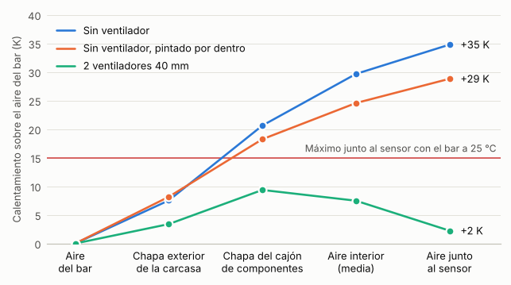

# Estudio térmico del diseño A · revisión 2, con el myPOS Sigma

13-11-2026 · diseño A (Compacta), CAD del 04-11-2026 · cobro con **myPOS Sigma** en un hueco del frente (opción 3 del estudio de alternativas de cobro, rama `claude/alternativas-cobro`) y fuente de 12 V · cargas en 5 V de la revisión de componentes del 13-11-2026.

El informe completo es [`Estudio_termico_alcoholimetro.pdf`](Estudio_termico_alcoholimetro.pdf) (35 páginas, 15 figuras). Aquí va el resumen y cómo repetir el cálculo. La revisión 1, con el SumUp Solo, está en [`historico-solo/`](historico-solo/README.md).

> **Estado: todo es cálculo, no hay nada montado ni medido.** El consumo del Sigma no está publicado y va estimado (3 W, entre 1,5 y 6). El cambio de lector no está en el CAD ni en `DECISIONES.md`: es lo que Guillermo planea hacer. Ningún cambio de los que se proponen está aplicado todavía.

## Resultado



Calentamiento sobre la temperatura del bar, en kelvin (1 K = 1 °C de diferencia). Todas las filas, con el Sigma:

| Configuración | Calor dentro | Aire interior | Junto al sensor | Junto al módem | Bar más caliente con todo en ficha |
|---|---|---|---|---|---|
| **Sin ventilador** (rejillas de hoy, cajón sin pintar) | 20,0 W | +29,7 K de media | **+34,8 K** | +30,8 K | **5 °C** |
| Sin ventilador, interior pintado | 20,0 W | +24,6 K de media | +28,8 K | +25,5 K | 11 °C |
| Sin ninguna abertura | 20,0 W | +36,6 K de media | +42,9 K | +38,0 K | — |
| 1 ventilador de 40 × 10 mm (4,2 m³/h reales) | 20,7 W | +8,9 K a la salida | +2,7 K | +6,2 K | 33 °C |
| **2 ventiladores de 40 × 10 mm en serie** (5,2 m³/h reales) | 20,7 W | +7,5 K a la salida | **+2,2 K** | +5,2 K | **34 °C** |
| 1 ventilador de 60 × 25 mm (14 m³/h; no cabe en los laterales) | 21,4 W | +3,3 K a la salida | +1,0 K | +2,3 K | 37 °C |

- **El Sigma quita la pieza más frágil.** Trabaja de −20 a 70 °C, sin batería y sin el bloqueo permanente del Solo. No se sale de su ficha en ningún caso.
- **Pero la máquina no se enfría.** Pasa de 15,7 a 20,0 W: el Sigma gasta unos 3 W (el Solo, 1) y convertir de 12 a 5 V cuesta otros 2. En el mejor caso (Sigma de 1,5 W y la fuente que menos pierde) son 16,3 W: lo mismo que con el Solo.
- **Dentro siguen dos piezas de 40 °C, el sensor y el módem.** Sin ventilador el sensor queda a +35 K (entre +30 y +40 K en el 80 % de 1 500 casos al azar); con el Solo eran +31 K. El bar máximo sin ventilación baja de 8 a 5 °C.
- **Los dos ventiladores de 40 mm siguen haciendo falta y siguen bastando.** El aire sale a +7,5 K (con el Solo, +6,3 K). Limita el módem: bar máximo de 34 °C, igual que antes (entre 32 y 36 °C en el 80 % de los casos). Ficha de instalación: **bares de 10 a 32 °C**.
- **La entrada de aire cambia de sitio:** arriba a la izquierda, junto al sensor, en vez de arriba a la derecha junto al lector.
- **Si los dos ventiladores se paran**, el sensor pasa de 40 °C en unos 9 minutos con el bar a 25 °C. Con el Solo se podía perder el lector; con el Sigma no se rompe nada, pero hay que dejar de vender pruebas.

## Qué cambia respecto a la revisión 1 (Solo)

| Punto | Con el Solo | Con el Sigma |
|---|---|---|
| Límite del lector | 0 a 40 °C, batería, bloqueo permanente | −20 a 70 °C, sin batería |
| Calor dentro, sin ventiladores | 15,7 W | 20,0 W (de 15 a 27) |
| Sin ventilador: aire junto a la pieza de 40 °C de arriba | +31,1 K | +34,8 K |
| Sin ventilador: bar máximo | 8 °C | 5 °C |
| Dos ventiladores: aire que sale | +6,3 K | +7,5 K |
| Dos ventiladores: bar máximo | 34 °C | 34 °C |
| Entrada de aire | Arriba a la derecha, junto al Solo | Arriba a la izquierda, junto al sensor |
| Avería de la ventilación | El Solo puede bloquearse para siempre | Nada irreversible |

## Qué fuente calienta menos

| Opción | Calor dentro | Sin ventilador, junto al sensor | Dos ventiladores, aire que sale |
|---|---|---|---|
| LRS-50-12 y convertidor de 12 a 5 V (caso base) | 20,0 W | +34,8 K | +7,5 K |
| LRS-50-5, como hoy, y una fuente pequeña de 12 V solo para el Sigma | 18,2 W | +32,6 K | +6,9 K |
| LRS-50-5 y un elevador de 5 a 12 V | 18,8 W | +33,2 K | +7,1 K |
| Fuente de dos salidas RD-50A | 19,0 W | +33,5 K | +7,2 K |

Entre la mejor y la peor hay 1,8 W. La fuente se elige por fiabilidad, sitio y cableado; el calor solo desempata.

## Qué habría que cambiar

Por orden de importancia (tabla completa en el apartado 13 del informe):

1. **Dos ventiladores de 40 mm**, con la entrada arriba a la izquierda, junto al sensor, y la salida abajo a la izquierda. Aberturas de Ø38 con malla y lamas, y burlete entre cajón y carcasa.
2. **Hueco del Sigma en el frente** (108,7 × 86,4 mm), con su junta.
3. **Sonda de temperatura junto al sensor** (DS18B20) y umbrales en el programa: 36 °C avisa y baja el brillo, 38 °C avería, 40 °C deja de vender pruebas hasta bajar de 37 °C.
4. **Poder parar el cobro desde la Pi**: preguntar a myPOS si una entrada del Sigma lo inhibe; si no, cortarle los 12 V.
5. Un fusible por ventilador.
6. Módem tras la ventana de la antena: queda bajo la entrada de aire y el bar máximo sube a unos 36 °C.
7. Decidir la fuente; cajón e interior pintados; ventiladores con control; reglas de instalación; medir lo que gasta el Sigma.

Lo que **no** cambiaría: los ventiladores, la doble pared, el doble policarbonato de la pantalla y la chapa de 3 mm.

### Lo que sale de las cotas del CAD

- **El Sigma no cabe de pie** en el frente de hoy: su marco mide 146 mm de alto y sobre la ventana de la pantalla hay 120 mm. Tumbado cabe.
- **El fondo es justo:** 57 mm de terminal en un cajón de 70 mm útiles, con el módem detrás. A comprobar con el aparato.
- **La entrada de aire nueva cabe**, justo: 52 mm de alto y 49 mm de fondo sobre la placa de la antena, moviendo dos topes de goma.
- Siguen valiendo las de la revisión 1: la abertura de Ø38 no cabe junto a la toma C14, un ventilador de 60 mm no cabe en los laterales y las rejillas actuales no valen como salida de un ventilador.

## Cómo está calculado

- El modelo de la revisión 1 con un nodo más para el terminal (58 en total): recibe sus vatios, da calor al aire del cajón por detrás y al bar por su cara. Convección natural (Churchill–Chu, placas horizontales, Hollands), radiación entre grises, conducción por los huecos y por la chapa, tiro natural por las rejillas y caudal forzado.
- Comprobaciones: balance de energía (lo que entra es lo que sale), independencia de malla con 11, 22 y 44 franjas, contraste con la regla de armarios de Rittal sobre la versión del Solo (+16,6 frente a +16,9 K) y la versión del Solo recalculada con este código, que da los números de la revisión 1. Las cifras están en el apartado 5.3 del informe.
- Incertidumbre: 1 500 casos al azar por configuración y sensibilidad parámetro a parámetro. Las dos mayores incógnitas son el consumo total (15–27 W) y el del Sigma.
- Ventiladores: curva de catálogo del Noctua NF-A4x10 5V contra la resistencia del recorrido (K = 14 de caso base).
- Transitorios: arranque en frío, parada de ventiladores y corte de luz.

## Qué hay en esta carpeta

| Ruta | Contenido |
|---|---|
| `Estudio_termico_alcoholimetro.pdf` | El informe, revisión 2 |
| `codigo/termico.py` | El modelo. Todos los parámetros están en la clase `P`; `sigma=True` añade el terminal |
| `codigo/analisis_conf.py` | Cargas, fuentes y configuraciones, con el Sigma y con el Solo |
| `codigo/analisis.py` | Corre todos los casos y escribe `resultados/` |
| `codigo/calc.py` | Las cuentas paso a paso de los recuadros del informe |
| `codigo/fig_*.py`, `codigo/estilo.py` | Las figuras |
| `codigo/informe.py`, `codigo/estilo.css` | Montan el PDF con los números de `resultados/` |
| `resultados/` | `resultados.json`, `calc.json` y las curvas (`.npz`) |
| `figuras/` | Las 14 figuras calculadas, en SVG y PNG. Las dos vistas de la figura 1 son las de `../FreeCAD/` |
| `historico-solo/` | El informe de la revisión 1, con el SumUp Solo |

## Cómo repetirlo

Hace falta Python 3 con NumPy, Matplotlib y pypdf, y Google Chrome para pasar el HTML a PDF. Las figuras usan la fuente Inter si está instalada. Todo se ejecuta desde `codigo/`:

```bash
cd carcasa/diseno-A/estudio-termico/codigo
python3 analisis.py          # unos 50 s; la semilla es fija, sale siempre lo mismo
python3 calc.py
for f in fig_a fig_b fig_c fig_red fig_seccion; do python3 $f.py; done
python3 informe.py           # escribe ../Estudio_termico_alcoholimetro.pdf
```

- **Con datos medidos:** cambiar en `analisis_conf.py` el consumo del Sigma (`P_SIGMA`), las cargas en 5 V (`C5`), los rendimientos y el caudal (`Q_fan`), y en `termico.py` los coeficientes que el ensayo corrija.
- **Si cambia la geometría:** las cotas están al principio de la clase `P`, con los mismos valores que `carcasa/diseno-A/modelo/diseno.py`. No se leen de ahí: hay que cambiarlas a mano.

## Fuentes

Lista completa, con enlaces, en las últimas páginas del informe. Los datos del Sigma salen de la ficha de myPOS y de la del Nexgo UN20, con el que coincide en medidas, hueco, alimentación y puertos; las cargas en 5 V, de [`componentes/REVISION-13-11-2026.md`](../../../componentes/REVISION-13-11-2026.md); la geometría, de `carcasa/diseno-A/modelo/diseno.py`; los límites de temperatura, de las fichas de `componentes/` y de las hojas de los fabricantes.
